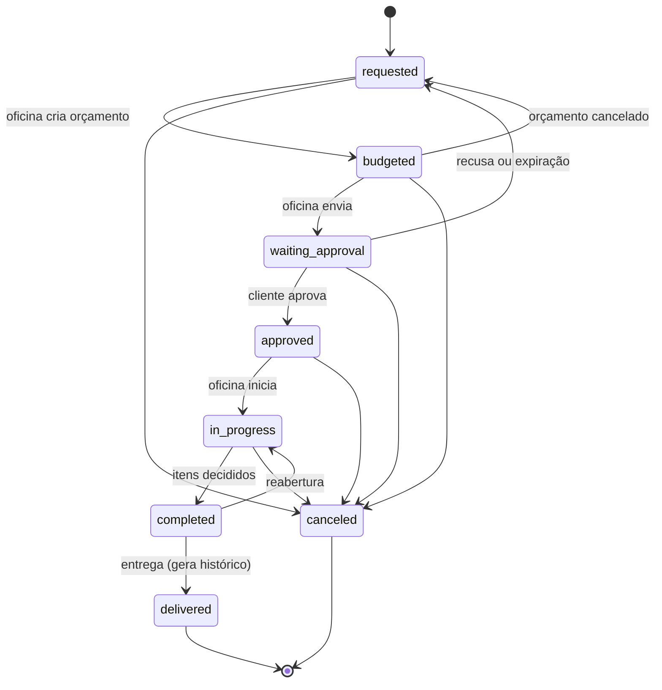

# SAM — Backlog Completo de Desenvolvimento do Backend

> **SAM — Simple Automotive Maintenance** · *Your car • Your care*
> Documento gerado por auditoria técnica do repositório. Nenhum arquivo do projeto foi alterado.

## Sumário

1. [Informações do documento](#1-informações-do-documento)
2. [Resumo executivo](#2-resumo-executivo)
3. [Diagnóstico da arquitetura atual](#3-diagnóstico-da-arquitetura-atual)
4. [Diagnóstico do banco de dados](#4-diagnóstico-do-banco-de-dados)
5. [Diagnóstico do frontend](#5-diagnóstico-do-frontend)
6. [Requisitos e regras de negócio](#6-requisitos-e-regras-de-negócio)
7. [Arquitetura proposta](#7-arquitetura-proposta)
8. [Especificação das APIs](#8-especificação-das-apis)
9. [Backlog de implementação](#9-backlog-de-implementação)
10. [Matriz de rastreabilidade](#10-matriz-de-rastreabilidade)
11. [Plano de testes](#11-plano-de-testes)
12. [Segurança](#12-segurança)
13. [Implantação e operação](#13-implantação-e-operação)
14. [Dependências e caminho crítico](#14-dependências-e-caminho-crítico)
15. [Decisões pendentes](#15-decisões-pendentes)
16. [Critérios de conclusão](#16-critérios-de-conclusão)
17. [Resumo final](#17-resumo-final)

---

## 1. Informações do documento

| Item | Conteúdo |
|---|---|
| **Projeto** | SAM — plataforma web que conecta clientes a oficinas e mecânicos independentes (busca no mapa, solicitação de atendimento, orçamento, chat, histórico de manutenção, avaliações e promoções). |
| **Objetivo deste documento** | Backlog técnico, completo e executável, para construir o backend do SAM e integrá-lo ao frontend e ao banco já existentes. |
| **Data da auditoria** | 03/11/2026 |
| **Pacote analisado** | `SAM-.zip` (raiz `SAM-/`) + `prompt.md` (instruções da auditoria) |
| **Local de entrega** | `SAM_BACKEND_BACKLOG.md` na raiz do projeto (`SAM-/SAM_BACKEND_BACKLOG.md`). O arquivo foi gerado fora do repositório; basta copiá-lo. |
| **Status da análise** | **Concluída**, com as ressalvas descritas abaixo. |

### 1.1 Artefatos auditados

| Artefato | Conteúdo verificado |
|---|---|
| `init.sql` (2.144 linhas, ~100 KB) | Lido integralmente (comentários, tabelas, índices, views, funções, triggers) **e executado** em um PostgreSQL 16 descartável. |
| `requirements.txt` | Resolvido com `pip install --dry-run` em Python 3.12: todas as versões pinadas existem e são compatíveis. |
| Frontend (`frontend/SAM-VERSAO-NOVA-SEM-MOCK/`) | 26 páginas HTML, 36 arquivos JS (9.742 linhas), 11 CSS (3.182 linhas). `api.js`, `auth.js`, `data.js`, `enums.js` e as telas lidos; os 36 JS passam em `node --check`. |
| `CLAUDE.md`, `README.md`, `PENDENCIAS-API.md` | Lidos integralmente. `PENDENCIAS-API.md` é o contrato **proposto** entre frontend e backend. |
| `backlog/backlog.md` (556 linhas) | Requisitos funcionais (17 do cliente, 17 da oficina, 7 do sistema), RNF01–RNF18, regras RN01–RN14, MoSCoW e fluxos. |
| `docs/DIAGRAMA_SAM.svg`, `docs/DIAGRAMA_DE_USO.svg` | Rótulos extraídos do SVG (draw.io) e comparados com o `init.sql`. |

**Não constam no pacote:** diretório `backend/` (os documentos o descrevem como vazio), `tests/` (inclusive o `tests/mock-api/server.py` que os documentos citam como mock do contrato), Dockerfile/docker-compose, `.env`, migrations Django, seeds além do `init.sql` e `AGENTS.md`.

### 1.2 Método e limites da análise

1. Leitura integral da documentação e do `init.sql`, incluindo todos os comentários.
2. Execução do `init.sql` em PostgreSQL 16 de uso único e de um roteiro de fumaça de 12 cenários (fluxo completo de atendimento, recusa, cancelamento, histórico, avaliação, chat duplicado, exclusão com dependências, SQLSTATE das mensagens e rotina de expiração).
3. Extração programática das chamadas de `api.js` (84 pares método+rota) e cruzamento com cada tela.
4. Resolução do `requirements.txt` e verificação de sintaxe do JavaScript.

**Limites declarados:** o frontend **não** foi executado em navegador; não há backend para testar; os diagramas foram lidos por seus textos; nenhuma ferramenta de CI existe para consultar. Onde o repositório não permite concluir algo, o item está marcado como *a confirmar* ou como decisão pendente (seção 15).

### 1.3 Convenções do documento

- **Classificação de situação:** *Implementado*, *Parcialmente implementado*, *Não implementado*, *Com problema*, *Não identificado*. Existir um arquivo não implica funcionar.
- **Identificadores:** `BE-nnn` tarefa · `DB-nn` achado do banco · `FE-nn` achado do frontend · `DP-nn` decisão pendente · `RN` regra do backlog do projeto · `RB` regra confirmada no código/banco · `RI` regra deduzida do frontend · `RF-C/M/S` requisitos funcionais (Cliente/Oficina/Sistema) · `RNF` requisitos não funcionais.
- **Caminhos novos** sob `backend/` são **propostos** (o diretório `backend/` é o citado em `CLAUDE.md` e `PENDENCIAS-API.md`, mas não existe). Devem ser confirmados no ADR de BE-001.
- **Regras:** *confirmada* = comprovada no `init.sql`/documentação; *deduzida* = inferida do comportamento do frontend; *pendente* = depende de decisão do responsável.

---

## 2. Resumo executivo

### 2.1 Situação atual

O SAM tem **frontend completo e banco de dados robusto, mas nenhum backend**. Das 84 chamadas de API que o frontend faz, **0 estão implementadas**: com `DRIVER:'http'` toda tela responderia “servidor indisponível”. O frontend só funciona hoje no driver local (`localStorage`), que não persiste dados de verdade.

| Componente | Situação | Evidência |
|---|---|---|
| Backend Django/DRF | **Não implementado** | Sem `backend/`, sem `manage.py`, sem models/views. |
| Banco de dados (`init.sql`) | **Parcialmente implementado** | Executa limpo no PostgreSQL 16 (23 tabelas, 3 views, 16 triggers, 26 funções) e as regras de estado funcionam; faltam colunas e restrições que o frontend assume (DB-01…DB-23). |
| Frontend (26 telas) | **Implementado** (UI) | 36 JS sem erro de sintaxe, sem dados fictícios; integração real **não verificável** sem API. |
| Contrato de API (`PENDENCIAS-API.md`) | **Parcialmente implementado** | Descrito em detalhe, mas é uma proposta; 9 premissas (P1–P9, distribuídas entre `PENDENCIAS-API.md` e comentários do código) dependem de decisão. |
| Telas de administração T27/T28 | **Não implementado** | Declaradas em `api.admin.*`, sem HTML. |
| Testes, Docker, CI, `.env`, OpenAPI | **Não implementado** | Ausentes no pacote. |
| `requirements.txt` | **Parcialmente implementado** | Resolve limpo, mas está marcado “TO TERMINADO DE CONFIGURAR” e não inclui teste, lint, ambiente nem pool. |

### 2.2 Principais problemas encontrados

1. **Backend inexistente** — 84 endpoints a construir, todos especificados na seção 8.
2. **A regra de negócio está no banco** (16 triggers); o backend precisa convertê-la corretamente em HTTP. Verificado: mensagens saem com SQLSTATE `23514` ou `P0001`, sem mapeamento seriam respostas 500.
3. **Autenticação de dois perfis em tabelas separadas** (`CLIENT`, `WORKSHOP`) não cabe no `AUTH_USER_MODEL` único do Django — decisão arquitetural DP-02.
4. **Colunas ausentes no banco** que o frontend usa: `VEHICLE.mileage_km` e `VEHICLE.history_shared` (DB-01, DB-02).
5. **`CHAT` permite conversas duplicadas** para o mesmo cliente e oficina (comprovado por teste) — a abertura “idempotente” exige unicidade (DB-04).
6. **Ninguém gera notificações** e nada expira sozinho: sem `notif_events` o sino fica vazio; sem job, orçamentos e promoções vencidos continuam “ativos” (DB-05, DB-14).
7. **Divulgação paga não tem política de preço, pagamento nem rotina de ativação** (DB-16, DB-23).
8. **Sem perfil/administração** para moderar denúncias e aprovar serviços personalizados (DB-07, FE-08).
9. **Documentação referencia artefatos ausentes do pacote** (o mock `tests/mock-api/server.py`; `backend/` descrito como vazio) e **o diagrama de classes diverge do SQL** (FE-01, DB-15).
10. **Colisão de portas e CORS no desenvolvimento** (README e contrato usam 8000) e `file://` incompatível com o driver http (FE-02, FE-04).

### 2.3 Quantidade de tarefas

O backlog tem **94 tarefas** (BE-001 a BE-094), todas com status inicial *Pendente*, em 8 fases. 6 são **condicionais** a decisões do responsável do projeto.

| Prioridade | Tarefas | % do total |
|---|---:|---:|
| P0 — Bloqueadora | 45 | 48% |
| P1 — Alta | 33 | 35% |
| P2 — Média | 12 | 13% |
| P3 — Baixa | 4 | 4% |
| **Total** | **94** | 100% |

| Fase | Tarefas | P0 | P1 | P2 | P3 |
|---|---:|---:|---:|---:|---:|
| Fase 0 — Preparação e arquitetura | 5 | 4 | 1 | 0 | 0 |
| Fase 1 — Banco de dados e infraestrutura | 18 | 12 | 3 | 2 | 1 |
| Fase 2 — Autenticação e autorização | 12 | 8 | 3 | 1 | 0 |
| Fase 3 — Módulos essenciais | 29 | 16 | 11 | 2 | 0 |
| Fase 4 — APIs públicas e integração com o frontend | 8 | 3 | 5 | 0 | 0 |
| Fase 5 — Funcionalidades complementares | 6 | 0 | 0 | 3 | 3 |
| Fase 6 — Segurança e testes | 9 | 1 | 6 | 2 | 0 |
| Fase 7 — Implantação e finalização | 7 | 1 | 4 | 2 | 0 |

Complexidade: Pequena: 27 · Média: 53 · Grande: 14.

> **Leitura da prioridade.** A concentração em P0 reflete que o backend não existe: P0 é o **núcleo mínimo funcional** (contas, veículos, atendimento/orçamento, chat, mapa e perfil públicos) mais a **segurança crítica**, e não uma lista de desejos. P1 completa o produto previsto no backlog; P2 e P3 podem ser adiadas formalmente.

### 2.4 Principais bloqueadores

- **Decisões humanas (seção 15):** DP-01 (fonte da verdade do schema), DP-02 (autenticação de dois perfis), DP-03 (perfil admin), DP-05 (colunas do veículo), DP-06 (regra de cadastro concluído), DP-16 (fuso), DP-21 (portas/origem). Todas têm recomendação padrão assumida, para que o trabalho não pare enquanto aguardam resposta.
- **Pré-requisitos técnicos:** BE-002 (esqueleto), BE-007 (schema versionado), BE-014 (modelos) e BE-025 (autenticação) precedem praticamente todo o resto.
- **Dependências externas:** servidor de e-mail (redefinição de senha), fonte dos pontos de interesse (DP-10), provedor de tiles e hospedagem (DP-22).

### 2.5 Prontidão

| Dimensão | Estado |
|---|---|
| Interface | Pronta: 26/26 telas construídas; T27/T28 (admin) fora do escopo atual. |
| Banco | Núcleo sólido: atendimento, orçamento, histórico, avaliação, promoção e denúncia já funcionam; ajustes necessários listados em 4.4 (DB-01…DB-23). |
| Backend | 0% — construção integral. |
| Integração | Bloqueada até BE-072 (frontend → API); só então as telas deixam de responder “servidor indisponível”. |
| Produção | Sem Docker, sem proxy, sem backup, sem monitoramento. |

---

## 3. Diagnóstico da arquitetura atual

### 3.1 Tecnologias

| Camada | Tecnologia | Origem | Situação |
|---|---|---|---|
| Frontend | HTML5, CSS3, JavaScript puro (sem framework, sem build); mapa com Leaflet 1.9.4 (CDN unpkg, com SRI) + tiles OpenStreetMap | `CLAUDE.md`, `map.js` | Implementado |
| Backend | Python 3.12, **Django 5.2.18**, **Django REST Framework 3.18.3** | `requirements.txt`, `backlog.md` (RNF02/RNF05) | Declarado, não implementado |
| Documentação da API | drf-spectacular 0.30.0 (OpenAPI/Swagger) | `requirements.txt` | Declarado, não implementado |
| Filtros | django-filter 26.2 | `requirements.txt` | Declarado |
| Imagens | Pillow 13.0.0 | `requirements.txt` | Declarado |
| CORS | django-cors-headers 4.9.0 | `requirements.txt` | Declarado |
| Servidor de aplicação | gunicorn 26.2.0 | `requirements.txt` | Declarado |
| Banco | **PostgreSQL ≥ 13** (driver psycopg 3, `psycopg[binary]>=3.2,<4`) | `init.sql`, `requirements.txt` | Implementado (schema) |
| Autenticação | Sessão do Django em cookie + CSRF (`X-CSRFToken`) | `CLAUDE.md`, P8 | Proposto (frontend pronto) |
| Contêineres | Docker (RNF18: “poderá”) | `backlog.md` | Não implementado |

### 3.2 Estrutura do projeto

```
SAM-/
├── init.sql                      # schema + regras + seed (2.144 linhas)
├── requirements.txt              # "TO TERMINADO DE CONFIGURAR"
├── backlog/backlog.md            # requisitos do produto
            backlog_backend.md
├── docs/                         # DIAGRAMA_SAM.svg, DIAGRAMA_DE_USO.svg
└── frontend/
    ├── *.html (26)  ·  css/ (11)  ·  js/ (36)  ·  assets/
    └── CLAUDE.md · README.md · PENDENCIAS-API.md
└── backend/
└── Dockerfile
└── compose.yaml
└── .gitignore
        
```

### 3.3 Arquitetura identificada

Cliente-servidor com **frontend estático desacoplado**, que conversa com o servidor por **um único módulo** (`js/api.js`), e **banco de dados com regras de negócio embutidas** (triggers, funções, constraints, views). O `api.js` tem dois *drivers*: `local` (simulação em `localStorage`, usada hoje) e `http` (REST, aguardando backend). O contrato REST está em `PENDENCIAS-API.md`.

```
Navegador (HTML/JS)
   │  fetch + cookie de sessão + X-CSRFToken   (somente via js/api.js)
   ▼
API REST (Django + DRF)        ← NÃO EXISTE
   │  ORM / chamadas a funções SQL
   ▼
PostgreSQL (init.sql: 23 tabelas · 16 triggers · 26 funções · 3 views)   ← EXISTE
```

### 3.4 Componentes ausentes

Backend (projeto, apps, models, serializers, views, serviços); autenticação e permissões; envio de e-mail; agendador de rotinas de expiração; armazenamento de mídia; OpenAPI; testes (unitários, banco, API, E2E); Docker/Compose; proxy HTTPS; backup; monitoramento; logs estruturados; CI.

### 3.5 Problemas na arquitetura

| Problema | Consequência | Tratamento |
|---|---|---|
| Regras no banco, sem camada de aplicação | Erros de trigger virariam 500 e a autorização não existe | BE-017, BE-030 |
| `init.sql` não idempotente com `BEGIN/COMMIT` próprios | Não pode virar migration comum do Django | BE-007 |
| Dois perfis em duas tabelas | Não cabe em `AUTH_USER_MODEL` | BE-025 (DP-02) |
| Documentos citam o mock `tests/mock-api` ausente do pacote | O contrato não pode ser exercitado sem backend e há incerteza sobre o que existe fora do pacote | BE-081, BE-093 |
| Sem rotina de expiração | Estados vencidos permanecem | BE-023 |
| Sem pipeline nem testes | Qualquer alteração no banco pode quebrar regras sem aviso | BE-015, BE-079, BE-087 |

---

## 4. Diagnóstico do banco de dados

### 4.1 Estrutura (medida no PostgreSQL 16)

**23 tabelas · 209 colunas · 95 índices · 47 chaves estrangeiras · 63 CHECKs · 16 triggers · 26 funções · 3 views · 4 ENUMs** · seed de **11 categorias** e **62 serviços**. O arquivo executa sem erro (`ON_ERROR_STOP`). Extensões usadas: apenas `plpgsql` (sem PostGIS).

Características que condicionam o backend: chaves compostas (veículo ∈ cliente; orçamento ∈ atendimento e oficina), colunas geradas (`BUDGET_ITEM.subtotal`, `service_item_type`, `REGISTER_MAINTENANCE*.item_type/item_execution_status`), identidade `GENERATED ALWAYS` (não enviar `id` no INSERT), PK `UUID` somente em `REVIEW`, nível de isolamento READ COMMITTED com retentativa em `40P01/40001`, e `BUDGET.total_price` que **só a trigger pode escrever**.

### 4.2 Mapa entidade → módulo do backend

| Tabela | PK | Relacionamentos principais | Módulo | Operações | Regras e validações (banco) | Transação | Permissão |
|---|---|---|---|---|---|---|---|
| CLIENT | `id_client` | → VEHICLE, ATTENDANCE, CHAT, FAVORITE, NOTIFICATION | accounts | criar, ler, editar | e-mail único (caixa-insensível), status | cadastro | próprio |
| WORKSHOP | `id_workshop` | → PAG_WORKSHOP, POINT_OF_INTEREST (1:1), OPERATION_HOUR… | accounts/workshops | criar, ler, editar | CNPJ 14 dígitos único, e-mail único | cadastro com PAG_WORKSHOP | própria |
| PAG_WORKSHOP | `id_pag_workshop` (`id_workshop` UNIQUE) | 1:1 com WORKSHOP | workshops | criar no cadastro, editar | descrição, fotos | com WORKSHOP | própria; leitura pública |
| POINT_OF_INTEREST | `id_point_of_interest` | ↔ WORKSHOP (opcional, 1:1) | workshops | importar, ler, vincular | tipo ENUM, lat/lng, `(external_source, external_id)` | vínculo atômico | leitura pública; vínculo: oficina |
| OPERATION_HOUR | `id_operation_hour` | → WORKSHOP | workshops | listar, substituir | sem sobreposição por dia (trigger) | PUT atômico | própria |
| VEHICLE | `id_vehicle` | → CLIENT; ← ATTENDANCE, REGISTER_MAINTENANCE | vehicles | CRUD | placa regex e única por cliente; anos | simples | dono |
| SERVICE_CATEGORY / SERVICE | `id_…` | catálogo global | catalog | ler; curadoria admin | nome normalizado único | — | público; admin edita |
| WORKSHOP_SERVICE | `id_workshop_service` | → WORKSHOP, SERVICE | catalog | listar, criar, editar | origem catálogo **ou** personalizada; solicitação `pending` (trigger); sem exclusão | criar | própria |
| PRODUCT | `id_product` | → WORKSHOP | catalog | listar, criar, editar | preço ≥ 0; sem exclusão (RESTRICT) | simples | própria; leitura pública (ativos) |
| ATTENDANCE | `id_attendance` | → CLIENT, VEHICLE, WORKSHOP; ← BUDGET | attendances | criar, ler, editar km/obs, transicionar | **máquina de estados** (trigger), FK composta veículo∈cliente | por transição | cliente dono / oficina dona |
| BUDGET | `id_budget` | → ATTENDANCE, WORKSHOP | attendances | criar, editar validade, aprovar, recusar | um pendente por atendimento; validade; total só por trigger | por operação | oficina (edita), cliente (responde) |
| BUDGET_ITEM | `id_budget_item` | → BUDGET, WORKSHOP_SERVICE, PRODUCT | attendances | incluir, editar, remover, executar | tipos, FKs da mesma oficina, subtotal gerado | recalcula total | oficina |
| REGISTER_MAINTENANCE (+_PART) | `id_register_maintenance` | → VEHICLE, ATTENDANCE/BUDGET_ITEM | vehicles | ler; criar manual; **gerado na entrega** | exatamente uma origem; só cresce | na transição `delivered` | cliente dono; oficina c/ autorização |
| CHAT / MESSAGE | `id_chat` / `id_message` | → CLIENT, WORKSHOP | chat | abrir, listar, enviar, ler | remetente único e do chat; status sent/delivered/read | simples | participantes |
| REVIEW | `id_review` (**UUID**) | → BUDGET (único) | reviews | criar, listar, responder | orçamento aprovado + atendimento entregue; uma por orçamento | simples | cliente dono; oficina responde |
| FAVORITE | `id_favorite` (`unique_favorite` no par cliente–oficina) | → CLIENT, WORKSHOP | accounts | listar, criar, remover | único por par | simples | cliente |
| NOTIFICATION | `id_notification` | → CLIENT **ou** WORKSHOP | notifications | listar, ler, marcar | exatamente um destinatário | no evento | destinatário |
| PROMOTION | `id_promotion` | → WORKSHOP, serviço **ou** produto | promotions | CRUD sem exclusão | percentual ≤100; alvo da mesma oficina; vigência | simples | própria; leitura pública (vigentes) |
| PROMOTION_ADVERTISEMENT | `id_promotion_advertisement` | → PROMOTION | promotions | solicitar, listar | período dentro da promoção; só `active` se paga | simples | própria |
| DENUNCIATION | `id_denunciation` | → CLIENT, alvo tipado | reviews/moderation | criar; moderar | um alvo; uma aberta por cliente/conteúdo | simples | cliente; admin modera |

### 4.3 Views, funções e triggers (resumo)

| Objeto | Função |
|---|---|
| `vw_vehicle_maintenance_history` | Serviços e peças do histórico em uma só lista (origem manual ou atendimento). |
| `vw_promotion_effective`, `vw_advertisement_effective` | Vigência real (`is_valid_now`, `is_running_now`); **nunca** confiar só no `status`. |
| `attendance_transition_allowed`, `fn_attendance_before_write/after_status` | Máquina de estados do atendimento e sincronia com o orçamento. |
| `fn_budget_before_write/after_write`, `fn_budget_item_guard`, `fn_budget_item_recalc_total` | Ciclo do orçamento, guarda de itens e total. |
| `register_attendance_history` | Gera o histórico na entrega, de forma idempotente. |
| `validate_review_budget`, `fn_promotion_validate`, `fn_promotion_advertisement_validate`, `fn_denunciation_guard` | Avaliação, promoção, divulgação e denúncia. |
| `approve_workshop_service_request`, `reject_workshop_service_request` | Moderação de serviços personalizados. |
| `expire_pending_budgets`, `expire_promotions`, `complete_finished_advertisements`, `run_expiration_jobs` | Expirações — **precisam de agendador**. |

### 4.4 Inconsistências, lacunas e alterações necessárias

| ID | Achado | Evidência | Alteração proposta e impacto | Tarefas |
|---|---|---|---|---|
| DB-01 | VEHICLE não tem `mileage_km` | init.sql:162-191; teste em PostgreSQL 16 (16 colunas); PENDENCIAS P1; DIAGRAMA_SAM tem `quilometragem`; T11 exige o campo | Adicionar `mileage_km INT CHECK (>=0)`. Impacto: baixo (tabela vazia); a API exige o campo na criação. | BE-008, BE-043 |
| DB-02 | Sem coluna do consentimento de histórico (`history_shared`) | PENDENCIAS P2; diagrama de uso (“se o cliente permitir”); vehicle.js:132 | Adicionar `history_shared BOOLEAN NOT NULL DEFAULT FALSE`. Sem ela o 403 do histórico da oficina não tem base. | BE-008, BE-056 |
| DB-03 | Sem `interval_km` para manutenção preventiva | PENDENCIAS P3; vehicle.js:51-59; backlog MoSCoW (Could have) | Condicional (DP-05): coluna em REGISTER_MAINTENANCE e recriação da view. | BE-013, BE-077 |
| DB-04 | CHAT permite vários chats para o mesmo par cliente–oficina | init.sql:708-722; teste: 2 chats criados para (1,1) | `UNIQUE (id_client,id_workshop)` com saneamento. Sem isso `open` não é idempotente sob concorrência. | BE-009, BE-057 |
| DB-05 | Nada cria notificações e NOTIFICATION não tem `url` | init.sql:773-793; busca por `INSERT INTO NOTIFICATION` em funções = 0 | Coluna `url` com CHECK; geração de eventos no backend (não em trigger). | BE-010, BE-070 |
| DB-06 | Não há tabela de tokens de redefinição de senha | PENDENCIAS §3 (“não há tabela de tokens”); forgot-password.js:2 | Resolvido sem tabela por token assinado (DP-12). | BE-032 |
| DB-07 | Sem entidade de administrador; DENUNCIATION não registra quem moderou | init.sql:894-936; PENDENCIAS P5 | Admin via usuário Django `is_staff` (DP-03); auditoria por log ou coluna (a decidir). | BE-035, BE-073 |
| DB-08 | `PAG_WORKSHOP` não é criada por trigger e o padrão `default-profile.png` não é URL válida para o `ui.url()` | init.sql:154-160; busca por `INSERT INTO PAG_WORKSHOP` = 0; components.js:432 | Backend cria PAG_WORKSHOP no cadastro; serializador traduz o padrão para URL de mídia. | BE-026, BE-021 |
| DB-09 | REVIEW não tem `id_workshop`; BUDGET não tem índice por `id_workshop` | init.sql:748-760; pg_indexes de budget | Índice `idx_budget_workshop`; medir antes de denormalizar (DP-23). | BE-011, BE-083 |
| DB-10 | `ATTENDANCE.observations` é uma só coluna (pedido do cliente e notas técnicas) | init.sql:419-435; PENDENCIAS §6 | Condicional (DP-13): `technical_notes`. | BE-012 |
| DB-11 | Grafias distintas: `canceled` (atendimento) × `cancelled` (orçamento/divulgação) | init.sql:77-86, 445-470, 844-860; PENDENCIAS §7, item 2 | Não alterar (quebraria o contrato); a API preserva os valores do banco. | BE-072 |
| DB-12 | Views `SELECT p.*` congelam as colunas no momento da criação | init.sql:868-880 | Migrations que alterem PROMOTION devem recriar `vw_promotion_effective`. | BE-007 |
| DB-13 | `init.sql` não é idempotente (CREATE sem IF NOT EXISTS, BEGIN/COMMIT próprios) | init.sql:32 (BEGIN) a 2144 (COMMIT) | Executar uma única vez por migration não atômica; evolução por migrations SQL versionadas. | BE-007, BE-091 |
| DB-14 | O banco não executa expirações sozinho | init.sql:20-22 (cabeçalho) e seção 9.11 (linha 2116) | Agendar `run_expiration_jobs()` a cada 1–5 min. | BE-023, BE-092 |
| DB-15 | Diagrama de classes diverge do SQL (UUID×BIGINT, `status {1-4}`, sem ADVERTISEMENT/PART) | DIAGRAMA_SAM.svg (64 rótulos) × init.sql | O init.sql é a autoridade; atualizar o diagrama. | BE-093 |
| DB-16 | `advertising_price` é NOT NULL > 0 mas não existe política de preço | init.sql:844-860; w-promotions.js:199 | Regra de preço configurável (DP-09). | BE-064, BE-076 |
| DB-17 | Excluir cliente/oficina é bloqueado por RESTRICT | teste: erro em `attendance_id_client_fkey` | Política de desativação/anonimização (DP-18). | BE-078 |
| DB-18 | Não há tabela de galeria (o frontend aceita `gallery`) | PENDENCIAS §6 | Fora do escopo documentado; decisão em DP-20. | — |
| DB-19 | Ninguém altera `status` de conta (`blocked`/`inactive`) | init.sql:92-105, 130-149 | Django Admin (RF-S07). | BE-075 |
| DB-20 | Geografia só com B-tree `(latitude, longitude)`, sem PostGIS | init.sql:128; extensões instaladas: apenas plpgsql | Caixa envolvente + Haversine (DP-17); PostGIS só se a medição exigir. | BE-067, BE-083 |
| DB-21 | `OPERATION_HOUR` usa `TIME` sem fuso | init.sql:194-205 | Definir o fuso do negócio (DP-16) para `is_open_now`. | BE-022, BE-065 |
| DB-22 | Não há índice para contar mensagens não lidas | pg_indexes de message | Índice parcial confirmado por EXPLAIN. | BE-011, BE-083 |
| DB-23 | Nenhuma rotina ativa divulgações pagas quando chega `date_start` | init.sql:1926-1950 (só existe `complete_finished_advertisements`) | Rotina de ativação no backend (condicionada a DP-09). | BE-076 |

### 4.5 Verificação empírica (roteiro executado em PostgreSQL 16)

| Cenário | Resultado observado |
|---|---|
| Fluxo completo: solicitação → orçamento → itens → envio → aprovação → execução → entrega | Funciona; total calculado pela trigger (160,00 no exemplo); histórico com serviços e peças. |
| Aprovar orçamento **sem enviar** | Recusado pelo banco: o “envio” é a transição do atendimento. |
| Concluir com itens sem decisão de execução | Recusado com mensagem em português. |
| Recusar orçamento | Atendimento volta a `requested`. |
| Cancelar atendimento | O orçamento pendente vira `cancelled`; um orçamento já recusado permanece `rejected`. |
| Segunda avaliação do mesmo orçamento | Recusada (UNIQUE). |
| `UPDATE budget SET total_price` direto | Recusado (somente a trigger escreve). |
| Duas inserções de `CHAT` para o mesmo par | **Aceitas** → lacuna DB-04. |
| Excluir cliente com atendimento | Recusado (RESTRICT) → DB-17. |
| Mensagens `RAISE` sem código | SQLSTATE `P0001`; com `check_violation`, `23514` → mapeamento necessário. |
| `run_expiration_jobs()` | Executa e devolve as três contagens (zeros, sem registros vencidos no teste); a idempotência com dados vencidos fica para BE-079. |

---

## 5. Diagnóstico do frontend

### 5.1 Visão geral

O frontend é um site estático multipágina: **26 páginas HTML** (T01–T26, incluindo a página de erro T09), **36 módulos JS**, **11 folhas CSS**. Toda chamada de rede passa por `js/api.js`, que normaliza as respostas e tem dois drivers (`local` e `http`, ver `js/config.js`). O driver local só atende autenticação, veículos e conversas do cliente, guardando tudo em `localStorage`; as demais telas dependem do backend.

| Grupo | Telas |
|---|---|
| Público | T01 Home · T05 Mapa e busca · T06 Perfil da oficina · T09 Erros |
| Autenticação e conta | T02 Login · T03 Cadastro · T04 Recuperar senha · T16 Minha conta |
| Cliente | T07 Chat · T08 Notificações · T10–T12 Veículos e histórico · T13–T14 Atendimentos · T15 Favoritas |
| Oficina | T17 Cadastro oficial (assistente) · T18–T20 Atendimentos e orçamento · T21 Perfil · T22 Serviços · T23 Produtos · T24 Promoções · T25 Avaliações · T26 Clientes |
| Administração | **T27 e T28 não construídas** (`api.admin.*` já declarado) |
| Modais | M01 Solicitar atendimento · M02 Avaliar · M03 Denunciar · M04 Responder avaliação |

### 5.2 Matriz de integração frontend × backend

*Frontend* = estado da interface; *Banco* = suporte do `init.sql`; *Backend* = existência do endpoint (hoje nenhum existe). Cobertura: **28 telas (26 construídas + T27/T28) e o cabeçalho compartilhado, 59 linhas de funcionalidade, 84/84 endpoints** referenciados.

| Tela ou módulo | Funcionalidade | Dados necessários | Operação no backend | Frontend | Banco | Backend |
|---|---|---|---|---|---|---|
| **C01** Cabeçalho e sino (todas as telas logadas) (`js/components.js`) | Identidade, menu por perfil e sair | usuário, perfil, setup_complete | `GET /auth/me/`<br>`POST /auth/logout/` | Implementado | Suportado | Não implementado |
| **C01** Cabeçalho e sino (todas as telas logadas) (`js/components.js`) | Contador de notificações (poll 60 s) | contagem de não lidas | `GET /notifications/unread-count/` | Implementado | Parcial | Não implementado |
| **T01** Home (`index.html`) | Promoções e divulgações vigentes | imagem, título, oficina, desconto, validade | `GET /promotions/` | Implementado | Suportado | Não implementado |
| **T02** Login (Cliente/Oficina) (`login.html`) | Autenticar por perfil | role, e-mail, senha | `POST /auth/login/` | Implementado | Suportado | Não implementado |
| **T03** Criar conta (`register.html`) | Cadastro de Cliente e de Oficina | nome ou (nome fantasia, responsável, CNPJ), e-mail, senha, telefone | `POST /auth/register/` | Implementado | Suportado | Não implementado |
| **T04** Recuperar senha (`forgot-password.html`) | Solicitar e confirmar redefinição | role, e-mail; token, nova senha | `POST /auth/password-reset/`<br>`POST /auth/password-reset/confirm/` | Implementado | Parcial | Não implementado |
| **T05** Mapa e busca (`map.html`) | Pontos no mapa e lista “oficinas próximas” | q, categoria, tipo, lat/lng, raio, aberto agora; distância, nota | `GET /map/points/` | Implementado | Parcial | Não implementado |
| **T05** Mapa e busca (`map.html`) | Chips de categoria | categorias de serviço | `GET /service-categories/` | Implementado | Suportado | Não implementado |
| **T05** Mapa e busca (`map.html`) | Promoções no mapa | promoções vigentes | `GET /promotions/` | Implementado | Suportado | Não implementado |
| **T06** Perfil público da oficina (`shop.html`) | Dados, horários, serviços, nota | perfil completo | `GET /workshops/{id}/` | Implementado | Suportado | Não implementado |
| **T06** Perfil público da oficina (`shop.html`) | Abas produtos, promoções, avaliações | listas públicas | `GET /workshops/{id}/products/`<br>`GET /workshops/{id}/promotions/`<br>`GET /workshops/{id}/reviews/` | Implementado | Suportado | Não implementado |
| **T06** Perfil público da oficina (`shop.html`) | Favoritar / desfavoritar | id_workshop | `POST /favorites/`<br>`DELETE /favorites/{id}/` | Implementado | Suportado | Não implementado |
| **T06** Perfil público da oficina (`shop.html`) | Abrir chat (“Perguntar no chat”) | id_workshop | `POST /chats/{workshopId}/open/` | Implementado | Parcial | Não implementado |
| **T06** Perfil público da oficina (`shop.html`) | M01 Solicitar atendimento | veículo, km, observações | `GET /vehicles/`<br>`POST /attendances/` | Implementado | Suportado | Não implementado |
| **T06** Perfil público da oficina (`shop.html`) | M03 Denunciar promoção | target, motivo, descrição | `POST /denunciations/` | Implementado | Suportado | Não implementado |
| **T07** Chat (Cliente e Oficina) (`chat.html`) | Lista de conversas e detalhe | interlocutor, última mensagem, não lidas, atendimento aberto | `GET /chats/`<br>`GET /chats/{id}/` | Implementado | Parcial | Não implementado |
| **T07** Chat (Cliente e Oficina) (`chat.html`) | Mensagens (polling 5 s) e envio | conteúdo ≤2000, status | `GET /chats/{id}/messages/`<br>`POST /chats/{id}/messages/` | Implementado | Suportado | Não implementado |
| **T07** Chat (Cliente e Oficina) (`chat.html`) | Marcar como lidas | id do chat | `POST /chats/{id}/read/` | Implementado | Suportado | Não implementado |
| **T07** Chat (Cliente e Oficina) (`chat.html`) | Compartilhar veículo/histórico (texto no chat) | veículos e histórico do cliente | `GET /vehicles/`<br>`GET /vehicles/{id}/history/` | Implementado | Suportado | Não implementado |
| **T08** Notificações (`notifications.html`) | Listar, marcar uma/todas como lidas | título, mensagem, data, url | `GET /notifications/`<br>`POST /notifications/{id}/read/`<br>`POST /notifications/read-all/` | Implementado | Parcial | Não implementado |
| **T09** Erro 404/403/500 (`404.html`) | Apresentação de erro | código na URL | — (sem operação) | Implementado | n/a | n/a |
| **T10** Meus veículos (`vehicles.html`) | Listar veículos do cliente | veículos com km e fotos | `GET /vehicles/` | Implementado | Parcial | Não implementado |
| **T11** Cadastro/edição de veículo (`vehicle-new.html`) | Criar e editar veículo (3 fotos) | marca, modelo, anos, km, placa, combustível, câmbio… | `POST /vehicles/`<br>`GET /vehicles/{id}/`<br>`PATCH /vehicles/{id}/` | Implementado | Parcial | Não implementado |
| **T12** Detalhe do veículo e histórico (`vehicle.html`) | Ficha, exclusão e autorização do histórico | dados do veículo, history_shared | `GET /vehicles/{id}/`<br>`PATCH /vehicles/{id}/`<br>`DELETE /vehicles/{id}/` | Parcialmente implementado | Parcial | Não implementado |
| **T12** Detalhe do veículo e histórico (`vehicle.html`) | Histórico de manutenção e registro manual | serviços, peças, data, km | `GET /vehicles/{id}/history/`<br>`POST /vehicles/{id}/history/` | Implementado | Parcial | Não implementado |
| **T12** Detalhe do veículo e histórico (`vehicle.html`) | Próximas manutenções (interval_km) | intervalo em km | — (sem operação) | Parcialmente implementado | Parcial | Não implementado |
| **T13** Meus atendimentos (`attendances.html`) | Listar/filtrar atendimentos | status em grupos, veículo | `GET /attendances/` | Implementado | Suportado | Não implementado |
| **T14** Detalhe do atendimento (Cliente) (`attendance.html`) | Acompanhar status, orçamento e itens | stepper, orçamentos, itens, avaliação | `GET /attendances/{id}/` | Implementado | Suportado | Não implementado |
| **T14** Detalhe do atendimento (Cliente) (`attendance.html`) | Aprovar ou recusar orçamento | id do orçamento | `POST /budgets/{id}/approve/`<br>`POST /budgets/{id}/reject/` | Implementado | Suportado | Não implementado |
| **T14** Detalhe do atendimento (Cliente) (`attendance.html`) | Cancelar atendimento | id do atendimento | `POST /attendances/{id}/cancel/` | Implementado | Suportado | Não implementado |
| **T14** Detalhe do atendimento (Cliente) (`attendance.html`) | M02 Avaliar atendimento | id_budget, nota, comentário | `POST /reviews/` | Implementado | Suportado | Não implementado |
| **T14** Detalhe do atendimento (Cliente) (`attendance.html`) | Abrir chat com a oficina | id_workshop | `POST /chats/{workshopId}/open/` | Implementado | Parcial | Não implementado |
| **T15** Oficinas favoritas (`favorites.html`) | Listar/remover favoritas e abrir chat | favoritos, nota, tipo | `GET /favorites/`<br>`DELETE /favorites/{id}/`<br>`POST /chats/{workshopId}/open/` | Implementado | Suportado | Não implementado |
| **T16** Minha conta (`account.html`) | Ver e editar perfil, foto e senha | nome, telefone, foto, status | `GET /auth/me/`<br>`PATCH /me/`<br>`POST /me/password/` | Implementado | Suportado | Não implementado |
| **T17** Cadastro oficial da oficina (assistente) (`workshop-setup.html`) | Passo 1 — dados do estabelecimento | nome fantasia, responsável, telefone | `GET /workshop/me/`<br>`PATCH /workshop/me/` | Implementado | Suportado | Não implementado |
| **T17** Cadastro oficial da oficina (assistente) (`workshop-setup.html`) | Passo 2 — ponto no mapa (P4) | busca de POI, confirmação, criação | `GET /points-of-interest/`<br>`POST /workshop/point/` | Implementado | Suportado | Não implementado |
| **T17** Cadastro oficial da oficina (assistente) (`workshop-setup.html`) | Passo 3 — horários | intervalos por dia | `GET /workshop/operation-hours/`<br>`PUT /workshop/operation-hours/` | Implementado | Suportado | Não implementado |
| **T17** Cadastro oficial da oficina (assistente) (`workshop-setup.html`) | Passo 4 — serviços | catálogo global e personalizados | `GET /workshop/services/`<br>`POST /workshop/services/`<br>`GET /service-categories/`<br>`GET /services/` | Implementado | Suportado | Não implementado |
| **T18** Atendimentos da oficina (`w-attendances.html`) | Quadro/lista por status | atendimentos, cliente, veículo | `GET /workshop/attendances/` | Implementado | Suportado | Não implementado |
| **T19** Detalhe do atendimento (Oficina) (`w-attendance.html`) | Detalhe e dados técnicos | cliente, veículo, orçamentos | `GET /workshop/attendances/{id}/`<br>`PATCH /workshop/attendances/{id}/` | Implementado | Parcial | Não implementado |
| **T19** Detalhe do atendimento (Oficina) (`w-attendance.html`) | Transições de status | status destino | `POST /workshop/attendances/{id}/transition/` | Implementado | Suportado | Não implementado |
| **T19** Detalhe do atendimento (Oficina) (`w-attendance.html`) | Execução dos itens | executado / não executado | `PATCH /workshop/budgets/{b}/items/{i}/execution/` | Implementado | Suportado | Não implementado |
| **T19** Detalhe do atendimento (Oficina) (`w-attendance.html`) | Histórico do veículo (com autorização) | histórico | `GET /workshop/vehicles/{id}/history/` | Implementado | Parcial | Não implementado |
| **T19** Detalhe do atendimento (Oficina) (`w-attendance.html`) | Abrir chat com o cliente | — | `POST /chats/{workshopId}/open/` | Parcialmente implementado | Parcial | Não implementado |
| **T20** Editor de orçamento (`w-budget.html`) | Criar orçamento e editar validade/observações | validade, observações | `POST /workshop/attendances/{id}/budget/`<br>`PATCH /workshop/budgets/{id}/` | Implementado | Suportado | Não implementado |
| **T20** Editor de orçamento (`w-budget.html`) | Itens (serviço, peça, mão de obra, outro) | tipo, vínculo, descrição, quantidade, preço | `POST /workshop/budgets/{id}/items/`<br>`PATCH /workshop/budgets/{b}/items/{i}/`<br>`DELETE /workshop/budgets/{b}/items/{i}/` | Implementado | Suportado | Não implementado |
| **T20** Editor de orçamento (`w-budget.html`) | Enviar ao cliente | — | `POST /workshop/budgets/{id}/send/` | Implementado | Suportado | Não implementado |
| **T20** Editor de orçamento (`w-budget.html`) | Catálogos para os itens | serviços e produtos da oficina | `GET /workshop/services/`<br>`GET /workshop/products/` | Implementado | Suportado | Não implementado |
| **T21** Perfil e conta da oficina (`w-profile.html`) | Dados da oficina e página pública | nome, telefone, descrição, fotos | `GET /workshop/me/`<br>`PATCH /workshop/me/`<br>`PATCH /workshop/page/` | Implementado | Suportado | Não implementado |
| **T21** Perfil e conta da oficina (`w-profile.html`) | Horários | intervalos | `GET /workshop/operation-hours/`<br>`PUT /workshop/operation-hours/` | Implementado | Suportado | Não implementado |
| **T21** Perfil e conta da oficina (`w-profile.html`) | Trocar senha | senha atual e nova | `POST /me/password/` | Implementado | Suportado | Não implementado |
| **T22** Serviços da oficina (`w-services.html`) | Listar, adicionar, editar e ativar serviços | preço, duração, disponibilidade, solicitação | `GET /workshop/services/`<br>`POST /workshop/services/`<br>`PATCH /workshop/services/{id}/`<br>`GET /service-categories/` | Implementado | Suportado | Não implementado |
| **T23** Produtos da oficina (`w-products.html`) | Listar, cadastrar, editar e desativar produtos | nome, marca, preço, disponibilidade, foto | `GET /workshop/products/`<br>`POST /workshop/products/`<br>`PATCH /workshop/products/{id}/` | Implementado | Suportado | Não implementado |
| **T24** Promoções e divulgações (`w-promotions.html`) | Promoções (CRUD sem exclusão) | título, desconto, período, alvo, imagem | `GET /workshop/promotions/`<br>`POST /workshop/promotions/`<br>`PATCH /workshop/promotions/{id}/`<br>`GET /workshop/services/`<br>`GET /workshop/products/` | Implementado | Suportado | Não implementado |
| **T24** Promoções e divulgações (`w-promotions.html`) | Divulgações pagas | imagem, período, preço, pagamento | `GET /workshop/promotions/{id}/advertisements/`<br>`POST /workshop/promotions/{id}/advertisements/` | Parcialmente implementado | Parcial | Não implementado |
| **T25** Avaliações recebidas (+M04) (`w-reviews.html`) | Listar e responder avaliações | nota, comentário, resposta, status | `GET /workshop/reviews/`<br>`POST /workshop/reviews/{id}/response/` | Implementado | Suportado | Não implementado |
| **T26** Clientes e veículos atendidos (`w-clients.html`) | Clientes, veículos e histórico autorizado | contagem, último atendimento, veículos, histórico | `GET /workshop/clients/`<br>`GET /workshop/clients/{id}/vehicles/`<br>`GET /workshop/vehicles/{id}/history/` | Implementado | Parcial | Não implementado |
| **T27** Moderação de denúncias (admin) — tela NÃO construída (`(inexistente)`) | Fila e decisão de denúncias; ocultar avaliação | denúncias, decisão | `GET /admin/denunciations/`<br>`PATCH /admin/denunciations/{id}/`<br>`POST /admin/reviews/{id}/hide/` | Não implementado | Suportado | Não implementado |
| **T28** Serviços personalizados (admin) — tela NÃO construída (`(inexistente)`) | Aprovar/rejeitar solicitações de serviço | solicitações, motivo | `GET /admin/service-requests/`<br>`POST /admin/service-requests/{id}/approve/`<br>`POST /admin/service-requests/{id}/reject/` | Não implementado | Suportado | Não implementado |

### 5.3 Dados fictícios ou simulados

Não foram encontrados dados fictícios no código (`grep` por `mock`, `fake`, `lorem`, `dummy`, `TODO`, `FIXME` nos 36 JS: nenhuma ocorrência) nem *seeds* no driver local (`data.js` só lê e grava o que o usuário cria). **Exceção:** a credencial `demo@sam.app` / `demo1234` (FE-11). Os valores que o frontend exibe vêm sempre da resposta da API.

### 5.4 Operações do frontend sem suporte hoje

| Operação | Motivo |
|---|---|
| Todas as listadas na matriz 5.2 com Backend “Não implementado” | Não há API. |
| Próximas manutenções (`interval_km`) e chave `history_shared` | Colunas ausentes (DB-02, DB-03). |
| Notificações automáticas | Nada as gera (DB-05). |
| Divulgação “No ar” | Sem pagamento nem rotina de ativação (DB-16, DB-23). |
| Aba “Galeria” da oficina | Só aparece se a API devolver `gallery`; não há tabela (DB-18, DP-20). |
| Telas T27/T28 | Não construídas. |
| Anúncios de veículos (*Could have*) | Sem tabela, tela nem requisito funcional: fora do escopo atual. |
| Cancelar um orçamento pendente sem cancelar o atendimento | Não há endpoint nem botão (PENDENCIAS §6); o banco permite `pending → cancelled`. Fora do escopo atual. |

### 5.5 Achados do frontend relevantes para o backend

| ID | Achado | Evidência | Tratamento | Tarefas |
|---|---|---|---|---|
| FE-01 | Os documentos descrevem `backend/` (vazio) e o mock `tests/mock-api/server.py` como existentes; nenhum dos dois consta no pacote recebido | CLAUDE.md:7,29; README.md:43; PENDENCIAS-API.md:3,6,17; listagem do zip (sem `backend/`, `tests/`, Docker ou `.env`) | Criar `backend/`; confirmar se o mock existe fora do pacote; contract tests próprios independem dele. | BE-002, BE-081, BE-093 |
| FE-02 | Colisão de porta: o README serve o frontend em 8000 e o contrato propõe `API_BASE:http://localhost:8000` | README.md (“Como rodar”); PENDENCIAS §1 | Portas distintas em desenvolvimento (DP-21). | BE-005, BE-034 |
| FE-03 | `ui.url()` descarta URLs sem barra (ex.: `default-profile.png`) | components.js:432-438 | Serializador devolve `/media/...` ou URL absoluta. | BE-021 |
| FE-04 | Abrir por `file://` é incompatível com `DRIVER:'http'` (origem `null`, cookies e CORS) | api.js (`credentials:'include'`) | Usar origem http; produção na mesma origem. | BE-034, BE-089 |
| FE-05 | Polling: chat = 3 requisições por ciclo de 5 s (mensagens, conversa e lista; mais `read` quando chegam mensagens novas); sino = 1 a cada 60 s. O `ui.poll` pausa com a aba oculta e recua em erro (até 8×) | chat.js:163-200, 357; components.js:336, 851-890 | Consultas agregadas, índices e teste de carga. | BE-057, BE-058, BE-083 |
| FE-06 | 403 em qualquer rota redireciona para 404.html?code=403, exceto com `soft` | api.js (`req`) | A semântica de 403 deve ser deliberada (só o histórico usa `soft`). | BE-030, BE-056 |
| FE-07 | O 1º POST depende de um `GET /auth/me/` que defina o cookie CSRF, mesmo em 401 | api.js (`primed`) | `ensure_csrf_cookie` na view. | BE-029 |
| FE-08 | `api.admin.*` e T27/T28 declarados sem tela | api.js; README (“não construídas”) | Backend admin condicionado a DP-03. | BE-035, BE-073, BE-074 |
| FE-10 | O mapa (T05) usa tiles públicos de `tile.openstreetmap.org` (Leaflet 1.9.4) | map.js:2, 38-40 | A política de uso das tiles públicas do OSM não admite uso intensivo em produção: definir o provedor de tiles na decisão de hospedagem (DP-22). | BE-089 |
| FE-11 | A credencial demonstrativa `demo@sam.app` / `demo1234` está no markup de `login.html` e em `login.js` | login.html:82; js/login.js:13-14; CLAUDE.md afirma que só aparece com `DRIVER:'local'` (não verificado em navegador) | Ocultar/remover o bloco quando `DRIVER:'http'`; conferir no aceite que não vai para produção. | BE-072, BE-094 |
| FE-09 | O polling de mensagens deduplica por `id` e usa `after` a partir da última mensagem | chat.js:163-190 | `after` inclusivo e `date_sent` gravado no INSERT. | BE-058 |

### 5.6 Contrato adotado

`PENDENCIAS-API.md` fixa: prefixo `/api/`, JSON snake_case, `id` em toda entidade, paginação `{count,next,previous,results}` com `?page=`, datas ISO-8601, dinheiro em string decimal, `multipart/form-data` quando há imagem (campo vazio remove), sessão por cookie + `X-CSRFToken`, erros `{campo:[msg]}` ou `{detail}`. A seção 8 consolida o contrato e o ajusta onde a auditoria encontrou lacunas.

---

## 6. Requisitos e regras de negócio

### 6.1 Requisitos funcionais e não funcionais

O `backlog/backlog.md` define **41 requisitos funcionais** (17 do cliente, 17 da oficina e 7 do sistema) e **18 não funcionais**. A cobertura de cada um por tarefa está nas tabelas 10.2 e 10.3: nenhum requisito ficou sem tarefa.

**Divergências entre fontes** (registradas para decisão; nenhuma foi resolvida em silêncio):

| Tema | Fonte A | Fonte B | Tratamento |
|---|---|---|---|
| Etapa “aguardando peça” | RN08 (sequência com essa etapa) | `STATUS_ATTENDANCE` tem 8 valores sem ela; stepper do frontend com 5 etapas | DP-14 |
| Quem altera o status | RN09: só a oficina responsável | Contrato e T14: o cliente também cancela | DP-08 |
| Cadastro oficial da oficina | RN02: dados, **endereço** e serviços | T17: só ≥1 serviço; ponto e horários opcionais | DP-06 |
| Chat “em tempo real” | MoSCoW (*Must have*) | Polling de 5 s (P7), sem WebSocket | Aceito (P7); WebSocket só se exigido |
| Quilometragem do veículo | Diagrama de classes e RN04 | `VEHICLE` sem a coluna | DB-01 |
| Histórico “se o cliente permitir” | Diagrama de uso | Sem coluna de consentimento | DB-02, DP-07 |
| Oficina edita dados do veículo | RF-M06 e caso de uso “Editar dados do veículo” (ator não verificável no SVG) | Frontend só edita km e observações | DP-13 |
| Divulgação paga | RF-M16 (pede especificar a regra nas RN), RF-S04 | Nenhuma RN a especifica; “pagamento integrado” é *Won't have*; sem tela de pagamento (P6) | DP-09 |
| Prioridade do mapa | MoSCoW do backlog: *Could have* | UI: porta de entrada da home e do cliente | Tratado como P0; confirmar |
| Chaves e status | Diagrama: UUID e `status {1-4}` | SQL: `BIGINT` (UUID só em REVIEW) e 8 status | DB-15; SQL é a autoridade |
| Contrato de promoção | `image` × `image_url` | `api.js` aceita ambos | BE-072 |

### 6.2 Regras confirmadas — backlog do projeto (RN)

| ID | Módulo | Regra e condição | Resultado esperado / exceção | Impacto no banco | Testes | Tarefas |
|---|---|---|---|---|---|---|
| RN01 | accounts | Usuário é Cliente ou Oficina; a mesma pessoa pode ter os dois; e-mail único **por perfil**, sem diferenciar caixa | Duplicado no mesmo perfil → 400/409 em `email`; e-mail repetido entre perfis é aceito | `uq_client_email`, `uq_workshop_email` | cadastro cruzado e duplicado | BE-026, BE-025 |
| RN02 | workshops | Oficina só usa a área administrativa após o cadastro oficial | 403 em `/workshop/*` até concluir; regra exata em DP-06 | derivada (sem coluna) | acesso antes/depois | BE-028 |
| RN03 | todos | Oficina só vê dados do próprio estabelecimento | Recurso de outra oficina → 404 | filtros por `id_workshop` | isolamento entre oficinas | BE-030, BE-084 |
| RN04 | vehicles | Manutenção vinculada a um veículo cadastrado | `id_vehicle` obrigatório | FK `NOT NULL` | registro sem veículo | BE-044 |
| RN05 | vehicles | Histórico é acumulativo e nunca apagado | `PATCH`/`DELETE` do histórico → 405; excluir veículo com histórico → 409 | FKs `RESTRICT` | tentativa de edição/exclusão | BE-044, BE-043 |
| RN06 | vehicles | Cada item registrado individualmente, com data e km | `service_name` obrigatório → 400 | `REGISTER_MAINTENANCE` | registro manual | BE-044 |
| RN07 | attendances | Orçamento só é enviado com itens | 409 “O orçamento pendente do atendimento % não possui itens.” | trigger | envio sem itens | BE-053 |
| RN08 | attendances | Status segue sequência fixa | 409 “Transição de atendimento inválida: % -> %.” | `attendance_transition_allowed` | matriz de transições | BE-050, BE-079 |
| RN09 | attendances | Só a oficina responsável altera o status | Outra oficina → 404; cliente só cancela (DP-08) | — | autorização por perfil | BE-050, BE-047 |
| RN10/RN11 | catalog | Catálogo informativo: sem carrinho nem pagamento | Não existe rota de compra | — | OpenAPI sem rotas de compra | BE-042 |
| RN12 | promotions | Promoção tem validade; vencida deixa de ser exibida | Listas públicas só `is_valid_now`; job expira | views + `expire_promotions` | relógio controlado | BE-063, BE-023 |
| RN13 | chat | Comunicação pelo chat, com histórico consultável | Mensagens persistem e ficam acessíveis | `MESSAGE` | polling e histórico | BE-058 |
| RN14 | reviews | Avaliar só após a entrega; uma por atendimento | 409 “A avaliação só pode ser realizada após a entrega do veículo…”; segunda → 409 | trigger + UNIQUE | avaliar antes/depois/duas vezes | BE-059 |

### 6.3 Regras confirmadas — no código e no banco (RB)

| ID | Módulo | Regra e condição | Resultado / exceção (mensagem ou código) | Impacto no banco | Testes | Tarefas |
|---|---|---|---|---|---|---|
| RB-01 | vehicles | Placa `^[A-Z]{3}[0-9][A-Z0-9][0-9]{2}$` (normalizada) e única por cliente; anos 1900–2100 | 400 em `plate`; `23505` → duplicidade | CHECK + `unique_vehicle` | placa antiga/Mercosul/duplicada | BE-043, BE-022 |
| RB-02 | accounts | CNPJ com 14 dígitos único; e-mail contém `@`; `status ∈ {active,inactive,blocked}` | 400 em `cnpj`; dígitos verificadores hoje só no frontend: o backend deve validá-los | CHECKs | CNPJ válido/inválido | BE-026, BE-022 |
| RB-03 | workshops | Horários do mesmo dia não se sobrepõem (consecutivos valem) | 400 “O intervalo %-% se sobrepõe…” (`23514`) | `fn_operation_hour_no_overlap` (serializa por oficina) | 08–12 + 12–18 ok; 08–12 + 11–14 não | BE-039 |
| RB-04 | catalog | Serviço personalizado nasce `pending`; aprovação reaproveita nome normalizado; rejeição exige motivo; nome único por oficina | “Informe a categoria do novo serviço global.”, “Informe o motivo da rejeição.”, “Somente solicitações pendentes…” (**`P0001`**), duplicado → `23505` | funções `approve/reject_…`, trigger | aprovação, duplicada, concorrente | BE-041, BE-074 |
| RB-05 | attendances | Atendimento nasce `requested`; veículo pertence ao cliente | “Um atendimento deve ser criado com status requested.” | FK composta `(id_vehicle,id_client)` | veículo alheio | BE-045 |
| RB-06 | attendances | **14 transições** permitidas: `requested→budgeted/canceled`; `budgeted→waiting_approval/requested/canceled`; `waiting_approval→approved/requested/canceled`; `approved→in_progress/canceled`; `in_progress→completed/canceled`; `completed→delivered/in_progress` | “Transição de atendimento inválida: % -> %.”; sem orçamento pendente/aprovado/itens → mensagens próprias | `attendance_transition_allowed` + triggers | uma prova por transição permitida e proibida | BE-050, BE-079 |
| RB-07 | budgets | Nasce `pending`, total 0, validade +7 dias; um pendente por atendimento; aprovação exige `waiting_approval`, validade vigente e itens; recusa/expiração/cancelamento devolve o atendimento a `requested`; aprovado só cancela com o atendimento e sem avaliação | “O orçamento está fora da validade (venceu em %).”, “…não pode ser aprovado…” | `fn_budget_before/after_write` | aprovar vencido/vazio/sem envio | BE-051, BE-048 |
| RB-08 | budget items | Só em orçamento pendente; tipos `service/product/labor/other` com FKs da **mesma oficina**; `quantity>0` (3 casas), `unit_price≥0`; subtotal gerado; total recalculado; dados comerciais imutáveis após o envio | “Itens só podem ser incluídos em orçamento pendente (status: %).”; `total_price` escrito à mão → recusado | `fn_budget_item_guard`, `recalc_total` | inclusão fora do estado, vínculo alheio, arredondamento | BE-052 |
| RB-09 | attendances | Concluir exige todos os itens de serviço/produto decididos | “Existem serviços ou produtos do orçamento ainda sem situação de execução.” | `fn_attendance_before_write` | conclusão com pendências | BE-050, BE-054 |
| RB-10 | vehicles | Histórico é gerado só na entrega, de forma idempotente; cancelamento não gera; só itens `executed` | “O histórico só é gerado para atendimento entregue…” | `register_attendance_history` | 2ª chamada retorna 0 | BE-050, BE-044 |
| RB-11 | reviews | Orçamento aprovado + atendimento entregue; UNIQUE por orçamento; **posse do cliente validada no backend** | “A avaliação exige um orçamento aprovado…”, “…após a entrega do veículo…”, `23505` | `validate_review_budget` | posse, duplicidade | BE-059 |
| RB-12 | promotions | Percentual ≤100; alvo serviço **ou** produto da mesma oficina; expirada é definitiva; ativar só dentro do período | “Uma promoção expirada é definitiva…”, “…não pode ser ativada fora do período…” | `fn_promotion_validate`, view | vigência e imutabilidade | BE-063 |
| RB-13 | advertisements | Exige promoção ativa; período dentro da promoção; só `active` com pagamento e dentro do período; fecha com a promoção | “A divulgação exige uma promoção ativa.”, “…contido no período da promoção.”, “…após a confirmação do pagamento.” (**`P0001`**) | `fn_promotion_advertisement_validate` | período, pagamento, vigência | BE-064, BE-076 |
| RB-14 | denunciations | Um alvo; motivo enumerado; `other` exige descrição; uma aberta por cliente/conteúdo; resolvida é imutável; `upheld/dismissed` exigem decisão | “Transição de denúncia inválida…”, “A decisão … já resolvida não pode ser alterada.” | `fn_denunciation_guard` | ciclo completo | BE-061, BE-073 |
| RB-15 | chat | Mensagem tem um único remetente, que pertence ao chat; status `sent/delivered/read` | 400/403 | CHECKs | remetente alheio | BE-058 |
| RB-16 | notifications | Exatamente um destinatário (cliente **ou** oficina) | 400 | CHECK | criação por perfil | BE-069 |
| RB-17 | favorites | Único por `(cliente, oficina)` | idempotente (a remoção usa o id da oficina) | `unique_favorite` | duplicado | BE-062 |
| RB-18 | workshops | Ponto de interesse ↔ oficina 1:1, **nunca por proximidade automática** | 409 se já reivindicado | UNIQUE | conflito | BE-040 |
| RB-19 | todos | Em `40P01`/`40001` repetir a transação inteira | até 3 tentativas; depois 503 | READ COMMITTED + locks ordenados | deadlock provocado | BE-017, BE-080 |
| RB-20 | jobs | `run_expiration_jobs()` a cada 1–5 minutos | idempotente | funções de expiração | orçamento/promoção vencidos | BE-023 |

### 6.4 Regras deduzidas do frontend (RI)

| ID | Regra deduzida | Evidência | Tarefas |
|---|---|---|---|
| RI-01 | Cliente só acessa o que é seu (veículos, atendimentos, chats, favoritos, notificações) | páginas `require('client')`, `api.js` | BE-030 |
| RI-02 | Oficina sem cadastro concluído é levada ao assistente T17 | `auth.js` (`require(role, needSetup)`) | BE-028 |
| RI-03 | Mapa, perfil público e home abrem sem login e **não** redirecionam em 401/403 | `api.js` (`soft`) | BE-065, BE-067 |
| RI-04 | Oficina sem ponto no mapa não aparece nele | P4; T17 | BE-067 |
| RI-05 | Só avaliações `published` são públicas; nota média e contagem vêm delas | `shop.js`, status do `REVIEW` | BE-065, BE-066 |
| RI-06 | “Aberto agora” é calculado a partir dos horários | T05/T06 | BE-065, BE-067 |
| RI-07 | Histórico do veículo exige autorização do cliente; sem ela → 403 com mensagem | T26, `soft:true` | BE-056 |
| RI-08 | Senha ≥ 8 caracteres, com letras e números | `components-parts.js` | BE-024 |
| RI-09 | Limites de texto: mensagem 2000, observações 1000, avaliação 500, denúncia 500, resposta 1000, informação do veículo 600 | `maxlength` das telas | BE-086 |
| RI-10 | Imagens são comprimidas no cliente; o servidor deve validar tipo e tamanho | `components-parts.js` | BE-021 |
| RI-11 | A quilometragem do veículo só aumenta ao registrar manutenção maior | `data.js` | BE-044 |
| RI-12 | A redefinição de senha nunca revela se o e-mail existe | `forgot-password.js` | BE-032 |
| RI-13 | Abrir chat é idempotente e a resposta traz **só o interlocutor** | `api.js` (`normChat`) | BE-057 |
| RI-14 | Conta `blocked`/`inactive` recebe 403 com `detail` exibido no login | `login.js` | BE-027 |
| RI-15 | Filtros por status em grupos (`?status=a,b,c`) | `attendances.js`, `w-attendances.js` | BE-016 |

### 6.5 Regras pendentes de decisão

Ver seção 15: **DP-06** (cadastro concluído), **DP-07** (consentimento do histórico), **DP-08** (cancelamento e duplicidade), **DP-09** (preço e pagamento da divulgação), **DP-13** (observações técnicas), **DP-14** (aguardando peça), **DP-15** (efeito da denúncia e nome do autor), **DP-16** (fuso), **DP-18** (exclusão de conta), **DP-19** (limites) e **DP-20** (visibilidade da oficina).

---

## 7. Arquitetura proposta

### 7.1 Princípios

1. **O banco é a autoridade das invariantes**; a aplicação **autoriza, valida cedo, orquestra e traduz erros**, nunca replica uma regra de estado que o banco já garante.
2. **Respeitar as decisões existentes:** Django + DRF + PostgreSQL, sessão por cookie + CSRF, contrato `PENDENCIAS-API.md`, `init.sql` como schema.
3. **Camadas:** `views` (HTTP) → `serializers` (forma e validação) → `services` (casos de uso, transação) → `selectors` (leituras) → `models` (`managed=False`).
4. **Segurança por padrão:** permissão fechada por padrão, queryset sempre filtrado pelo dono, nada confiável vindo do corpo (`id_client`, `status`, `total_price`).

### 7.2 Estrutura proposta (caminhos a confirmar em BE-001)

```
backend/
├── manage.py · pyproject.toml · pytest.ini · .env.example · Dockerfile
├── requirements/{base,dev}.txt
├── config/settings/{base,dev,prod,test}.py · urls.py · wsgi.py
├── apps/
│   ├── core/           paginação, serializador base, erros (SQLSTATE→HTTP), permissões, mídia, utilitários, health, jobs
│   ├── accounts/       CLIENT, WORKSHOP, auth (sessão+CSRF), conta, senha, favoritos
│   ├── catalog/        categorias, serviços, serviços da oficina, produtos
│   ├── workshops/      perfil, horários, ponto/POI, mapa, perfil público
│   ├── vehicles/       veículos, histórico, autorização do histórico
│   ├── attendances/    atendimento, orçamento, itens, clientes da oficina
│   ├── chat/           conversas e mensagens
│   ├── reviews/        avaliações e denúncias
│   ├── promotions/     promoções e divulgações
│   ├── notifications/  API e geração de eventos
│   └── moderation/     endpoints de administração
├── db/                 (opcional) SQL versionado; init.sql permanece na raiz do repositório
└── tests/{contract,e2e,concurrency,security,perf}
deploy/{nginx,backup,monitoring}
```

### 7.3 Decisões arquiteturais

| Decisão | Estado | Detalhe |
|---|---|---|
| Django 5.2 + DRF + PostgreSQL 13+ | **Confirmada** | `requirements.txt`, backlog RNF02/RNF03/RNF05. |
| Sessão por cookie + CSRF, sem JWT | **Confirmada no frontend** (P8) | O `api.js` já envia `credentials:'include'` e `X-CSRFToken`. |
| `init.sql` como fonte do schema; modelos `managed=False`; migration `0001` o executa | **Proposta** (DP-01) | ORM não gera chaves compostas, colunas geradas nem triggers. |
| Autenticação própria para `client`/`workshop` sobre sessão Django | **Proposta** (DP-02) | `Principal(role,id)`; admin com `auth.User` (`is_staff`). |
| Polling (chat 5 s, sino 60 s), sem WebSocket | **Confirmada** (P7) | Mantém a infraestrutura simples. |
| Mídia em sistema de arquivos atrás de storage abstrato | **Proposta** (DP-04) | Trocável por S3 sem mudar o contrato. |
| Notificações geradas na aplicação (`on_commit`), não em triggers | **Proposta** (DP-11) | Textos e links dependem de contexto da aplicação. |
| Distância por caixa envolvente + Haversine, sem PostGIS | **Proposta** (DP-17) | O banco tem só B-tree em `(latitude, longitude)`. |

### 7.4 Comunicação e convenções

REST/JSON sob `/api/`. Autenticação por cookie de sessão; métodos não seguros exigem `X-CSRFToken`. Listas paginadas `{count,next,previous,results}` (20 por página, máximo 100). Toda entidade devolve `id`. Dinheiro como string decimal (`"160.00"`); datas ISO-8601 com fuso. Recurso de outro dono responde **404**. Status HTTP: 200/201/204 sucesso · 400 validação · 401 não autenticado · 403 sem permissão/conta bloqueada/histórico não autorizado · 404 inexistente ou de outro dono · 405 método inexistente (ex.: `DELETE` de produto) · 409 conflito de estado ou duplicidade · 429 limite de taxa · 503 deadlock esgotado.

### 7.5 Persistência, transações e mapeamento de erros

- `ATOMIC_REQUESTS=False`; cada serviço usa `@transactional(retries=3)`, que combina `atomic` com repetição em deadlock.
- Colunas geradas e `total_price` são somente leitura nos modelos.
- Em cada operação de estado, o serviço faz `UPDATE` e deixa o banco validar; o erro é traduzido.

| Origem do erro | SQLSTATE | HTTP | Observação |
|---|---|---|---|
| UNIQUE | `23505` | 409 (ou 400 no campo) | Campo identificado quando possível (`plate`, `email`, `cnpj`). |
| FOREIGN KEY | `23503` | 409 / 400 | Exclusão bloqueada por RESTRICT → 409. |
| CHECK / `check_violation` das triggers | `23514` | 409 | `detail` = mensagem do banco (já em português). |
| `RAISE EXCEPTION` sem código | `P0001` | 409 ou 400 | **Verificado:** serviços e divulgações usam `P0001`; validar período e campos **antes** para distinguir 400 de 409. |
| Dados inválidos | `22xxx` | 400 | |
| Deadlock / serialização | `40P01`, `40001` | retentativa → 503 | RB-19. |
| Qualquer outro | — | 500 genérico | Sem SQL, constraint ou stack trace. |

### 7.6 Máquina de estados do atendimento (verificada no banco)



### 7.7 Autenticação e autorização

`Principal(role, id, entity)` em `request.user`; sessão guarda `role` e `id`; troca de chave no login; CSRF em métodos não seguros; contas `blocked`/`inactive` recusadas. Permissões: `IsClient`, `IsWorkshop`, `IsWorkshopSetupComplete`, `IsChatParticipant`, `IsAdmin`. **Padrão de dono:** todo queryset é filtrado pelo `Principal` (cliente por `id_client`; oficina por `id_workshop`; chat pelos dois participantes). A matriz de autorização por endpoint está na seção 8 (colunas Autenticação e Permissão) e alimenta BE-084.

### 7.8 Arquivos, rotinas e observabilidade

- **Mídia:** 9 pontos de upload; validação por conteúdo, reprocessamento com Pillow, nome aleatório, remoção do arquivo antigo; URL entregue como `/media/...` (BE-021).
- **Rotinas:** `run_expiration_jobs` a cada 1–5 minutos (BE-023); ativação de divulgações pagas se DP-09 for aprovada (BE-076).
- **Observabilidade:** log estruturado com `request_id` e sem dados sensíveis (BE-018); health `/api/health/` e `/api/health/ready/` (BE-019); alertas (BE-092).

---

## 8. Especificação das APIs

### 8.0 Convenções e exemplos

Todos os endpoints ficam sob o prefixo `/api` (a coluna *Rota* omite o prefixo). Perfis: **Pública** (sem login), **Sessão** (cookie de sessão; métodos não seguros exigem `X-CSRFToken`). A coluna *Permissão* indica o perfil e a regra de posse; recurso de outro dono responde **404**. A coluna *Tarefa* aponta o item do backlog (seção 9) que implementa o endpoint. A tabela cobre **84/84 endpoints** consumidos pelo frontend (`api.js`).

**Erros**

```json
// 400 — validação por campo
{ "plate": ["Já existe um veículo com esta placa."], "mileage_km": ["Informe a quilometragem."] }

// 403 / 409 — regra de negócio (mensagem do banco ou da aplicação)
{ "detail": "O orçamento está fora da validade (venceu em 2026-11-01 18:00)." }
```

**Paginação**

```json
{ "count": 42, "next": "/api/attendances/?page=2", "previous": null, "results": [ { "id": 7 } ] }
```

**Login e sessão**

```json
// POST /api/auth/login/
{ "role": "client", "email": "ana@exemplo.com", "password": "senha1234" }
// 200  (Set-Cookie: sessionid, csrftoken)
{ "user": { "id": 3, "role": "client", "name": "Ana", "email": "ana@exemplo.com" } }
```

**Orçamento — incluir item** (`POST /api/workshop/budgets/12/items/`)

```json
{ "item_type": "service", "id_workshop_service": 5, "description": "Troca de óleo", "quantity": "1", "unit_price": "100.00" }
// 201
{ "item": { "id": 31, "item_type": "service", "quantity": "1.000", "unit_price": "100.00", "subtotal": "100.00", "execution_status": "pending" },
  "budget": { "id": 12, "status_budget": "pending", "total_price": "100.00" } }
```

**Ponto do mapa** (`GET /api/map/points/?lat=-5.09&lng=-42.80&radius_km=5`)

```json
{ "count": 2, "next": null, "previous": null, "results": [
  { "kind": "workshop", "id": 4, "name": "Auto Center Silva", "type": "oficina", "lat": -5.0912, "lng": -42.8031, "distance_km": 0.4, "rating_avg": 4.6, "rating_count": 18, "is_open_now": true },
  { "kind": "poi", "id": 90, "name": "Borracharia do Zé", "type": "borracharia", "lat": -5.0955, "lng": -42.8100, "distance_km": 1.1 } ] }
```

> Os exemplos ilustram a forma; os campos exatos de cada resposta estão nas tabelas abaixo e em `PENDENCIAS-API.md` §3. Valores numéricos de exemplo não são dados reais.

### 8.1 Módulo `accounts` — Contas, autenticação e favoritos

| Método | Rota (`/api` + …) | Finalidade | Autenticação | Permissão | Parâmetros | Resposta | Erros | Dependências | Tarefa |
|---|---|---|---|---|---|---|---|---|---|
| POST | `/auth/register/` | Cadastra Cliente ou Oficina e abre sessão | Pública | — | corpo: role(client\|workshop), email, password, phone_number?; cliente: name; oficina: name_fantasy, name_responsible, cnpj(14 díg.) | 201 {user:{id,role,name,email,setup_complete?}} | 400 {campo:[msg]}; 409 e-mail já usado no perfil; 429 | CLIENT, WORKSHOP, PAG_WORKSHOP | BE-026 |
| POST | `/auth/login/` | Autentica e abre sessão (cookie) | Pública | — | corpo: role, email, password | 200 {user} | 400/401 credenciais; 403 {detail} conta bloqueada/inativa; 429 | CLIENT, WORKSHOP | BE-027 |
| POST | `/auth/logout/` | Encerra a sessão | Sessão | qualquer perfil | — | 204 | — | django_session | BE-029 |
| GET | `/auth/me/` | Quem sou eu + define cookie csrftoken (inclusive em 401) | Pública | — | — | 200 {user:{id,role,name,email,phone_number?,photo_profile?,status?,setup_complete?}}; 401 | 401 (com Set-Cookie csrftoken) | CLIENT, WORKSHOP | BE-029 |
| POST | `/auth/password-reset/` | Solicita e-mail de redefinição (não revela se o e-mail existe) | Pública | — | corpo: role, email | 204/200 genérico | 429 | CLIENT, WORKSHOP | BE-032 |
| POST | `/auth/password-reset/confirm/` | Define nova senha com token | Pública | — | corpo: token, password | 204 | 400 {password:[msg]} token inválido/expirado/senha fraca | CLIENT, WORKSHOP | BE-032 |
| PATCH | `/me/` | Edita nome, telefone e foto do próprio perfil | Sessão | cliente ou oficina | JSON ou multipart: name, phone_number, photo_profile ("" remove) | 200 {user} | 400; 401 | CLIENT/WORKSHOP | BE-031 |
| POST | `/me/password/` | Troca de senha logado | Sessão | cliente ou oficina | corpo: current_password, new_password | 204 | 400 {current_password\|new_password}; 401 | CLIENT/WORKSHOP | BE-031 |
| GET | `/favorites/` | Oficinas favoritas do cliente | Sessão | cliente | page | paginada [{id,id_workshop,name_fantasy,photo_profile,rating_avg,type}] | 401; 403 | FAVORITE, WORKSHOP, PAG_WORKSHOP | BE-062 |
| POST | `/favorites/` | Favorita uma oficina (idempotente) | Sessão | cliente | corpo: id_workshop | 201 item | 400; 404 oficina; 409 já favorita (ou 200) | FAVORITE | BE-062 |
| DELETE | `/favorites/{id}/` | Remove favorito (id = id_workshop) | Sessão | cliente | id | 204 | 404 | FAVORITE | BE-062 |

### 8.2 Módulo `catalog` — Catálogo, serviços e produtos

| Método | Rota (`/api` + …) | Finalidade | Autenticação | Permissão | Parâmetros | Resposta | Erros | Dependências | Tarefa |
|---|---|---|---|---|---|---|---|---|---|
| GET | `/service-categories/` | Lista categorias de serviço | Pública | — | page | paginada [{id,name,description}] | — | SERVICE_CATEGORY | BE-036 |
| GET | `/services/` | Catálogo global de serviços ativos | Pública | — | q, category, page | paginada [{id,name,description,id_service_category,category_name}] | — | SERVICE, SERVICE_CATEGORY | BE-036 |
| GET | `/workshops/{id}/products/` | Catálogo informativo de produtos da oficina | Pública | — | page | paginada [{id,name,description,category,brand,price,disponibility,photo}] (só active) | 404 | PRODUCT | BE-066 |
| GET | `/workshop/services/` | Serviços da oficina (catálogo global e personalizados) | Sessão | oficina | page | paginada [{id,id_service?,name,name_local?,description_local?,id_service_category,category_name,price_base,duration_estimate,disponibility,status_solicitation?,motivation_rejection?}] | — | WORKSHOP_SERVICE, SERVICE | BE-041 |
| POST | `/workshop/services/` | Adiciona serviço do catálogo ou personalizado (gera solicitação) | Sessão | oficina (setup concluído, exceto no assistente) | corpo: {id_service,price_base,duration_estimate} ou {name_local,description_local?,id_suggested_category,price_base,duration_estimate} | 201 item | 400 {campo:[msg]}; 409 duplicado | WORKSHOP_SERVICE | BE-041 |
| PATCH | `/workshop/services/{id}/` | Edita preço, duração, descrição local e disponibilidade | Sessão | oficina (dona) | JSON parcial | 200 item | 400; 404 | WORKSHOP_SERVICE | BE-041 |
| GET | `/workshop/products/` | Produtos da oficina (inclui inativos) | Sessão | oficina | page | paginada [{id,name,description,category,brand,price,disponibility,active,photo}] | — | PRODUCT | BE-042 |
| POST | `/workshop/products/` | Cadastra produto (multipart) | Sessão | oficina | multipart: name, description?, category?, brand?, price, disponibility, active, photo | 201 produto | 400 | PRODUCT | BE-042 |
| PATCH | `/workshop/products/{id}/` | Edita/desativa produto (sem DELETE) | Sessão | oficina (dona) | multipart parcial; booleans true/false | 200 produto | 400; 404 | PRODUCT | BE-042 |

### 8.3 Módulo `workshops` — Oficina, mapa e perfil público

| Método | Rota (`/api` + …) | Finalidade | Autenticação | Permissão | Parâmetros | Resposta | Erros | Dependências | Tarefa |
|---|---|---|---|---|---|---|---|---|---|
| GET | `/map/points/` | Pontos do mapa: oficinas cadastradas + POIs | Pública | — | q, category, type, lat, lng, radius_km, open_now, page | paginada [{kind:workshop\|poi,id,name,type,lat,lng,address,distance_km?,rating_avg?,rating_count?,is_open_now?}] | 400 filtros inválidos | POINT_OF_INTEREST, WORKSHOP, OPERATION_HOUR, WORKSHOP_SERVICE, REVIEW/BUDGET | BE-067 |
| GET | `/points-of-interest/` | Busca POIs para a oficina escolher/confirmar seu ponto | Sessão | oficina | q, page | paginada [{id,name,type,address,latitude,longitude,claimed}] | — | POINT_OF_INTEREST, WORKSHOP | BE-040 |
| GET | `/workshops/{id}/` | Perfil público da oficina | Pública | — | id | 200 {id,name_fantasy,phone_number,description,photo_profile,photo_banner,address,latitude,longitude,type,operation_hours[],services[],rating_avg,rating_count,is_favorite?,is_open_now?} | 404 inexistente/inativa | WORKSHOP, PAG_WORKSHOP, POINT_OF_INTEREST, OPERATION_HOUR, WORKSHOP_SERVICE, REVIEW, FAVORITE | BE-065 |
| GET | `/workshop/me/` | Dados da oficina logada (+ point, page, setup_complete) | Sessão | oficina | — | 200 {id,name_fantasy,name_responsible,email,phone_number,cnpj,status,setup_complete,point{...}\|null,page{description,photo_profile,photo_banner}} | 401; 403 | WORKSHOP, PAG_WORKSHOP, POINT_OF_INTEREST | BE-037 |
| PATCH | `/workshop/me/` | Edita nome fantasia, responsável e telefone | Sessão | oficina | JSON parcial (cnpj/email somente leitura) | 200 workshop | 400 | WORKSHOP | BE-037 |
| PATCH | `/workshop/page/` | Edita descrição, foto de perfil e banner (multipart) | Sessão | oficina | multipart: description, photo_profile, photo_banner ("" remove) | 200 page | 400 imagem inválida | PAG_WORKSHOP | BE-038 |
| GET | `/workshop/operation-hours/` | Lista horários de funcionamento | Sessão | oficina | page | paginada [{id,day_of_week,opening_time,closing_time}] | — | OPERATION_HOUR | BE-039 |
| PUT | `/workshop/operation-hours/` | Substitui a lista de horários atomicamente | Sessão | oficina | corpo: [{day_of_week(1–7),opening_time,closing_time}] | 200 lista | 400 sobreposição/intervalo inválido | OPERATION_HOUR | BE-039 |
| POST | `/workshop/point/` | Vincula POI existente ou cria ponto novo e vincula | Sessão | oficina | corpo: {id_point_of_interest} ou {name,type,latitude,longitude,address} | 200 point | 400; 409 ponto já reivindicado por outra oficina | POINT_OF_INTEREST, WORKSHOP | BE-040 |

### 8.4 Módulo `vehicles` — Veículos e histórico

| Método | Rota (`/api` + …) | Finalidade | Autenticação | Permissão | Parâmetros | Resposta | Erros | Dependências | Tarefa |
|---|---|---|---|---|---|---|---|---|---|
| GET | `/vehicles/` | Lista veículos do cliente | Sessão | cliente | page | paginada [{id,brand,model,year_fabrication,year_model,plate,fuel,exchange,version,motorization,color,information,photo_1..3,mileage_km,history_shared}] | 401; 403 | VEHICLE | BE-043 |
| POST | `/vehicles/` | Cadastra veículo (multipart, até 3 fotos) | Sessão | cliente | multipart: brand, model, year_fabrication, year_model, plate, fuel, exchange, version?, motorization?, color(≤20)?, information?, photo_1..3, mileage_km | 201 veículo | 400 {campo:[msg]} (placa duplicada/formato) | VEHICLE | BE-043 |
| GET | `/vehicles/{id}/` | Detalha veículo próprio | Sessão | cliente (dono) | id | 200 veículo | 404 (inclusive de outro cliente) | VEHICLE | BE-043 |
| PATCH | `/vehicles/{id}/` | Edita veículo e/ou history_shared; "" limpa foto | Sessão | cliente (dono) | multipart/JSON parcial | 200 veículo | 400; 404 | VEHICLE | BE-043 |
| DELETE | `/vehicles/{id}/` | Exclui veículo sem histórico/atendimento | Sessão | cliente (dono) | id | 204 | 409 há histórico ou atendimento; 404 | VEHICLE, ATTENDANCE, REGISTER_MAINTENANCE* | BE-043 |
| GET | `/vehicles/{id}/history/` | Histórico (serviços e peças) do veículo | Sessão | cliente (dono) | page | paginada [{record_type,description,quantity?,unit_price?,date_maintenance,mileage_km,observations,id_workshop?,interval_km?}] ordenada por data desc | 404 | vw_vehicle_maintenance_history | BE-044 |
| POST | `/vehicles/{id}/history/` | Registro manual de manutenção (somente inclusão) | Sessão | cliente (dono) | corpo: service_name, id_service?, date_maintenance, mileage_km?, observations? | 201 registro | 400; 404 | REGISTER_MAINTENANCE | BE-044 |

### 8.5 Módulo `attendances` — Atendimentos, orçamentos e clientes da oficina

| Método | Rota (`/api` + …) | Finalidade | Autenticação | Permissão | Parâmetros | Resposta | Erros | Dependências | Tarefa |
|---|---|---|---|---|---|---|---|---|---|
| POST | `/attendances/` | Cliente solicita atendimento a uma oficina | Sessão | cliente | corpo: id_workshop, id_vehicle, mileage_km?, observations?(≤1000) | 201 {id,status_attendance:requested,...} | 400 veículo de outro cliente/oficina indisponível; 404 | ATTENDANCE, VEHICLE, WORKSHOP | BE-045 |
| GET | `/attendances/` | Lista atendimentos do cliente | Sessão | cliente | status (lista separada por vírgula), vehicle, page | paginada [resumo] | 401; 403 | ATTENDANCE, WORKSHOP, VEHICLE | BE-046 |
| GET | `/attendances/{id}/` | Detalhe: oficina, veículo, orçamentos (itens) e avaliação | Sessão | cliente (dono) | id | 200 {id,status_attendance,workshop,vehicle,budgets[{id,status_budget,date_validity,total_price,items[]}],review?} | 404 | ATTENDANCE, BUDGET, BUDGET_ITEM, REVIEW | BE-046 |
| POST | `/attendances/{id}/cancel/` | Cliente cancela atendimento (cancela orçamentos) | Sessão | cliente (dono) | id | 200 atendimento | 404; 409 estado final/transição inválida | ATTENDANCE, BUDGET | BE-047 |
| POST | `/budgets/{id}/approve/` | Cliente aprova orçamento pendente | Sessão | cliente (dono do atendimento) | id | 200 orçamento | 404; 409 validade vencida/estado inválido (mensagem do banco) | BUDGET, ATTENDANCE | BE-048 |
| POST | `/budgets/{id}/reject/` | Cliente recusa orçamento (atendimento volta a requested) | Sessão | cliente (dono do atendimento) | id | 200 orçamento | 404; 409 | BUDGET, ATTENDANCE | BE-048 |
| GET | `/workshop/attendances/` | Atendimentos da oficina (quadro/lista) | Sessão | oficina | status (lista CSV), page | paginada [{id,status_attendance,date_attendance,client{id,name},vehicle{...}}] | — | ATTENDANCE, CLIENT, VEHICLE | BE-049 |
| GET | `/workshop/attendances/{id}/` | Detalhe do atendimento (cliente, veículo, orçamentos) | Sessão | oficina (dona) | id | 200 {..., client{id,name,phone_number?}, vehicle, budgets[]} | 404 | ATTENDANCE, BUDGET, BUDGET_ITEM | BE-049 |
| PATCH | `/workshop/attendances/{id}/` | Atualiza quilometragem e observações | Sessão | oficina (dona) | JSON: mileage_km?, observations? | 200 atendimento | 400; 404; 409 atendimento final | ATTENDANCE | BE-049 |
| POST | `/workshop/attendances/{id}/transition/` | Transição de status feita pela oficina | Sessão | oficina (dona) | corpo: status (in_progress\|completed\|delivered\|canceled\|in_progress[reabrir]) | 200 atendimento | 400 status inválido; 409 transição/regra (mensagem do banco) | ATTENDANCE, BUDGET, REGISTER_MAINTENANCE* | BE-050 |
| POST | `/workshop/attendances/{id}/budget/` | Cria orçamento pendente (atendimento → budgeted) | Sessão | oficina (dona) | corpo: {} | 201 orçamento | 409 status não permite / já há pendente | BUDGET, ATTENDANCE | BE-051 |
| PATCH | `/workshop/budgets/{id}/` | Edita validade e observações do orçamento pendente | Sessão | oficina (dona) | corpo: date_validity, observations | 200 orçamento | 400 validade no passado; 409 não pendente | BUDGET | BE-051 |
| POST | `/workshop/budgets/{id}/items/` | Inclui item (serviço, produto, mão de obra, outro) | Sessão | oficina (dona) | corpo: item_type, id_workshop_service?, id_product?, id_service_item?, description, quantity(≤3 casas), unit_price | 201 item (+ total_price do orçamento) | 400 {campo:[msg]}; 409 orçamento não pendente | BUDGET_ITEM, WORKSHOP_SERVICE, PRODUCT | BE-052 |
| PATCH | `/workshop/budgets/{b}/items/{i}/` | Edita item (somente orçamento pendente) | Sessão | oficina (dona) | JSON parcial | 200 item | 400; 404; 409 | BUDGET_ITEM | BE-052 |
| DELETE | `/workshop/budgets/{b}/items/{i}/` | Remove item (somente orçamento pendente) | Sessão | oficina (dona) | — | 204 | 404; 409 | BUDGET_ITEM | BE-052 |
| POST | `/workshop/budgets/{id}/send/` | Envia orçamento ao cliente (budgeted → waiting_approval) | Sessão | oficina (dona) | — | 200 orçamento | 409 sem itens/estado inválido | ATTENDANCE, BUDGET, NOTIFICATION | BE-053 |
| PATCH | `/workshop/budgets/{b}/items/{i}/execution/` | Marca item executado / não executado (atendimento in_progress) | Sessão | oficina (dona) | corpo: execution_status(executed\|not_executed\|pending) | 200 item | 409 fora de in_progress | BUDGET_ITEM | BE-054 |
| GET | `/workshop/clients/` | Clientes atendidos pela oficina | Sessão | oficina | page | paginada [{id,name,attendance_count,last_attendance,vehicles[{id,brand,model,plate}]}] | — | ATTENDANCE, CLIENT, VEHICLE | BE-055 |
| GET | `/workshop/clients/{id}/vehicles/` | Veículos do cliente atendidos pela oficina + atendimentos | Sessão | oficina | page | paginada [{id,brand,model,plate,attendances[{id,date_attendance,status_attendance}]}] | 404 sem vínculo | VEHICLE, ATTENDANCE | BE-055 |
| GET | `/workshop/vehicles/{id}/history/` | Histórico do veículo, se o cliente autorizou | Sessão | oficina com vínculo | page | paginada (mesma forma do histórico do cliente) | 403 {detail} cliente não autorizou; 404 sem vínculo | vw_vehicle_maintenance_history, VEHICLE.history_shared | BE-056 |

### 8.6 Módulo `chat` — Chat

| Método | Rota (`/api` + …) | Finalidade | Autenticação | Permissão | Parâmetros | Resposta | Erros | Dependências | Tarefa |
|---|---|---|---|---|---|---|---|---|---|
| GET | `/chats/` | Lista conversas (apenas o interlocutor é enviado) | Sessão | cliente ou oficina | page | paginada [{id,workshop{id,name_fantasy,photo_profile}\|client{id,name},last_message{content,date_sent},unread_count,open_attendance?}] | 401 | CHAT, MESSAGE, ATTENDANCE | BE-057 |
| POST | `/chats/{workshopId}/open/` | Obtém ou cria o chat com a oficina (idempotente) | Sessão | cliente | id_workshop (rota) | 200/201 chat | 404 oficina | CHAT, WORKSHOP | BE-057 |
| GET | `/chats/{id}/` | Detalhe de uma conversa | Sessão | participante | id | 200 chat | 404 | CHAT | BE-057 |
| GET | `/chats/{id}/messages/` | Mensagens (polling a cada 5 s com ?after) | Sessão | participante | after=<date_sent>, page | paginada [{id,content,date_sent,status_message,sender:client\|workshop}] em ordem cronológica | 404 | MESSAGE | BE-058 |
| POST | `/chats/{id}/messages/` | Envia mensagem de texto | Sessão | participante | corpo: content (1–2000) | 201 mensagem | 400; 404; 403 chat closed/archived; 429 | MESSAGE, CHAT, NOTIFICATION | BE-058 |
| POST | `/chats/{id}/read/` | Marca como lidas as mensagens do interlocutor | Sessão | participante | id | 204 | 404 | MESSAGE | BE-058 |

### 8.7 Módulo `reviews` — Avaliações e denúncias

| Método | Rota (`/api` + …) | Finalidade | Autenticação | Permissão | Parâmetros | Resposta | Erros | Dependências | Tarefa |
|---|---|---|---|---|---|---|---|---|---|
| GET | `/workshops/{id}/reviews/` | Avaliações publicadas da oficina | Pública | — | page | paginada [{id(uuid),rating,comment,date_creation,workshop_response,client_name?}] | 404 | REVIEW, BUDGET, ATTENDANCE, CLIENT | BE-066 |
| POST | `/reviews/` | Cliente avalia atendimento entregue (por orçamento aprovado) | Sessão | cliente (dono) | corpo: id_budget, rating(1-5), comment?(≤500) | 201 avaliação | 400; 404; 409 já avaliado/ainda não entregue | REVIEW, BUDGET, ATTENDANCE | BE-059 |
| POST | `/denunciations/` | Cliente denuncia avaliação, promoção ou divulgação | Sessão | cliente | corpo: target_type(review\|promotion\|advertisement), target_id, reason, description?(≤500; obrigatória se other) | 201 denúncia | 400; 404 alvo; 409 já há denúncia em aberto | DENUNCIATION | BE-061 |
| GET | `/workshop/reviews/` | Todas as avaliações recebidas (inclui hidden/under_review) | Sessão | oficina | page | paginada [{id,rating,comment,date_creation,workshop_response,status_review,client_name?}] | — | REVIEW, BUDGET | BE-060 |
| POST | `/workshop/reviews/{id}/response/` | Responde ou edita resposta pública da avaliação | Sessão | oficina (dona) | corpo: workshop_response (1–1000) | 200 avaliação | 400; 404; 409 avaliação oculta | REVIEW | BE-060 |

### 8.8 Módulo `promotions` — Promoções e divulgações

| Método | Rota (`/api` + …) | Finalidade | Autenticação | Permissão | Parâmetros | Resposta | Erros | Dependências | Tarefa |
|---|---|---|---|---|---|---|---|---|---|
| GET | `/promotions/` | Promoções e divulgações no ar (home/mapa) | Pública | — | active=true, page | paginada [{id,kind:promotion\|advertisement,title,image_url,workshop:{id,name_fantasy},type_discount,discount_value,date_end,is_valid_now,is_running_now}] | — | vw_promotion_effective, vw_advertisement_effective, WORKSHOP | BE-068 |
| GET | `/workshops/{id}/promotions/` | Promoções vigentes da oficina | Pública | — | page | paginada (mesma forma de GET /promotions/) | 404 | vw_promotion_effective | BE-066 |
| GET | `/workshop/promotions/` | Promoções da oficina (com effective_status) | Sessão | oficina | page | paginada [{id,title,...,status_promotion,effective_status,is_valid_now,target_name?}] | — | vw_promotion_effective | BE-063 |
| POST | `/workshop/promotions/` | Cria promoção (multipart) | Sessão | oficina | multipart: title, description?, id_workshop_service\|id_product, type_discount, discount_value, date_start, date_end, image, status_promotion | 201 promoção | 400 {campo:[msg]} | PROMOTION | BE-063 |
| PATCH | `/workshop/promotions/{id}/` | Edita/ativa/desativa promoção (expirada é imutável) | Sessão | oficina (dona) | multipart parcial | 200 promoção | 400; 404; 409 expirada | PROMOTION | BE-063 |
| GET | `/workshop/promotions/{id}/advertisements/` | Divulgações contratadas da promoção | Sessão | oficina (dona) | page | paginada [{id,image_url,date_start,date_end,advertising_price,payment_status,status_advertisement,is_running_now}] | 404 | vw_advertisement_effective | BE-064 |
| POST | `/workshop/promotions/{id}/advertisements/` | Solicita divulgação (nasce pending/pending) | Sessão | oficina (dona) | multipart: image, date_start, date_end | 201 divulgação com advertising_price | 400 período fora da promoção; 409 promoção inativa | PROMOTION_ADVERTISEMENT | BE-064 |

### 8.9 Módulo `notifications` — Notificações

| Método | Rota (`/api` + …) | Finalidade | Autenticação | Permissão | Parâmetros | Resposta | Erros | Dependências | Tarefa |
|---|---|---|---|---|---|---|---|---|---|
| GET | `/notifications/` | Lista notificações do usuário | Sessão | cliente ou oficina | unread=true, page | paginada [{id,title,message,date_creation,read_status,url?}] | 401 | NOTIFICATION | BE-069 |
| GET | `/notifications/unread-count/` | Contador do sino (poll 60 s) | Sessão | cliente ou oficina | — | 200 {count} | 401 | NOTIFICATION | BE-069 |
| POST | `/notifications/{id}/read/` | Marca uma notificação como lida | Sessão | dono | id | 204 | 404 | NOTIFICATION | BE-069 |
| POST | `/notifications/read-all/` | Marca todas como lidas | Sessão | cliente ou oficina | — | 204 | 401 | NOTIFICATION | BE-069 |

### 8.10 Módulo `moderation` — Moderação (admin)

| Método | Rota (`/api` + …) | Finalidade | Autenticação | Permissão | Parâmetros | Resposta | Erros | Dependências | Tarefa |
|---|---|---|---|---|---|---|---|---|---|
| GET | `/admin/denunciations/` | Fila de denúncias | Sessão | admin | status, page | paginada [{id,target_type,target_id,reason,description,status_denunciation,...}] | 401; 403 | DENUNCIATION | BE-073 |
| PATCH | `/admin/denunciations/{id}/` | Move para in_review ou resolve (upheld/dismissed + decisão) | Sessão | admin | corpo: status_denunciation, moderation_decision | 200 denúncia | 400 decisão obrigatória; 409 transição | DENUNCIATION | BE-073 |
| POST | `/admin/reviews/{id}/hide/` | Oculta avaliação (status_review=hidden) | Sessão | admin | id (uuid) | 200 avaliação | 404 | REVIEW | BE-073 |
| GET | `/admin/service-requests/` | Solicitações de serviço personalizado pendentes | Sessão | admin | status, page | paginada [{id,workshop,name_local,description_local,id_suggested_category,status_solicitation}] | — | WORKSHOP_SERVICE | BE-074 |
| POST | `/admin/service-requests/{id}/approve/` | Aprova solicitação (approve_workshop_service_request) | Sessão | admin | corpo: id_category?, name?, description? | 200 solicitação | 400 categoria obrigatória; 409 não pendente/duplicada | WORKSHOP_SERVICE, SERVICE | BE-074 |
| POST | `/admin/service-requests/{id}/reject/` | Rejeita solicitação (reject_workshop_service_request) | Sessão | admin | corpo: motivation | 200 solicitação | 400 motivo obrigatório; 409 não pendente | WORKSHOP_SERVICE | BE-074 |


### 8.11 Endpoints de infraestrutura (não consumidos pelo frontend)

| Método | Rota | Finalidade | Autenticação | Tarefa |
|---|---|---|---|---|
| GET | `/api/health/` | Liveness (processo vivo, sem tocar no banco) | Pública | BE-019 |
| GET | `/api/health/ready/` | Readiness (banco acessível, schema presente) | Pública | BE-019 |
| GET | `/api/schema/` | Schema OpenAPI | Pública (dev) / protegida (prod) | BE-020 |
| GET | `/api/docs/` | Swagger UI | Pública (dev) / protegida (prod) | BE-020 |

---

## 9. Backlog de implementação

**Prioridades:** **P0 — Bloqueadora** (núcleo funcional ou risco crítico) · **P1 — Alta** · **P2 — Média** · **P3 — Baixa**.
**Complexidade:** Pequena (≈ até 1 dia) · Média (≈ 2–4 dias) · Grande (≈ 1 semana ou mais) — estimativa relativa, não compromisso de prazo.
**Status inicial** de todas as tarefas: *Pendente*. Tarefas marcadas **(Condicional)** só entram se a decisão correspondente da seção 15 for aprovada.
**Critérios de aceitação** seguem o padrão *Dado / quando / então* e são verificáveis. Cada tarefa lista os endpoints que implementa, quando houver.

### 9.0 Índice das tarefas

| ID | Título | Fase | Prio. | Compl. | Depende de |
|---|---|:-:|:-:|:-:|---|
| BE-001 | Registrar as decisões arquiteturais bloqueadoras (ADRs) | 0 | P0 | Pequena | — |
| BE-002 | Criar o esqueleto do projeto Django em backend/ | 0 | P0 | Média | BE-001 |
| BE-003 | Configuração por variáveis de ambiente e gestão de segredos | 0 | P0 | Pequena | BE-002 |
| BE-004 | Completar e separar as dependências do backend | 0 | P0 | Pequena | BE-001 |
| BE-005 | Ambiente de desenvolvimento com Docker Compose | 0 | P1 | Média | BE-002, BE-003, BE-004 |
| BE-006 | Conexão com PostgreSQL, pool e política de transações | 1 | P0 | Pequena | BE-002, BE-003 |
| BE-007 | Aplicar init.sql via migration e definir o fluxo de migrations seguintes | 1 | P0 | Média | BE-006, BE-001 |
| BE-008 | Migration: quilometragem e consentimento de histórico no veículo | 1 | P0 | Pequena | BE-007 |
| BE-009 | Migration: unicidade de conversa por par cliente–oficina | 1 | P0 | Pequena | BE-007 |
| BE-010 | Migration: destino de navegação das notificações | 1 | P1 | Pequena | BE-007 |
| BE-011 | Migration: índices de desempenho ausentes | 1 | P2 | Pequena | BE-007 |
| BE-012 | (Condicional) Migration: observações técnicas separadas das do cliente | 1 | P2 | Pequena | BE-007, BE-001 |
| BE-013 | (Condicional) Migration: intervalo de manutenção preventiva | 1 | P3 | Pequena | BE-007, BE-001 |
| BE-014 | Modelos Django (managed=False) das 23 tabelas e 3 views | 1 | P0 | Grande | BE-007, BE-008, BE-009 |
| BE-015 | Infraestrutura de testes com banco real | 1 | P0 | Média | BE-014, BE-004 |
| BE-016 | Base da API: paginação, serializador comum e convenções | 1 | P0 | Média | BE-002, BE-014 |
| BE-017 | Tratamento de erros e mapeamento de SQLSTATE para HTTP | 1 | P0 | Média | BE-016, BE-006 |
| BE-018 | Logging estruturado com identificador de requisição | 1 | P0 | Pequena | BE-002 |
| BE-019 | Health checks de liveness e readiness | 1 | P1 | Pequena | BE-006 |
| BE-020 | Documentação OpenAPI da API | 1 | P0 | Pequena | BE-016 |
| BE-021 | Upload e armazenamento de imagens com validação de segurança | 1 | P0 | Grande | BE-002, BE-003, BE-016 |
| BE-022 | Utilitários de domínio: dinheiro, datas, placa, CNPJ e nomes | 1 | P0 | Pequena | BE-002 |
| BE-023 | Agendamento das rotinas de expiração do banco | 1 | P1 | Pequena | BE-006, BE-007 |
| BE-024 | Hash seguro de senhas e política de senha | 2 | P0 | Pequena | BE-014, BE-004 |
| BE-025 | Autenticação de dois perfis: backend, sessão e CSRF | 2 | P0 | Grande | BE-014, BE-024, BE-017, BE-001 |
| BE-026 | POST /auth/register/ — cadastro de Cliente e de Oficina | 2 | P0 | Média | BE-025, BE-022 |
| BE-027 | POST /auth/login/ — autenticação e bloqueio de conta | 2 | P0 | Média | BE-025, BE-026, BE-018 |
| BE-028 | Regra de “cadastro oficial concluído” da oficina (setup_complete) | 2 | P0 | Pequena | BE-025, BE-014, BE-001 |
| BE-029 | GET /auth/me/ e POST /auth/logout/ com cookie CSRF | 2 | P0 | Média | BE-025, BE-028 |
| BE-030 | Permissões por perfil e por objeto (anti-BOLA) | 2 | P0 | Média | BE-025 |
| BE-031 | PATCH /me/ e POST /me/password/ — conta do usuário | 2 | P1 | Média | BE-025, BE-021, BE-024, BE-030 |
| BE-032 | Recuperação e redefinição de senha por e-mail | 2 | P1 | Média | BE-025, BE-024, BE-003 |
| BE-033 | Rate limiting e proteção contra força bruta | 2 | P1 | Média | BE-027, BE-018 |
| BE-034 | Política de CORS, CSRF e cookies por ambiente | 2 | P0 | Pequena | BE-002, BE-003, BE-001 |
| BE-035 | (Condicional) Perfil de administração/moderação (P5) | 2 | P2 | Média | BE-025, BE-030, BE-001 |
| BE-036 | Catálogo global: categorias e serviços (leitura pública) | 3 | P1 | Pequena | BE-016, BE-014 |
| BE-037 | Oficina: dados da conta, página e ponto (GET/PATCH /workshop/me/) | 3 | P0 | Média | BE-030, BE-028, BE-014, BE-016 |
| BE-038 | Oficina: página pública (descrição, foto de perfil e banner) | 3 | P1 | Média | BE-037, BE-021 |
| BE-039 | Oficina: horários de funcionamento (GET e PUT atômico) | 3 | P0 | Média | BE-037, BE-017 |
| BE-040 | Oficina: ponto no mapa — busca de POIs e vínculo/criação | 3 | P1 | Média | BE-037, BE-017 |
| BE-041 | Oficina: serviços (catálogo global e personalizados) | 3 | P0 | Grande | BE-030, BE-014, BE-017, BE-022, BE-028 |
| BE-042 | Oficina: produtos do catálogo informativo | 3 | P1 | Média | BE-030, BE-021, BE-014, BE-028 |
| BE-043 | Veículos do cliente: CRUD com fotos e autorização do histórico | 3 | P0 | Grande | BE-030, BE-021, BE-022, BE-008, BE-014, BE-017 |
| BE-044 | Histórico de manutenção: leitura e registro manual | 3 | P0 | Média | BE-043, BE-014 |
| BE-045 | Cliente: solicitar atendimento (POST /attendances/) | 3 | P0 | Média | BE-030, BE-014, BE-043, BE-028, BE-017 |
| BE-046 | Cliente: listar e detalhar atendimentos | 3 | P0 | Média | BE-045, BE-016 |
| BE-047 | Cancelar atendimento (cliente) e notificar a outra parte | 3 | P1 | Pequena | BE-046, BE-017 |
| BE-048 | Cliente: aprovar e recusar orçamento | 3 | P0 | Média | BE-046, BE-017 |
| BE-049 | Oficina: listar, detalhar e atualizar atendimentos | 3 | P0 | Média | BE-030, BE-046, BE-028 |
| BE-050 | Oficina: transições de status e geração do histórico | 3 | P0 | Média | BE-049, BE-017, BE-043 |
| BE-051 | Oficina: criar orçamento e editar validade e observações | 3 | P0 | Pequena | BE-049, BE-017 |
| BE-052 | Oficina: itens do orçamento (incluir, editar, remover) | 3 | P0 | Grande | BE-051, BE-041, BE-017, BE-022 |
| BE-053 | Oficina: enviar orçamento ao cliente | 3 | P0 | Pequena | BE-052, BE-017 |
| BE-054 | Oficina: situação de execução dos itens | 3 | P0 | Pequena | BE-050, BE-017 |
| BE-055 | Oficina: clientes e veículos atendidos | 3 | P1 | Média | BE-049 |
| BE-056 | Oficina: histórico do veículo mediante autorização do cliente | 3 | P1 | Média | BE-044, BE-055 |
| BE-057 | Chat: abrir (idempotente), listar e detalhar conversas | 3 | P0 | Grande | BE-030, BE-009, BE-014 |
| BE-058 | Chat: enviar, consultar (polling) e marcar como lidas | 3 | P0 | Média | BE-057, BE-017 |
| BE-059 | Cliente: avaliar atendimento entregue | 3 | P1 | Média | BE-030, BE-046, BE-017 |
| BE-060 | Oficina: avaliações recebidas e resposta pública | 3 | P1 | Média | BE-030, BE-059 |
| BE-061 | Cliente: denunciar avaliação, promoção ou divulgação | 3 | P1 | Média | BE-030, BE-017 |
| BE-062 | Cliente: oficinas favoritas | 3 | P2 | Pequena | BE-030, BE-014 |
| BE-063 | Oficina: promoções (criar, editar, ativar/desativar) | 3 | P1 | Média | BE-030, BE-021, BE-014, BE-017, BE-028 |
| BE-064 | Oficina: solicitar divulgação paga de uma promoção | 3 | P2 | Média | BE-063, BE-017 |
| BE-065 | Público: perfil da oficina (GET /workshops/{id}/) | 4 | P0 | Grande | BE-037, BE-039, BE-041, BE-022 |
| BE-066 | Público: produtos, promoções e avaliações da oficina | 4 | P1 | Média | BE-065, BE-042, BE-063, BE-059 |
| BE-067 | Público: pontos do mapa (oficinas e pontos de interesse) | 4 | P0 | Grande | BE-065, BE-014, BE-022 |
| BE-068 | Público: promoções e divulgações no ar (home e mapa) | 4 | P1 | Média | BE-063, BE-065 |
| BE-069 | Notificações: listar, contar e marcar como lidas | 4 | P1 | Média | BE-030, BE-010, BE-014 |
| BE-070 | Geração de notificações pelos eventos de negócio | 4 | P1 | Grande | BE-069, BE-045, BE-047, BE-048, BE-053, BE-050, BE-058, BE-059, BE-060, BE-023 |
| BE-071 | Importação de pontos de interesse para o mapa | 4 | P1 | Média | BE-007, BE-014, BE-001 |
| BE-072 | Integrar o frontend ao backend (DRIVER http) nos fluxos essenciais e reconciliar o contrato | 4 | P0 | Média | BE-029, BE-027, BE-037, BE-067, BE-065, BE-058, BE-050, BE-052, BE-044 |
| BE-073 | Moderação: fila de denúncias e ocultação de avaliações | 5 | P2 | Média | BE-035, BE-061, BE-017, BE-070 |
| BE-074 | Moderação: solicitações de serviços personalizados | 5 | P2 | Média | BE-035, BE-041, BE-017, BE-070 |
| BE-075 | Django Admin para contas e curadoria do catálogo | 5 | P2 | Pequena | BE-035, BE-014 |
| BE-076 | (Condicional) Pagamento e ativação das divulgações | 5 | P3 | Média | BE-064, BE-035, BE-023 |
| BE-077 | (Condicional) Lembretes de manutenção preventiva | 5 | P3 | Grande | BE-013, BE-044, BE-070, BE-023 |
| BE-078 | (Condicional) Desativação e anonimização de conta | 5 | P3 | Média | BE-025, BE-075, BE-001 |
| BE-079 | Suíte de testes das regras do banco (triggers e funções) | 6 | P1 | Grande | BE-015, BE-014 |
| BE-080 | Testes de concorrência e de deadlock | 6 | P1 | Média | BE-079, BE-048, BE-057, BE-059, BE-017 |
| BE-081 | Testes de contrato contra o schema e os normalizadores do frontend | 6 | P1 | Média | BE-020, BE-072 |
| BE-082 | Testes end-to-end Frontend → API → Banco | 6 | P1 | Grande | BE-072, BE-070, BE-021 |
| BE-083 | Desempenho: N+1, EXPLAIN e carga de polling | 6 | P2 | Média | BE-067, BE-058, BE-069, BE-011 |
| BE-084 | Revisão sistemática de autorização (BOLA/IDOR) em todos os endpoints | 6 | P0 | Grande | BE-030, BE-020, BE-049, BE-058 |
| BE-085 | Configuração segura de produção e cabeçalhos de segurança | 6 | P1 | Pequena | BE-034, BE-003 |
| BE-086 | Validação de entradas, limites e prevenção de injeção | 6 | P1 | Média | BE-016, BE-021 |
| BE-087 | Qualidade: lint, cobertura, auditoria de dependências e CI | 6 | P2 | Média | BE-015, BE-020 |
| BE-088 | Imagem Docker de produção e configuração do Gunicorn | 7 | P1 | Média | BE-002, BE-004, BE-019, BE-007 |
| BE-089 | Proxy reverso: HTTPS, frontend estático e mesma origem | 7 | P1 | Média | BE-088, BE-085, BE-034 |
| BE-090 | Backup e recuperação do banco e da mídia | 7 | P1 | Média | BE-088 |
| BE-091 | Estratégia de migrations, seeds e atualização | 7 | P1 | Média | BE-088, BE-007, BE-090, BE-023 |
| BE-092 | Monitoramento, métricas e alertas | 7 | P2 | Média | BE-019, BE-018, BE-023, BE-088 |
| BE-093 | Documentação de implantação e atualização dos documentos do projeto | 7 | P2 | Pequena | BE-072, BE-091, BE-090, BE-092 |
| BE-094 | Validação final em staging e aceite | 7 | P0 | Média | BE-082, BE-084, BE-089, BE-091, BE-090, BE-081, BE-080, BE-079, BE-086, BE-071, BE-068, BE-072 |

### Fase 0 — Preparação e arquitetura

Decisões arquiteturais bloqueadoras, esqueleto do projeto, configuração, dependências e ambiente de desenvolvimento.

#### BE-001 — Registrar as decisões arquiteturais bloqueadoras (ADRs)

**Categoria:** Arquitetura

**Prioridade:** P0 — Bloqueadora

**Complexidade:** Pequena

**Status inicial:** Pendente

**Descrição:** Transformar em ADRs curtos (um arquivo por decisão) as decisões DP-01, DP-02, DP-03, DP-04, DP-05, DP-06, DP-16 e DP-21 da seção 15, com a opção escolhida pelo responsável do projeto.

**Justificativa:** O repositório não tem backend e várias premissas do frontend (P1–P9, em PENDENCIAS-API.md e nos comentários do código) dependem de escolhas humanas. Sem elas, DP-01 (fonte da verdade do schema) e DP-02 (autenticação de dois perfis) bloqueiam quase todo o backend.

**Escopo técnico:**
- Um arquivo `NNNN-titulo.md` por decisão, com Contexto, Decisão, Alternativas, Consequências e Status (Proposto/Aceito).
- Quando o responsável não decidir, registrar a recomendação desta auditoria como “Aceito por padrão” e a data.
- Índice `backend/docs/adr/README.md` ligando cada ADR às tarefas que ele destrava.

**Arquivos e módulos envolvidos:** **Novos (caminho proposto, a confirmar):** backend/docs/adr/*.md

**Dependências:** —

**Critérios de aceitação:**
- Dado o conjunto de decisões bloqueadoras, quando a tarefa terminar, então existe 1 ADR por decisão listada e nenhum está “Proposto” sem recomendação padrão.
- Dado um ADR aceito, então a tarefa dependente cita o ADR na sua descrição de PR.

**Testes necessários:** Revisão manual pelo responsável do projeto (não há teste automatizado).

**Rastreabilidade:** Seção 15 (DP-01…DP-06, DP-16, DP-21); PENDENCIAS-API.md §5; CLAUDE.md (“decisões P4–P8”).

- [x] Concluída

#### BE-002 — Criar o esqueleto do projeto Django em backend/

**Categoria:** Arquitetura

**Prioridade:** P0 — Bloqueadora

**Complexidade:** Média

**Status inicial:** Pendente

**Descrição:** Criar o projeto Django 5.2 em `backend/` (citado em PENDENCIAS-API.md como `backend/`, descrito como vazio e ausente do pacote), com settings divididos por ambiente e um app Django por domínio.

**Justificativa:** Não existe nenhum código de backend. O esqueleto define a estrutura em camadas (views → serializers → services → models) que todas as demais tarefas seguem, evitando retrabalho.

**Escopo técnico:**
- `manage.py`, pacote `config/` (`settings/{base,dev,prod,test}.py`, `urls.py`, `wsgi.py`, `asgi.py`).
- Apps vazios: `core`, `accounts`, `catalog`, `workshops`, `vehicles`, `attendances`, `chat`, `reviews`, `promotions`, `notifications`, `moderation` (responsabilidades na seção 7).
- Registro de `rest_framework`, `django_filters`, `drf_spectacular`, `corsheaders` (já previstos em requirements.txt).
- Roteamento `/api/` com um `urls.py` por app; configuração do ruff/pytest em `backend/pyproject.toml`.

**Arquivos e módulos envolvidos:** **Novos (caminho proposto, a confirmar):** backend/manage.py, backend/config/**, backend/apps/*/ (apps.py, urls.py, models.py, services.py, serializers.py, views.py, tests/)

**Dependências:** BE-001

**Critérios de aceitação:**
- Dado o esqueleto, quando `python manage.py check` for executado, então termina sem erros.
- Dado o servidor em desenvolvimento, quando `GET /api/` for chamado, então responde JSON (não HTML) com 404 padronizado.
- Dado o repositório, então cada app contém a pasta `tests/` e nenhuma regra de negócio está em `views.py`.

**Testes necessários:** `manage.py check`; teste de fumaça do roteamento `/api/`.

**Rastreabilidade:** RNF02, RNF04, RNF13; CLAUDE.md (backend Django + DRF + PostgreSQL); requirements.txt.

- [x] Concluída

#### BE-003 — Configuração por variáveis de ambiente e gestão de segredos

**Categoria:** Infraestrutura

**Prioridade:** P0 — Bloqueadora

**Complexidade:** Pequena

**Status inicial:** Pendente

**Descrição:** Ler toda configuração sensível ou dependente de ambiente de variáveis de ambiente, com `.env.example` documentado e falha imediata quando faltar algo obrigatório em produção.

**Justificativa:** Evita segredos no repositório, permite os ambientes de desenvolvimento e produção exigidos e atende o requisito de gerenciamento seguro de segredos.

**Escopo técnico:**
- Variáveis: `SECRET_KEY`, `DEBUG`, `ALLOWED_HOSTS`, `DATABASE_URL` (ou `DB_*`), `CORS_ALLOWED_ORIGINS`, `CSRF_TRUSTED_ORIGINS`, `MEDIA_ROOT`, `MEDIA_URL`, `EMAIL_*`, `SAM_TIME_ZONE`, `SESSION_COOKIE_AGE`, `SAM_INIT_SQL_PATH`.
- `.env.example` sem valores reais; `.env` no `.gitignore`.
- Em `prod`, `DEBUG=True` ou `SECRET_KEY` ausente/padrão aborta a inicialização.

**Arquivos e módulos envolvidos:** **Novos (caminho proposto, a confirmar):** backend/.env.example, .gitignore, backend/config/settings/*.py

**Dependências:** BE-002

**Critérios de aceitação:**
- Dado `DEBUG=False` e `SECRET_KEY` ausente, quando a aplicação iniciar, então ocorre `ImproperlyConfigured` com mensagem clara.
- Dado o repositório, quando uma varredura de segredos (gitleaks ou regex equivalente) for executada, então não encontra credenciais.

**Testes necessários:** Teste de settings por ambiente; varredura de segredos no CI.

**Rastreabilidade:** RNF06; seção 12 (gerenciamento de segredos); CLAUDE.md (“Com API: ajuste config.js”).

- [x] Concluída

#### BE-004 — Completar e separar as dependências do backend

**Categoria:** Infraestrutura

**Prioridade:** P0 — Bloqueadora

**Complexidade:** Pequena

**Status inicial:** Pendente

**Descrição:** Reorganizar `requirements.txt` (marcado “TO TERMINADO DE CONFIGURAR”) em base e desenvolvimento, preservando as versões já pinadas e adicionando as bibliotecas que a arquitetura exige e hoje faltam.

**Justificativa:** Auditoria: as 8 dependências pinadas resolvem em Python 3.12 (Django 5.2.18, DRF 3.18.3, psycopg 3.3.7…), mas faltam bibliotecas de teste, lint, leitura de ambiente e pool de conexões.

**Escopo técnico:**
- Manter as versões atuais de `requirements.txt` como base (Django, DRF, psycopg[binary], drf-spectacular, django-filter, Pillow, django-cors-headers, gunicorn).
- Acrescentar: `psycopg[pool]`, `django-environ` (ou equivalente aprovado no ADR), `argon2-cffi` (se Argon2 for escolhido em BE-024).
- Criar `requirements/dev.txt`: `pytest`, `pytest-django`, `factory-boy`, `pytest-cov`, `ruff`, `pip-audit`, `playwright`.
- Remover o comentário provisório e documentar a versão suportada de Python (3.12).

**Arquivos e módulos envolvidos:** **Existentes a modificar:** requirements.txt; **Novos (caminho proposto, a confirmar):** backend/requirements/{base,dev}.txt

**Dependências:** BE-001

**Critérios de aceitação:**
- Dado um virtualenv limpo com Python 3.12, quando `pip install -r requirements/dev.txt` rodar, então conclui sem conflitos.
- Dado o arquivo base, então todas as dependências estão com versão exata fixada.

**Testes necessários:** Esse comando verifica se as dependências de dev.txt e base.txt podem ser resolvidas. = `pip install --dry-run` e teste de auditoria de segurança = `pip-audit` no CI.

**Rastreabilidade:** requirements.txt; RNF13, RNF17.

- [x] Concluída

#### BE-005 — Ambiente de desenvolvimento com Docker Compose

**Categoria:** Infraestrutura

**Prioridade:** P1 — Alta

**Complexidade:** Média

**Status inicial:** Pendente

**Descrição:** Criar `docker-compose.yml` de desenvolvimento com PostgreSQL 16, a API Django e um volume de mídia, mais um servidor estático do frontend em porta distinta da API.

**Justificativa:** RNF18 prevê Docker como facilitador. O README do frontend usa `python -m http.server 8000` e propõe `API_BASE:http://localhost:8000`: as duas coisas colidem na porta 8000 (DP-21).

**Escopo técnico:**
- Serviços: `db` (postgres:16 com healthcheck), `api` (runserver/gunicorn), `web` (arquivos estáticos do frontend).
- Não montar `init.sql` em `docker-entrypoint-initdb.d`: o schema é aplicado por BE-007 para evitar aplicação dupla.
- Portas documentadas: API 8000, frontend 5500 (valores confirmados no ADR).

**Arquivos e módulos envolvidos:** **Novos (caminho proposto, a confirmar):** docker-compose.yml, backend/Dockerfile.dev

**Dependências:** BE-002, BE-003, BE-004

**Critérios de aceitação:**
- Dado o repositório limpo, quando `docker compose up` for executado, então `db` fica saudável, `api` responde em `/api/health/` e o frontend abre sem colisão de portas.
- Dado o volume `pgdata`, quando o contêiner reiniciar, então os dados persistem.

**Testes necessários:** Teste manual de subida; verificação do healthcheck.

**Rastreabilidade:** RNF18; PENDENCIAS-API.md §1 (API_BASE); README.md (“Como rodar”).

- [x] Concluída
### Fase 1 — Banco de dados e infraestrutura

Schema versionado, correções do banco, modelos, base da API, erros, mídia, jobs e infraestrutura de testes.

#### BE-006 — Conexão com PostgreSQL, pool e política de transações

**Categoria:** Banco de dados

**Prioridade:** P0 — Bloqueadora

**Complexidade:** Pequena

**Status inicial:** Pendente

**Descrição:** Configurar `DATABASES` com psycopg 3, pool de conexões, fuso UTC no banco e verificação de versão mínima do PostgreSQL (13).

**Justificativa:** init.sql exige PostgreSQL 13+ e documenta o nível READ COMMITTED e as retentativas em 40P01/40001. A política de transação precisa ser fixada antes de escrever serviços.

**Escopo técnico:**
- `ENGINE=django.db.backends.postgresql`, `OPTIONS={"pool": ...}` com limites por variável de ambiente.
- `USE_TZ=True`; `ATOMIC_REQUESTS=False` — a atomicidade é explícita em cada serviço (ver BE-017).
- Verificação, na inicialização, de `server_version_num >= 130000`.

**Arquivos e módulos envolvidos:** **Novos (caminho proposto, a confirmar):** backend/config/settings/base.py (DATABASES), backend/apps/core/checks.py

**Dependências:** BE-002, BE-003

**Critérios de aceitação:**
- Dado PostgreSQL 12, quando `manage.py check --database default` rodar, então falha com mensagem “requer PostgreSQL 13 ou superior”.
- Dado o pool configurado, quando 50 requisições simultâneas ocorrerem, então o número de conexões abertas não excede o limite do pool.

**Testes necessários:** Teste de integração da conexão; teste do check de versão.

**Rastreabilidade:** init.sql linhas 1–45 (verificação de versão, concorrência); RNF03, RNF08.

- [x] Concluída

#### BE-007 — Aplicar init.sql via migration e definir o fluxo de migrations seguintes

**Categoria:** Banco de dados

**Prioridade:** P0 — Bloqueadora

**Complexidade:** Média

**Status inicial:** Pendente

**Descrição:** Criar a migration `0001` que executa o `init.sql` íntegro em banco vazio e as regras para as migrations posteriores (SQL versionado), mantendo o init.sql como fonte da verdade do schema de domínio (DP-01).

**Justificativa:** O init.sql contém chaves compostas, colunas geradas, índices parciais/de expressão e 16 triggers que o ORM do Django não consegue gerar. O arquivo não é idempotente (CREATE TYPE/TABLE sem IF NOT EXISTS) e tem BEGIN/COMMIT próprios.

**Escopo técnico:**
- Migration não atômica (`atomic=False`) que lê `SAM_INIT_SQL_PATH` e executa o conteúdo completo com a conexão bruta do psycopg (evitar o divisor de SQL do `RunSQL` com blocos `$$`).
- `SeparateDatabaseAndState` para registrar os modelos como `managed=False`.
- Convenção: cada mudança posterior é uma migration `RunSQL` com SQL de ida e de volta, e quando alterar tabela usada por views `SELECT p.*` (`vw_promotion_effective`) deve recriar a view.
- Documentar que o init.sql não deve ser reexecutado manualmente.

**Arquivos e módulos envolvidos:** **Novos (caminho proposto, a confirmar):** backend/apps/core/migrations/0001_init_schema.py, backend/apps/core/sql/

**Dependências:** BE-006, BE-001

**Critérios de aceitação:**
- Dado um banco vazio, quando `manage.py migrate` rodar, então existem 23 tabelas, 3 views, 16 triggers, 26 funções e 62 serviços semeados em SERVICE.
- Dado o banco criado por `migrate` e outro por `psql -f init.sql`, quando comparados com `pg_dump --schema-only`, então não há diferença nos objetos do SAM.
- Dado um banco já migrado, quando `migrate` rodar de novo, então não reaplica o init.sql.

**Testes necessários:** Teste que compara contagens de objetos e o schema dump; teste de reexecução idempotente de `migrate`.

**Rastreabilidade:** init.sql (todo); DB-13; DP-01; RNF03.

> **Atualização (18/11/2026, P-21):** o `init.sql` não aplicava em PostgreSQL 17+ (`CREATE INDEX` roda as funções do índice com `search_path = pg_catalog, pg_temp`; `normalize_service_name()` chamava `clean_service_name()` sem schema → `function clean_service_name(text) does not exist` na `core/0001`). Corrigido no próprio `init.sql` (`public.clean_service_name`, função preservada: `IMMUTABLE STRICT PARALLEL SAFE`, mesmo resultado), com autorização do responsável; `core/0001` inalterada. Validado em banco vazio no PostgreSQL 16.15 e 18.6: `psql -f init.sql` e `manage.py migrate` (23 tabelas, 3 views, 16 triggers, 26 funções, 62 serviços; `check_schema` OK; `migrate` repetido não reaplica), índices `uq_service_name_normalized`/`uq_ws_custom_name` criados e reconstruídos com `search_path` restrito e vazio, `pg_dump`/`pg_restore` no 18. Teste: `apps/catalog/tests/test_init_sql_search_path.py`. O mapeamento `23001` → 409 (RESTRICT no PostgreSQL 18) segue em `apps/core/db_errors.py`.

- [x] Concluída

#### BE-008 — Migration: quilometragem e consentimento de histórico no veículo

**Categoria:** Banco de dados

**Prioridade:** P0 — Bloqueadora

**Complexidade:** Pequena

**Status inicial:** Pendente

**Descrição:** Adicionar `VEHICLE.mileage_km INT CHECK (>= 0)` e `VEHICLE.history_shared BOOLEAN NOT NULL DEFAULT FALSE`.

**Justificativa:** Confirmado no init.sql (linhas 162–191) e no teste em PostgreSQL 16: VEHICLE não tem as duas colunas. O formulário T11 exige quilometragem (obrigatória), o diagrama de classes já a inclui e o diagrama de uso exige histórico “se o cliente permitir”. Hoje a km some e a chave de autorização fica desabilitada (premissas P1 e P2).

**Escopo técnico:**
- `ALTER TABLE VEHICLE ADD COLUMN mileage_km INT CHECK (mileage_km >= 0)`; obrigatória na criação via API (nula apenas para linhas legadas).
- `ALTER TABLE VEHICLE ADD COLUMN history_shared BOOLEAN NOT NULL DEFAULT FALSE`.
- Reverso da migration e atualização do modelo Django.

**Arquivos e módulos envolvidos:** **Novos (caminho proposto, a confirmar):** backend/apps/vehicles/migrations/0002_vehicle_mileage_history_shared.py

**Dependências:** BE-007

**Critérios de aceitação:**
- Dado o banco migrado, quando `\d vehicle` for consultado, então as colunas existem com CHECK e DEFAULT corretos.
- Dado um UPDATE com `mileage_km = -1`, então o banco rejeita por CHECK.

**Testes necessários:** Teste de schema; teste do reverso da migration.

**Rastreabilidade:** DB-01, DB-02; PENDENCIAS-API.md P1/P2; T10, T11, T12; RN04; RF-C03.

- [x] Concluída

#### BE-009 — Migration: unicidade de conversa por par cliente–oficina

**Categoria:** Banco de dados

**Prioridade:** P0 — Bloqueadora

**Complexidade:** Pequena

**Status inicial:** Pendente

**Descrição:** Adicionar `UNIQUE (id_client, id_workshop)` em CHAT, com saneamento prévio de duplicatas.

**Justificativa:** Verificado por teste: duas inserções do mesmo par criaram 2 chats. O contrato `POST /chats/{id_workshop}/open/` é idempotente, o que exige unicidade garantida no banco, também sob concorrência.

**Escopo técnico:**
- Migration que consolida duplicatas existentes (mover mensagens para o chat mais antigo) antes do `ADD CONSTRAINT`.
- Constraint `uq_chat_client_workshop`.

**Arquivos e módulos envolvidos:** **Novos (caminho proposto, a confirmar):** backend/apps/chat/migrations/0002_chat_unique_pair.py

**Dependências:** BE-007

**Critérios de aceitação:**
- Dado um chat para (cliente 1, oficina 1), quando outra inserção do mesmo par ocorrer, então o banco levanta 23505.
- Dado duplicatas pré-existentes, quando a migration rodar, então todas as mensagens ficam preservadas no chat mantido.

**Testes necessários:** Teste de migration com dados duplicados; teste de constraint.

**Rastreabilidade:** DB-04; init.sql linhas 708–722; T07, T06, T14, T15 (chats.open); RI-13.

- [x] Concluída

#### BE-010 — Migration: destino de navegação das notificações

**Categoria:** Banco de dados

**Prioridade:** P1 — Alta

**Complexidade:** Pequena

**Status inicial:** Pendente

**Descrição:** Adicionar `NOTIFICATION.url VARCHAR(255)` opcional, validado por CHECK para o padrão de páginas `.html` do projeto.

**Justificativa:** O frontend só segue `url` se for página `.html` do projeto (`^[a-z-]+\.html(\?[\w=&.-]*)?$`); hoje NOTIFICATION não tem coluna para isso e nada a preenche (DB-05, DP-11).

**Escopo técnico:**
- `ALTER TABLE NOTIFICATION ADD COLUMN url VARCHAR(255)` com CHECK por regex.
- Atualização do modelo e do serializador.

**Arquivos e módulos envolvidos:** **Novos (caminho proposto, a confirmar):** backend/apps/notifications/migrations/0002_notification_url.py

**Dependências:** BE-007

**Critérios de aceitação:**
- Dado `url = "http://evil.com"`, quando inserido, então o banco rejeita por CHECK.
- Dado `url = "attendance.html?id=12"`, então é aceito.

**Testes necessários:** Teste de constraint.

**Rastreabilidade:** DB-05; DP-11; T08; auth.js (regex SAFE).

- [x] Concluída

#### BE-011 — Migration: índices de desempenho ausentes

**Categoria:** Banco de dados

**Prioridade:** P2 — Média

**Complexidade:** Pequena

**Status inicial:** Pendente

**Descrição:** Criar índices para as consultas que o frontend repete por polling ou por listagem pública.

**Justificativa:** Verificado em pg_indexes: BUDGET não tem índice por `id_workshop` (avaliações e nota média da oficina passam por REVIEW→BUDGET) e MESSAGE só tem `(id_chat, date_sent)`, insuficiente para contar não lidas.

**Escopo técnico:**
- `CREATE INDEX idx_budget_workshop ON BUDGET (id_workshop)`.
- `CREATE INDEX idx_message_unread ON MESSAGE (id_chat, id_client, id_workshop) WHERE status_message <> 'read'` (forma final confirmada com EXPLAIN em BE-083).
- Registrar no ADR que índices adicionais só entram com EXPLAIN que os justifique.

**Arquivos e módulos envolvidos:** **Novos (caminho proposto, a confirmar):** backend/apps/core/migrations/0003_perf_indexes.py

**Dependências:** BE-007

**Critérios de aceitação:**
- Dado o índice criado, quando `EXPLAIN` da listagem de avaliações por oficina rodar com volume de teste, então usa o índice.
- Dado o reverso, então os índices são removidos sem erro.

**Testes necessários:** EXPLAIN ANALYZE com massa de dados de teste.

**Rastreabilidade:** DB-09, DB-22; RNF08; T06, T07, T25.

- [x] Concluída

#### BE-012 — (Condicional) Migration: observações técnicas separadas das do cliente

**Categoria:** Banco de dados

**Prioridade:** P2 — Média

**Complexidade:** Pequena

**Status inicial:** Pendente

**Descrição:** Se DP-13 confirmar, adicionar `ATTENDANCE.technical_notes TEXT` para as observações técnicas da oficina.

**Justificativa:** ATTENDANCE tem uma única coluna `observations` compartilhada entre o pedido do cliente e as observações técnicas (PENDENCIAS-API.md §6). O backlog classifica “observações técnicas” como Should have.

**Escopo técnico:**
- Coluna `technical_notes`; `PATCH /workshop/attendances/{id}/` passa a gravar nela.
- Se DP-13 for negado: registrar a decisão e encerrar a tarefa sem mudança.

**Arquivos e módulos envolvidos:** **Novos (caminho proposto, a confirmar):** backend/apps/attendances/migrations/0002_attendance_technical_notes.py

**Dependências:** BE-007, BE-001

**Critérios de aceitação:**
- Dado DP-13 aceito, quando a oficina salvar observações, então o texto do cliente em `observations` permanece inalterado.

**Testes necessários:** Teste de API do PATCH.

**Rastreabilidade:** DB-10; DP-13; RF-M06; T19.

- [x] Concluída

#### BE-013 — (Condicional) Migration: intervalo de manutenção preventiva

**Categoria:** Banco de dados

**Prioridade:** P3 — Baixa

**Complexidade:** Pequena

**Status inicial:** Pendente

**Descrição:** Se DP-05 confirmar, adicionar `REGISTER_MAINTENANCE.interval_km INT CHECK (> 0)` para suportar “próxima troca em km”.

**Justificativa:** Premissa P3: o campo e “Próximas manutenções” existem só com o driver local. O backlog marca “aviso automático de manutenção” como Could have.

**Escopo técnico:**
- Coluna `interval_km` opcional; exposição na view `vw_vehicle_maintenance_history` (recriar a view).

**Arquivos e módulos envolvidos:** **Novos (caminho proposto, a confirmar):** backend/apps/vehicles/migrations/0003_maintenance_interval.py

**Dependências:** BE-007, BE-001

**Critérios de aceitação:**
- Dado um registro manual com `interval_km=10000`, quando o histórico for listado, então o campo é devolvido.

**Testes necessários:** Teste de schema e de API.

**Rastreabilidade:** DB-03; PENDENCIAS-API.md P3; RN06; T12.

- [x] Concluída

#### BE-014 — Modelos Django (managed=False) das 23 tabelas e 3 views

**Categoria:** Banco de dados

**Prioridade:** P0 — Bloqueadora

**Complexidade:** Grande

**Status inicial:** Pendente

**Descrição:** Mapear todas as tabelas e views do init.sql como modelos Django `managed=False`, respeitando nomes de coluna, PKs e as peculiaridades do schema.

**Justificativa:** O ORM é a decisão de arquitetura (RNF e “Stack” do backlog). Sem modelos corretos nenhum serviço pode ser escrito, e o mapeamento tem armadilhas verificadas no SQL.

**Escopo técnico:**
- PK por tabela (`id_client`, `id_workshop`…, UUID em REVIEW) com `db_column` e `primary_key=True`; identidade `GENERATED ALWAYS` (nunca enviar o id no INSERT).
- Colunas geradas (`BUDGET_ITEM.subtotal`, `service_item_type`; `REGISTER_MAINTENANCE*.item_type/item_execution_status`) como `GeneratedField` somente leitura ou omitidas do INSERT.
- `BUDGET.total_price` somente leitura (o banco rejeita escrita fora do trigger).
- Chaves compostas (veículo∈cliente, orçamento∈atendimento) mapeadas como FKs simples; a integridade composta fica no banco.
- ENUMs (FUEL, EXCHANGE, TYPE_ESTABLISHMENT, STATUS_ATTENDANCE) como `TextChoices` com os valores exatos.
- Views como modelos `managed=False` de leitura.

**Arquivos e módulos envolvidos:** **Novos (caminho proposto, a confirmar):** backend/apps/*/models.py

**Dependências:** BE-007, BE-008, BE-009

**Critérios de aceitação:**
- Dado o modelo de cada tabela, quando `manage.py makemigrations --check` rodar, então não propõe criar/alterar tabelas de domínio.
- Dado um `BudgetItem.objects.create(...)`, então `subtotal` é calculado pelo banco e retornado pelo refresh.
- Dado `Budget.total_price` atribuído manualmente e salvo, então o erro do banco é propagado (não silenciado).

**Testes necessários:** Teste de round-trip CRUD por modelo; teste de colunas geradas.

**Rastreabilidade:** init.sql seções 1–8; DB-xx; RNF13.

- [x] Concluída

#### BE-015 — Infraestrutura de testes com banco real

**Categoria:** Testes

**Prioridade:** P0 — Bloqueadora

**Complexidade:** Média

**Status inicial:** Pendente

**Descrição:** Configurar pytest-django para criar o banco de teste a partir da migration `0001` (com triggers) e fornecer fábricas e fixtures dos dois perfis.

**Justificativa:** As regras críticas estão em triggers; testes com SQLite ou banco sem init.sql não provam nada. Esta base é pré-requisito dos critérios de aceitação de todas as tarefas.

**Escopo técnico:**
- `pytest.ini` com `DJANGO_SETTINGS_MODULE=config.settings.test`; banco PostgreSQL real (serviço no compose/CI).
- Fábricas (factory-boy): Client, Workshop (com PAG_WORKSHOP), Vehicle, WorkshopService, Product, Attendance etc.
- Fixtures `api_client`, `client_session`, `workshop_session`, `admin_session` e marcadores `@pytest.mark.db_rules`, `slow`.

**Arquivos e módulos envolvidos:** **Novos (caminho proposto, a confirmar):** backend/pytest.ini, backend/conftest.py, backend/apps/*/tests/factories.py

**Dependências:** BE-014, BE-004

**Critérios de aceitação:**
- Dado o banco de teste, quando a suíte rodar, então as triggers do SAM estão presentes (consulta a `pg_trigger`).
- Dado um teste que grava dados, quando terminar, então o estado é revertido.

**Testes necessários:** Teste de sanidade da própria infraestrutura.

**Rastreabilidade:** RNF17; seção 11.

- [x] Concluída

#### BE-016 — Base da API: paginação, serializador comum e convenções

**Categoria:** API

**Prioridade:** P0 — Bloqueadora

**Complexidade:** Média

**Status inicial:** Pendente

**Descrição:** Implementar as convenções que o frontend assume: prefixo `/api/`, JSON snake_case, `id` em toda entidade, paginação `{count,next,previous,results}` por `?page=`, datas ISO-8601 com fuso e dinheiro em string decimal.

**Justificativa:** PENDENCIAS-API.md §2 fixa o contrato; `api.js` normaliza apenas parte das variações. Padronizar uma vez evita divergência em 84 endpoints.

**Escopo técnico:**
- `SamPagination` (page_size 20, máximo 100, link `next` com `?page=`).
- `SamModelSerializer` que sempre emite `id` (= PK) além do nome da coluna (`id_workshop`…), e mapeia URLs de imagem (ver BE-021).
- Filtro reutilizável para listas separadas por vírgula (`?status=a,b,c`).
- Renderer JSON e `DEFAULT_PERMISSION_CLASSES` fechado por padrão (público só por exceção explícita).

**Arquivos e módulos envolvidos:** **Novos (caminho proposto, a confirmar):** backend/apps/core/{pagination.py,serializers.py,filters.py,renderers.py}

**Dependências:** BE-002, BE-014

**Critérios de aceitação:**
- Dado qualquer listagem, quando chamada, então devolve `{count,next,previous,results}` e `next` usa `?page=`.
- Dado qualquer entidade serializada, então contém `id`.
- Dado `GET /api/attendances/?status=requested,budgeted`, então filtra por ambos os status.

**Testes necessários:** Testes unitários de paginação, serializador e filtro CSV.

**Rastreabilidade:** PENDENCIAS-API.md §2; api.js (`paged`, `all`, `pageOf`); RNF05.

- [x] Concluída

#### BE-017 — Tratamento de erros e mapeamento de SQLSTATE para HTTP

**Categoria:** API

**Prioridade:** P0 — Bloqueadora

**Complexidade:** Média

**Status inicial:** Pendente

**Descrição:** Criar o handler global de exceções com o formato de erro do contrato e converter erros de PostgreSQL das triggers/constraints em respostas HTTP corretas, com retentativa de transação em 40P01/40001.

**Justificativa:** As regras de negócio estão no banco e falam por `RAISE EXCEPTION` em português. Verificado: algumas usam `check_violation` (23514) e outras saem como `P0001`. Sem mapeamento o frontend receberia 500. O init.sql manda repetir a transação em deadlock.

**Escopo técnico:**
- Formato: `400 {campo:[msg]}` ou `{detail}`; `code` opcional (o `api.js` lê `detail`, `non_field_errors` e campos).
- Mapa: 23505→409 (duplicidade; campo quando identificável), 23503→409 ou 400, 23514/P0001→409 com `detail` = mensagem do banco, 22xxx→400, 40P01/40001→retentativa e, se esgotar, 503.
- Decorador `@transactional(retries=3)` (atomic + retry) para os serviços.
- Nunca vazar SQL, nome de constraint ou stack trace; 500 genérico.

**Arquivos e módulos envolvidos:** **Novos (caminho proposto, a confirmar):** backend/apps/core/{exceptions.py,db_errors.py,transactions.py}

**Dependências:** BE-016, BE-006

**Critérios de aceitação:**
- Dado uma aprovação de orçamento vencido, quando o banco levantar 23514, então a API responde 409 com a mensagem do banco em `detail`.
- Dado uma violação de `uq_client_email`, então responde 409/400 com `{email:["…"]}`.
- Dado um 40P01 simulado, então o serviço repete a transação até 3 vezes.
- Dado erro inesperado, então responde 500 com mensagem genérica e sem stack trace.

**Testes necessários:** Testes unitários do mapa de SQLSTATE; teste com deadlock provocado (BE-080).

**Rastreabilidade:** init.sql linhas 24–29 (deadlock) e triggers; api.js (`norm`, `DEF`); RB-19.

- [x] Concluída

#### BE-018 — Logging estruturado com identificador de requisição

**Categoria:** Infraestrutura

**Prioridade:** P0 — Bloqueadora

**Complexidade:** Pequena

**Status inicial:** Pendente

**Descrição:** Configurar o logging do Django em formato estruturado, com `request_id`, usuário (id e perfil) e sem credenciais ou dados sensíveis.

**Justificativa:** RNF16 exige logging do Django; o requisito de segurança proíbe senhas, tokens e cookies nos logs.

**Escopo técnico:**
- Middleware de `request_id` (cabeçalho `X-Request-ID`).
- Filtro que mascara `password`, `token`, `sessionid`, `csrftoken`, `Authorization`.
- Logger de eventos de autenticação (sucesso, falha, bloqueio) sem a senha.

**Arquivos e módulos envolvidos:** **Novos (caminho proposto, a confirmar):** backend/apps/core/{middleware.py,logging.py}

**Dependências:** BE-002

**Critérios de aceitação:**
- Dado um login com senha errada, quando o evento for logado, então o log contém e-mail mascarado e IP, e nunca a senha.
- Dado um erro 500, então o log tem `request_id` igual ao do cabeçalho de resposta.

**Testes necessários:** Teste do filtro de mascaramento; teste do middleware.

**Rastreabilidade:** RNF16; seção 12 (logs sem dados sensíveis); prompt §6.2 (registro de tentativas).

- [x] Concluída

#### BE-019 — Health checks de liveness e readiness

**Categoria:** Infraestrutura

**Prioridade:** P1 — Alta

**Complexidade:** Pequena

**Status inicial:** Pendente

**Descrição:** Expor `GET /api/health/` (processo vivo) e `GET /api/health/ready/` (banco acessível e migrations aplicadas).

**Justificativa:** Necessário para orquestração, balanceador e monitoramento; não existe no contrato do frontend.

**Escopo técnico:**
- Liveness sem tocar no banco; readiness executa `SELECT 1` e confere `server_version_num` e a existência do schema.
- Resposta mínima, sem versão de software.

**Arquivos e módulos envolvidos:** **Novos (caminho proposto, a confirmar):** backend/apps/core/views_health.py

**Dependências:** BE-006

**Critérios de aceitação:**
- Dado o banco fora do ar, quando `/api/health/ready/` for chamado, então responde 503.
- Dado tudo saudável, então responde 200 em menos de 200 ms.

**Testes necessários:** Teste de API com banco indisponível simulado.

**Rastreabilidade:** Seção 13 (health checks); RNF11.

- [x] Concluída

#### BE-020 — Documentação OpenAPI da API

**Categoria:** API

**Prioridade:** P0 — Bloqueadora

**Complexidade:** Pequena

**Status inicial:** Pendente

**Descrição:** Gerar o schema OpenAPI com drf-spectacular e expor Swagger UI, com autenticação por sessão documentada.

**Justificativa:** RNF05 exige API conforme OpenAPI com documentação dos endpoints; a biblioteca já está em requirements.txt.

**Escopo técnico:**
- `/api/schema/` e `/api/docs/` (docs desligada em produção ou protegida).
- Anotar serializers e views com exemplos de erro e paginação.
- Tarefa de CI: schema sem warnings.

**Arquivos e módulos envolvidos:** **Novos (caminho proposto, a confirmar):** backend/config/urls.py (rotas), anotações nos views

**Dependências:** BE-016

**Critérios de aceitação:**
- Dado o schema gerado, quando validado com `spectacular --validate`, então não há erros.
- Dado cada endpoint da seção 8, então existe no schema com seu método e rota.

**Testes necessários:** Teste que compara rotas do schema com a lista da seção 8.

**Rastreabilidade:** RNF05; seção 8.

- [x] Concluída

#### BE-021 — Upload e armazenamento de imagens com validação de segurança

**Categoria:** Infraestrutura

**Prioridade:** P0 — Bloqueadora

**Complexidade:** Grande

**Status inicial:** Pendente

**Descrição:** Implementar armazenamento de mídia (conforme DP-04), validação e reprocessamento de imagens com Pillow, e URLs que o frontend consiga renderizar.

**Justificativa:** Há 9 pontos de upload (foto de perfil, banner, 3 fotos de veículo, produto, promoção, divulgação). O banco guarda `VARCHAR(500)` com caminho. O `ui.url()` do frontend só aceita http(s), `/caminho` ou `pasta/arquivo`, então o default do banco `default-profile.png` (sem barra) não renderizaria.

**Escopo técnico:**
- Storage abstrato (FileSystem em volume por padrão), `MEDIA_URL` servido pelo proxy.
- Validação: tipo real por conteúdo (não pela extensão), limite de tamanho e dimensão, rejeitar SVG/HTML; reprocessar com Pillow (remove EXIF e payloads); nome aleatório (UUID).
- Semântica do contrato: campo vazio (`photo_2=`) remove a imagem e apaga o arquivo antigo.
- Serializador devolve `/media/<arquivo>` (ou URL absoluta); o valor `default-profile.png` é traduzido para um asset real.

**Arquivos e módulos envolvidos:** **Novos (caminho proposto, a confirmar):** backend/apps/core/{storage.py,images.py,fields.py}; asset padrão de perfil

**Dependências:** BE-002, BE-003, BE-016

**Critérios de aceitação:**
- Dado um arquivo `.jpg` que na verdade é HTML, quando enviado, então responde 400 e nada é salvo.
- Dado uma imagem com EXIF de GPS, quando salva, então o arquivo armazenado não contém EXIF.
- Dado `photo_2=` vazio no PATCH do veículo, então `photo_2` vira nulo e o arquivo antigo é removido.
- Dado uma oficina sem foto, então `photo_profile` devolve uma URL que o `ui.url()` aceita.

**Testes necessários:** Testes unitários de validação (tipos, tamanho, EXIF); teste de API de remoção; teste do serializador de URL.

**Rastreabilidade:** DB-08; PENDENCIAS-API.md §2 (fotos); components.js `ui.url`; T10–T12, T16, T21, T23, T24; seção 12 (segurança de uploads).

- [x] Concluída

#### BE-022 — Utilitários de domínio: dinheiro, datas, placa, CNPJ e nomes

**Categoria:** Arquitetura

**Prioridade:** P0 — Bloqueadora

**Complexidade:** Pequena

**Status inicial:** Pendente

**Descrição:** Implementar utilitários compartilhados que repetem no backend as validações que o frontend faz só por formato.

**Justificativa:** CLAUDE.md: “a interface valida formato; regras ficam no backend”. O CNPJ tem dígitos verificadores só no frontend (components-parts.js) e o banco só confere 14 dígitos; a placa e o dinheiro exigem normalização idêntica à do banco.

**Escopo técnico:**
- `validate_cnpj` (14 dígitos + dígitos verificadores, rejeita repetidos).
- `normalize_plate` (maiúsculas, sem hífen; regex do banco `^[A-Z]{3}[0-9][A-Z0-9][0-9]{2}$`).
- Dinheiro sempre `Decimal` (2 casas; quantidade com até 3), serializado como string; nunca float.
- `clean_service_name`/`normalize_service_name` iguais às funções SQL; utilitário de “agora” no fuso do negócio (DP-16).

**Arquivos e módulos envolvidos:** **Novos (caminho proposto, a confirmar):** backend/apps/core/{validators.py,money.py,timeutils.py}

**Dependências:** BE-002

**Critérios de aceitação:**
- Dado `11.222.333/0001-81`, então `validate_cnpj` aceita; dado `11111111111111`, então rejeita.
- Dado `abc-1d23`, então `normalize_plate` devolve `ABC1D23`.
- Dado `Decimal("0.1") + Decimal("0.2")`, então a soma serializa `"0.30"`.

**Testes necessários:** Testes unitários parametrizados.

**Rastreabilidade:** RB-01, RB-02; RI-08; CLAUDE.md (dinheiro em centavos inteiros no front).

- [x] Concluída

#### BE-023 — Agendamento das rotinas de expiração do banco

**Categoria:** Infraestrutura

**Prioridade:** P1 — Alta

**Complexidade:** Pequena

**Status inicial:** Pendente

**Descrição:** Criar o comando de gerenciamento que chama `run_expiration_jobs()` e o agendamento recorrente (a cada 1–5 minutos).

**Justificativa:** O init.sql avisa: o banco não expira nada sozinho. Sem esta rotina, orçamentos vencidos permanecem “pending”, promoções vencidas permanecem “active” e a divulgação não conclui.

**Escopo técnico:**
- `manage.py run_expiration_jobs` que executa `SELECT * FROM run_expiration_jobs()` e registra as contagens.
- Agendador por contêiner/cron (ou pg_cron opcional), com execução segura em paralelo (a função é idempotente e usa SKIP LOCKED).
- Gerar notificação de “orçamento expirado” será tratada em BE-070.

**Arquivos e módulos envolvidos:** **Novos (caminho proposto, a confirmar):** backend/apps/core/management/commands/run_expiration_jobs.py; serviço de agendamento no compose

**Dependências:** BE-006, BE-007

**Critérios de aceitação:**
- Dado um orçamento pendente com validade vencida, quando o comando rodar, então o orçamento fica `expired` e o atendimento volta a `requested`.
- Dado uma segunda execução imediata, então retorna 0/0/0.
- Dado a falha do banco, então o comando sai com código diferente de zero e loga o erro.

**Testes necessários:** Teste de integração com orçamento/promoção vencidos; teste de idempotência.

**Rastreabilidade:** init.sql 9.11 (run_expiration_jobs); RB-20; RN12.

- [x] Concluída

### Fase 2 — Autenticação e autorização

Identidade dos dois perfis, sessão e CSRF, senhas, permissões por perfil e por objeto, limites de taxa e CORS.

#### BE-024 — Hash seguro de senhas e política de senha

**Categoria:** Autenticação

**Prioridade:** P0 — Bloqueadora

**Complexidade:** Pequena

**Status inicial:** Pendente

**Descrição:** Usar os hashers do Django (Argon2 se aprovado, senão PBKDF2) para preencher `password_hash` e aplicar no backend a mesma política de senha do frontend.

**Justificativa:** O banco só guarda hash (“bcrypt/argon2 etc. gerados pelo backend”). O frontend exige mínimo 8 caracteres com letras e números; a regra precisa existir no servidor, que é a autoridade.

**Escopo técnico:**
- Funções `make_password`/`check_password` sobre as colunas `CLIENT.password_hash` e `WORKSHOP.password_hash` (255 caracteres bastam para Argon2/PBKDF2).
- Validadores de senha: ≥8, ao menos uma letra e um número, rejeitar senhas comuns.
- Rehash transparente quando os parâmetros mudarem.

**Arquivos e módulos envolvidos:** **Novos (caminho proposto, a confirmar):** backend/apps/accounts/passwords.py; settings PASSWORD_HASHERS

**Dependências:** BE-014, BE-004

**Critérios de aceitação:**
- Dado uma senha “abc12345”, quando cadastrada, então `password_hash` não contém a senha em texto e tem prefixo do algoritmo.
- Dado “12345678”, então responde 400 “Use letras e números”.

**Testes necessários:** Testes unitários de hash e validadores.

**Rastreabilidade:** RNF07; init.sql (comentário de convenções); components-parts.js `v.password`; RI-08.

- [x] Concluída

#### BE-025 — Autenticação de dois perfis: backend, sessão e CSRF

**Categoria:** Autenticação

**Prioridade:** P0 — Bloqueadora

**Complexidade:** Grande

**Status inicial:** Pendente

**Descrição:** Implementar a identidade dos perfis `client` e `workshop` (tabelas separadas, mesmo e-mail permitido nas duas) sobre sessão Django com CSRF, conforme DP-02, expondo um “principal” autenticado às views.

**Justificativa:** O Django só admite um `AUTH_USER_MODEL`, mas o modelo de dados tem CLIENT e WORKSHOP independentes e a regra RN01/P9 permite o mesmo e-mail nos dois. O frontend assume cookie de sessão + `X-CSRFToken` (P8).

**Escopo técnico:**
- Classe DRF de autenticação que lê `request.session` (`role`, `id`), carrega o Client/Workshop, recusa status `blocked`/`inactive` e aplica a verificação de CSRF do DRF em métodos não seguros.
- Objeto `Principal(role, id, entity)` em `request.user` e `request.auth`; `AnonymousUser` quando ausente.
- Rotação da chave de sessão no login (`cycle_key`), expiração configurável e cookies `HttpOnly`/`Secure`/`SameSite=Lax`.
- O perfil admin usa usuário Django (ver BE-035).

**Arquivos e módulos envolvidos:** **Novos (caminho proposto, a confirmar):** backend/apps/accounts/{authentication.py,principal.py}

**Dependências:** BE-014, BE-024, BE-017, BE-001

**Critérios de aceitação:**
- Dado um cliente e uma oficina com o mesmo e-mail, quando cada um fizer login com seu `role`, então recebem sessões distintas e `request.user.role` correto.
- Dado um POST autenticado sem `X-CSRFToken`, então responde 403 de CSRF.
- Dado uma conta `blocked`, quando a sessão for usada, então é recusada.

**Testes necessários:** Testes de integração de sessão, CSRF e dois perfis com mesmo e-mail.

**Rastreabilidade:** DP-02; RN01; RNF07; PENDENCIAS-API.md P8/P9; auth.js; CLAUDE.md (“sessão por cookie do Django + CSRF”).

- [x] Concluída

#### BE-026 — POST /auth/register/ — cadastro de Cliente e de Oficina

**Categoria:** Autenticação

**Prioridade:** P0 — Bloqueadora

**Complexidade:** Média

**Status inicial:** Pendente

**Descrição:** Cadastrar Cliente (`name`) ou Oficina (`name_fantasy`, `name_responsible`, `cnpj`), gravar o hash, criar a linha de PAG_WORKSHOP da oficina e abrir a sessão.

**Justificativa:** T03 envia o cadastro; verificado no init.sql que nenhuma trigger cria PAG_WORKSHOP (DB-08), e `setup_complete` nasce falso para a oficina.

**Escopo técnico:**
- Serializer com `role`, e-mail (único por perfil, sem diferenciar caixa, via `uq_*_email`), senha, telefone opcional, CNPJ com BE-022.
- Serviço transacional: INSERT em WORKSHOP + PAG_WORKSHOP na mesma transação.
- Resposta `201 {user:{id,role,name,email,setup_complete}}` e Set-Cookie de sessão.

**Arquivos e módulos envolvidos:** **Novos (caminho proposto, a confirmar):** backend/apps/accounts/{serializers.py,services.py,views.py}

**Dependências:** BE-025, BE-022

**Critérios de aceitação:**
- Dado dados válidos de oficina, quando enviados, então existem 1 WORKSHOP e 1 PAG_WORKSHOP e `setup_complete=false`.
- Dado um e-mail já usado como cliente, quando cadastrar uma oficina com ele, então é permitido; dado o mesmo e-mail como cliente de novo, então 409/400 em `email`.
- Dado CNPJ com dígito verificador inválido, então 400 em `cnpj`.

**Testes necessários:** Testes de API (válido, e-mail duplicado, CNPJ inválido, senha fraca) e teste de transação (falha no PAG_WORKSHOP desfaz WORKSHOP).

**Rastreabilidade:** T03; RN01, RN02; RB-02; DB-08; RF-C01, RF-M01.

**Endpoints implementados:** `POST /auth/register/`

- [x] Concluída

#### BE-027 — POST /auth/login/ — autenticação e bloqueio de conta

**Categoria:** Autenticação

**Prioridade:** P0 — Bloqueadora

**Complexidade:** Média

**Status inicial:** Pendente

**Descrição:** Autenticar por `role` + e-mail + senha, criar a sessão e devolver o usuário; contas `blocked`/`inactive` recebem 403 com mensagem exibível.

**Justificativa:** T02 mapeia 400/401 para “E-mail ou senha incorretos.” e exibe o `detail` do 403; o mesmo e-mail pode existir nos dois perfis, então o `role` é obrigatório.

**Escopo técnico:**
- Comparação com tempo constante e mensagem única para e-mail inexistente e senha errada.
- Conta bloqueada/inativa: 403 `{detail:"Conta bloqueada…"}` (só após senha correta, para não revelar a conta).
- Registrar a tentativa no log de autenticação (BE-018).

**Arquivos e módulos envolvidos:** **Novos (caminho proposto, a confirmar):** backend/apps/accounts/views.py (LoginView)

**Dependências:** BE-025, BE-026, BE-018

**Critérios de aceitação:**
- Dado credenciais corretas, quando enviadas, então 200 com `user` e cookie de sessão.
- Dado e-mail inexistente e dado senha errada, então ambos devolvem a mesma resposta e tempo comparável.
- Dado conta `blocked` com senha correta, então 403 com `detail`.

**Testes necessários:** Testes de API; teste de não enumeração.

**Rastreabilidade:** T02; RN01; RF-C01, RF-M01; seção 12 (força bruta).

**Endpoints implementados:** `POST /auth/login/`

- [x] Concluída

#### BE-028 — Regra de “cadastro oficial concluído” da oficina (setup_complete)

**Categoria:** Regra de negócio

**Prioridade:** P0 — Bloqueadora

**Complexidade:** Pequena

**Status inicial:** Pendente

**Descrição:** Definir e calcular `setup_complete` no servidor e impor o bloqueio das rotas administrativas da oficina enquanto for falso (RN02).

**Justificativa:** Não há coluna `setup_complete` no banco; o frontend leva a oficina ao assistente T17 enquanto for falso e, ao concluir, confirma com o servidor. O T17 exige apenas ≥1 serviço e trata ponto no mapa e horários como opcionais, enquanto a RN02 cita dados, endereço e serviços: a regra exata é decisão pendente (DP-06).

**Escopo técnico:**
- Função de domínio `is_setup_complete(workshop)` conforme DP-06 (recomendação: ≥1 serviço em WORKSHOP_SERVICE; ponto e horários não exigidos).
- Permissão BE-030 `IsWorkshopSetupComplete` aplicada a todas as rotas `/workshop/*` exceto as do assistente (`me`, `page`, `operation-hours`, `point`, `services`, `points-of-interest`).
- Expor o valor em `/auth/me/` e `/workshop/me/` (sem o campo, o frontend assume concluído).

**Arquivos e módulos envolvidos:** **Novos (caminho proposto, a confirmar):** backend/apps/workshops/domain.py

**Dependências:** BE-025, BE-014, BE-001

**Critérios de aceitação:**
- Dado uma oficina recém-cadastrada, quando acessar `GET /workshop/attendances/`, então 403.
- Dado a oficina com ≥1 serviço, então `setup_complete=true` e o acesso é liberado.
- Dado a oficina sem horários e sem ponto, então a regra recomendada não bloqueia o acesso.

**Testes necessários:** Testes de unidade da regra; testes de API de bloqueio.

**Rastreabilidade:** RN02; DP-06; T17, T18; auth.js (`require(role, needSetup)`).

> **Verificação (17/11/2026):** regra em `apps/workshops/domain.py` (≥1 serviço; solicitação `rejected` não conta); `WORKSHOP_PERMISSIONS`/`WORKSHOP_WIZARD_PERMISSIONS` em `apps/core/permissions.py`; um teste percorre o URLconf e exige `IsWorkshopSetupComplete` em toda rota `/workshop/*` fora do assistente. O 403 de `GET /workshop/attendances/` foi provado por sonda (`apps/core/tests/probe_urls.py`); a rota real (BE-049) deve usar `WORKSHOP_PERMISSIONS`.

- [x] Concluída

#### BE-029 — GET /auth/me/ e POST /auth/logout/ com cookie CSRF

**Categoria:** Autenticação

**Prioridade:** P0 — Bloqueadora

**Complexidade:** Média

**Status inicial:** Pendente

**Descrição:** Devolver a identidade corrente (incluindo `setup_complete` da oficina) e encerrar a sessão; `GET /auth/me/` deve definir o cookie `csrftoken` também em respostas 401.

**Justificativa:** O `api.js` faz um `GET /auth/me/` silencioso antes do primeiro POST para obter o cookie (P8); sem Set-Cookie o primeiro POST falha por CSRF.

**Escopo técnico:**
- `ensure_csrf_cookie` aplicado à view, inclusive no 401.
- Resposta `{user:{id,role,name,email,phone_number?,photo_profile?,status?,setup_complete?}}`.
- Logout invalida a sessão no servidor e responde 204.

**Arquivos e módulos envolvidos:** **Novos (caminho proposto, a confirmar):** backend/apps/accounts/views.py (MeView, LogoutView)

**Dependências:** BE-025, BE-028

**Critérios de aceitação:**
- Dado um visitante, quando `GET /auth/me/`, então 401 com `Set-Cookie: csrftoken`.
- Dado logout, quando o cookie antigo for reutilizado, então a sessão é inválida (401).
- Dado uma oficina sem serviços cadastrados, então `setup_complete` é `false`.

**Testes necessários:** Testes de API (cookie em 401, logout invalida).

**Rastreabilidade:** PENDENCIAS-API.md §2 (P8); api.js (`primed`); T16.

**Endpoints implementados:** `GET /auth/me/`, `POST /auth/logout/`

- [x] Concluída

#### BE-030 — Permissões por perfil e por objeto (anti-BOLA)

**Categoria:** Autorização

**Prioridade:** P0 — Bloqueadora

**Complexidade:** Média

**Status inicial:** Pendente

**Descrição:** Criar as classes de permissão base e o padrão de queryset por dono, para que cada endpoint só alcance dados do próprio usuário.

**Justificativa:** RN03 e o requisito de “validar permissões no backend”: esconder botão não é autorização. Recursos de outro dono devem responder 404 (não vazar existência).

**Escopo técnico:**
- `IsClient`, `IsWorkshop`, `IsAdmin`, `IsChatParticipant` e `IsWorkshopSetupComplete`.
- Mixins `OwnedByClientMixin` e `OwnedByWorkshopMixin` que filtram o queryset pelo `Principal`.
- Matriz de autorização por endpoint (seção 8) usada como fonte dos testes negativos de BE-084.

**Arquivos e módulos envolvidos:** **Novos (caminho proposto, a confirmar):** backend/apps/core/permissions.py, backend/apps/core/mixins.py

**Dependências:** BE-025

**Critérios de aceitação:**
- Dado o cliente A autenticado, quando acessar `/vehicles/{id}` do cliente B, então 404.
- Dado uma oficina, quando chamar `GET /vehicles/`, então 403.
- Dado um visitante em endpoint protegido, então 401.

**Testes necessários:** Testes de permissão parametrizados por endpoint.

**Rastreabilidade:** RN03; seção 6.3 do prompt; seção 8 (matriz); RI-01.

> **Verificação (17/11/2026):** visitante → 401 (`WWW-Authenticate: Session`), perfil errado → 403, outro dono → 404 — testados em `apps/core/tests/test_permissions.py` e `apps/accounts/tests/test_authentication.py` (sondas para `/vehicles/` e `/chats/` até as rotas reais da Fase 3).

- [x] Concluída

#### BE-031 — PATCH /me/ e POST /me/password/ — conta do usuário

**Categoria:** Autenticação

**Prioridade:** P1 — Alta

**Complexidade:** Média

**Status inicial:** Pendente

**Descrição:** Editar nome, telefone e foto do próprio perfil e trocar a senha exigindo a atual, para Cliente e Oficina.

**Justificativa:** T16 e T21 usam estas rotas; a troca de senha deve invalidar as demais sessões.

**Escopo técnico:**
- PATCH em CLIENT (`name`, `phone_number`, `photo_profile`) ou WORKSHOP (nome fantasia/responsável/telefone) conforme o perfil; e-mail e CNPJ imutáveis.
- Multipart quando houver foto (BE-021); `photo_profile=""` remove.
- Troca de senha: confere `current_password`, valida a nova (BE-024), reemite a sessão e invalida as outras.

**Arquivos e módulos envolvidos:** **Novos (caminho proposto, a confirmar):** backend/apps/accounts/{serializers.py,views.py}

**Dependências:** BE-025, BE-021, BE-024, BE-030

**Critérios de aceitação:**
- Dado `current_password` errada, então 400 em `current_password`.
- Dado a troca bem-sucedida, então outra sessão aberta do mesmo usuário deixa de funcionar.
- Dado `email` no corpo do PATCH, então é ignorado.

**Testes necessários:** Testes de API (cliente e oficina).

**Rastreabilidade:** T16, T21; RF-C02, RF-M02, RF-S07.

**Endpoints implementados:** `PATCH /me/`, `POST /me/password/`

- [x] Concluída

#### BE-032 — Recuperação e redefinição de senha por e-mail

**Categoria:** Autenticação

**Prioridade:** P1 — Alta

**Complexidade:** Média

**Status inicial:** Pendente

**Descrição:** Gerar um token assinado de uso único e prazo curto, enviá-lo por e-mail e redefinir a senha com ele, sem revelar se o e-mail existe.

**Justificativa:** T04 já implementa o fluxo e avisa que não há tabela de tokens no banco. O padrão do Django (`PasswordResetTokenGenerator`) não serve a duas tabelas; um token assinado que embute um fingerprint do hash atual é de uso único sem criar tabela (DP-12).

**Escopo técnico:**
- `signing.dumps({role,id,fp})` com prazo (1 h); `fp` derivado de `password_hash`, então a senha trocada invalida o link.
- Backend de e-mail configurável por variável (console em dev, SMTP em prod) e template em português com o link `forgot-password.html?token=`.
- Resposta sempre genérica; limite de pedidos por e-mail/IP (BE-033).

**Arquivos e módulos envolvidos:** **Novos (caminho proposto, a confirmar):** backend/apps/accounts/{tokens.py,emails.py,templates/}

**Dependências:** BE-025, BE-024, BE-003

**Critérios de aceitação:**
- Dado um e-mail existente e um inexistente, quando solicitar a redefinição, então a resposta é idêntica.
- Dado o token usado uma vez, quando reutilizado, então 400.
- Dado token com mais de 1 h, então 400.

**Testes necessários:** Testes de API; teste de e-mail enviado (outbox do Django).

**Rastreabilidade:** T04; DP-12; RI-12; seção 12.

**Endpoints implementados:** `POST /auth/password-reset/`, `POST /auth/password-reset/confirm/`

- [x] Concluída

#### BE-033 — Rate limiting e proteção contra força bruta

**Categoria:** Segurança

**Prioridade:** P1 — Alta

**Complexidade:** Média

**Status inicial:** Pendente

**Descrição:** Aplicar limites de taxa por IP e por e-mail em login, cadastro, redefinição de senha e envio de mensagens, com resposta 429.

**Justificativa:** O frontend faz polling (chat a cada 5 s, sino a cada 60 s) e expõe formulários públicos; sem limites há força bruta e abuso. O backlog e o prompt exigem proteção contra força bruta e rate limit.

**Escopo técnico:**
- Throttles do DRF com cache compartilhado; escopos: `login` (5/min por IP+e-mail), `register`, `reset`, `message`.
- Atraso progressivo/bloqueio temporário após falhas repetidas e log da ocorrência.
- Polling legítimo (messages, unread-count) com limite folgado.

**Arquivos e módulos envolvidos:** **Novos (caminho proposto, a confirmar):** backend/apps/core/throttles.py; settings REST_FRAMEWORK

**Dependências:** BE-027, BE-018

**Critérios de aceitação:**
- Dado 6 logins inválidos em 1 minuto do mesmo IP/e-mail, então o 6º recebe 429.
- Dado o polling normal de 5 s por 10 minutos, então nenhuma requisição recebe 429.

**Testes necessários:** Testes de API de limite; teste de não regressão do polling.

**Rastreabilidade:** Seção 12 (força bruta); RF-S07.

> **Verificação (17/11/2026):** `MessageRateThrottle` (só POST) e `PollingRateThrottle` (só leituras) prontos para o chat/notificações (BE-058/BE-069 devem declará-los); bloqueio progressivo por IP+conta e por conta; produção recusa cache local (padrão `DatabaseCache` + `createcachetable`).

- [x] Concluída

#### BE-034 — Política de CORS, CSRF e cookies por ambiente

**Categoria:** Segurança

**Prioridade:** P0 — Bloqueadora

**Complexidade:** Pequena

**Status inicial:** Pendente

**Descrição:** Configurar `django-cors-headers`, `CSRF_TRUSTED_ORIGINS` e os atributos de cookie para desenvolvimento (origens distintas) e produção (mesma origem).

**Justificativa:** O `api.js` usa `credentials:"include"` e `X-CSRFToken`. CORS com credenciais exige origem explícita. Abrir o frontend por `file://` (origem `null`) é incompatível com `DRIVER:"http"`; README e porta 8000 colidem (DP-21).

**Escopo técnico:**
- Dev: `CORS_ALLOWED_ORIGINS` explícito + `CORS_ALLOW_CREDENTIALS=True` + `CORS_ALLOW_HEADERS` com `x-csrftoken`.
- Prod recomendada: mesma origem via proxy (BE-089), sem CORS aberto; `SESSION_COOKIE_SECURE` e `CSRF_COOKIE_SECURE`.
- Nunca `CORS_ALLOW_ALL_ORIGINS=True` em produção.

**Arquivos e módulos envolvidos:** **Novos (caminho proposto, a confirmar):** backend/config/settings/{base,dev,prod}.py

**Dependências:** BE-002, BE-003, BE-001

**Critérios de aceitação:**
- Dado a origem do frontend de desenvolvimento, quando fizer fetch com credenciais, então recebe `Access-Control-Allow-Origin` exato e `Allow-Credentials: true`.
- Dado uma origem não listada, então a resposta não contém cabeçalhos CORS.

**Testes necessários:** Testes de API com cabeçalho `Origin`.

**Rastreabilidade:** DP-21; PENDENCIAS-API.md P8; seção 12 (CORS, CSRF); FE-02, FE-04.

- [x] Concluída

#### BE-035 — (Condicional) Perfil de administração/moderação (P5)

**Categoria:** Autorização

**Prioridade:** P2 — Média

**Complexidade:** Média

**Status inicial:** Pendente

**Descrição:** Se DP-03 confirmar, autenticar administradores com usuários Django (`is_staff`) e proteger `/api/admin/*` com `IsAdmin`; o Django Admin serve de interface provisória.

**Justificativa:** O perfil `admin` está “previsto, não confirmado”: não há tabela de admin, e as telas T27/T28 não foram construídas. O sistema precisa moderar (RF-S06) e as funções SQL de aprovação/rejeição existem.

**Escopo técnico:**
- Admin separado dos perfis de domínio (auth do Django para `is_staff`); login do admin fora do formulário público.
- `IsAdmin` no principal; registro do admin em log de auditoria.
- Registrar no ADR a decisão e, se negada, encerrar BE-073 e BE-074.

**Arquivos e módulos envolvidos:** **Novos (caminho proposto, a confirmar):** backend/apps/moderation/{permissions.py,admin.py}

**Dependências:** BE-025, BE-030, BE-001

**Critérios de aceitação:**
- Dado um cliente autenticado, quando chamar `/api/admin/denunciations/`, então 403.
- Dado um usuário `is_staff`, então acessa a lista.

**Testes necessários:** Testes de permissão.

**Rastreabilidade:** DP-03; PENDENCIAS-API.md P5; RF-S06; seção 6.3.

> **Verificação (17/11/2026):** `apps/moderation/{permissions,views,audit}.py`; `/api/admin/` montado. Cliente → 403 e `is_staff` → 200 provados por sonda; as rotas reais (BE-073/BE-074) herdam `AdminViewMixin`.

- [x] Concluída

### Fase 3 — Módulos essenciais

Oficina, veículos, atendimento e orçamento, chat, avaliações, denúncias, favoritos e promoções.

#### BE-036 — Catálogo global: categorias e serviços (leitura pública)

**Categoria:** API

**Prioridade:** P1 — Alta

**Complexidade:** Pequena

**Status inicial:** Pendente

**Descrição:** Implementar `GET /service-categories/` e `GET /services/` públicos, com busca por nome e filtro por categoria, somente serviços ativos.

**Justificativa:** T05, T17 e T22 leem estes catálogos; o mapa e o cadastro de serviços dependem deles. O init.sql semeia 11 categorias e 62 serviços.

**Escopo técnico:**
- `GET /services/?q=&category=`: `q` compara com `normalize_service_name`; `active=true`; paginado.
- Leitura pública (visitante), sem redirecionar para login em 401/403.
- Cache curto (catálogo muda raramente).

**Arquivos e módulos envolvidos:** **Novos (caminho proposto, a confirmar):** backend/apps/catalog/{views.py,serializers.py,filters.py}

**Dependências:** BE-016, BE-014

**Critérios de aceitação:**
- Dado o seed, quando `GET /service-categories/`, então devolve as 11 categorias.
- Dado `?q=oleo`, quando houver serviço “Troca de óleo”, então a regra de busca documentada decide se acentos são ignorados (ver DP-19) e o resultado é determinístico.
- Dado um serviço com `active=false`, então não aparece.

**Testes necessários:** Testes de API (público, filtros, paginação).

**Rastreabilidade:** T05, T17, T22; RF-C05; tabelas SERVICE, SERVICE_CATEGORY.

**Endpoints implementados:** `GET /service-categories/`, `GET /services/`

- [x] Concluída

#### BE-037 — Oficina: dados da conta, página e ponto (GET/PATCH /workshop/me/)

**Categoria:** API

**Prioridade:** P0 — Bloqueadora

**Complexidade:** Média

**Status inicial:** Pendente

**Descrição:** Devolver os dados da oficina logada com `point`, `page` e `setup_complete`, e permitir editar nome fantasia, responsável e telefone.

**Justificativa:** T17, T21 e o guardião de páginas dependem de `/workshop/me/` (formato em PENDENCIAS-API.md §3). CNPJ e e-mail são somente leitura no frontend.

**Escopo técnico:**
- Serializer composto: WORKSHOP + PAG_WORKSHOP + POINT_OF_INTEREST (ou `null`) + `setup_complete` (BE-028).
- PATCH parcial; `cnpj`, `email`, `status` ignorados.
- Select related para evitar N+1.

**Arquivos e módulos envolvidos:** **Novos (caminho proposto, a confirmar):** backend/apps/workshops/{views.py,serializers.py}

**Dependências:** BE-030, BE-028, BE-014, BE-016

**Critérios de aceitação:**
- Dado a oficina logada, quando `GET /workshop/me/`, então inclui `point` e `page` aninhados.
- Dado um cliente, então 403.
- Dado `PATCH` com `cnpj`, então o CNPJ não muda.

**Testes necessários:** Testes de API (oficina, cliente, visitante).

**Rastreabilidade:** T17, T21; RN02, RN03; RF-M02.

**Endpoints implementados:** `GET /workshop/me/`, `PATCH /workshop/me/`

- [x] Concluída

#### BE-038 — Oficina: página pública (descrição, foto de perfil e banner)

**Categoria:** API

**Prioridade:** P1 — Alta

**Complexidade:** Média

**Status inicial:** Pendente

**Descrição:** Implementar `PATCH /workshop/page/` multipart, atualizando PAG_WORKSHOP.

**Justificativa:** T21 edita a vitrine pública da oficina (T06). A foto de perfil padrão do banco precisa continuar válida quando removida.

**Escopo técnico:**
- Campos `description`, `photo_profile`, `photo_banner`; campo vazio remove e restaura o padrão no perfil.
- Reaproveitar BE-021 para validação e limpeza do arquivo antigo.

**Arquivos e módulos envolvidos:** **Novos (caminho proposto, a confirmar):** backend/apps/workshops/views.py (WorkshopPageView)

**Dependências:** BE-037, BE-021

**Critérios de aceitação:**
- Dado `photo_banner=""`, então o banner é removido e o arquivo antigo apagado.
- Dado um arquivo não imagem, então 400 em `photo_banner`.

**Testes necessários:** Testes de API multipart.

**Rastreabilidade:** T21, T06; RF-M02; tabela PAG_WORKSHOP.

**Endpoints implementados:** `PATCH /workshop/page/`

- [x] Concluída

#### BE-039 — Oficina: horários de funcionamento (GET e PUT atômico)

**Categoria:** API

**Prioridade:** P0 — Bloqueadora

**Complexidade:** Média

**Status inicial:** Pendente

**Descrição:** Listar e substituir os horários de funcionamento em uma única transação, aceitando múltiplos intervalos por dia, sem sobreposição.

**Justificativa:** T17/T21 usam `PUT` que “substitui a lista”. A trigger de sobreposição serializa por oficina e permite 08–12 e 12–18; a substituição precisa ser atômica para não deixar a oficina sem horários em caso de erro.

**Escopo técnico:**
- Validar `day_of_week` 1–7 e `closing_time > opening_time` antes do banco.
- Dentro de `transactional`: apagar os horários atuais e inserir os novos; qualquer erro desfaz tudo.
- Traduzir o erro da trigger de sobreposição em 400 com a mensagem do banco (BE-017).

**Arquivos e módulos envolvidos:** **Novos (caminho proposto, a confirmar):** backend/apps/workshops/{views.py,services.py}

**Dependências:** BE-037, BE-017

**Critérios de aceitação:**
- Dado a lista 08–12 e 12–18 na segunda, quando enviada, então é aceita.
- Dado 08–12 e 11–14 no mesmo dia, então 400 e os horários anteriores permanecem.
- Dado `PUT []`, então a lista fica vazia, a oficina aparece como fechada e `setup_complete` não muda (horários não são exigidos).

**Testes necessários:** Testes de API; teste de atomicidade (falha no meio preserva o estado).

**Rastreabilidade:** T17, T21, T06; RB-03; tabela OPERATION_HOUR.

**Endpoints implementados:** `GET /workshop/operation-hours/`, `PUT /workshop/operation-hours/`

- [x] Concluída

#### BE-040 — Oficina: ponto no mapa — busca de POIs e vínculo/criação

**Categoria:** API

**Prioridade:** P1 — Alta

**Complexidade:** Média

**Status inicial:** Pendente

**Descrição:** Implementar `GET /points-of-interest/?q=` e `POST /workshop/point/` (vincular POI existente ou criar um novo e vinculá-lo).

**Justificativa:** WORKSHOP não tem endereço; ele vem de POINT_OF_INTEREST (P4). O init.sql proíbe associação automática por proximidade e o vínculo é 1:1 (UNIQUE). Sem ponto a oficina não aparece no mapa.

**Escopo técnico:**
- Busca por nome/endereço, marcando POIs já reivindicados por outra oficina (`claimed`).
- Vincular: `{id_point_of_interest}`; criar: `{name,type,latitude,longitude,address}` com validação de faixa.
- Conflito de UNIQUE em `WORKSHOP.id_point_of_interest` vira 409; trocar de ponto libera o anterior.

**Arquivos e módulos envolvidos:** **Novos (caminho proposto, a confirmar):** backend/apps/workshops/{views.py,services.py}

**Dependências:** BE-037, BE-017

**Critérios de aceitação:**
- Dado um POI já vinculado a outra oficina, quando outra oficina tentar vincular, então 409.
- Dado `latitude=95`, então 400.
- Dado a criação de um ponto novo, então ele é vinculado à oficina e retornado em `point`.

**Testes necessários:** Testes de API (vincular, criar, conflito, faixa).

**Rastreabilidade:** T17; P4; RB-18; tabelas POINT_OF_INTEREST, WORKSHOP; RF-C06.

**Endpoints implementados:** `GET /points-of-interest/`, `POST /workshop/point/`

- [x] Concluída

#### BE-041 — Oficina: serviços (catálogo global e personalizados)

**Categoria:** Regra de negócio

**Prioridade:** P0 — Bloqueadora

**Complexidade:** Grande

**Status inicial:** Pendente

**Descrição:** Implementar listagem, inclusão e edição dos serviços da oficina, incluindo serviço personalizado que gera solicitação de inclusão no catálogo global.

**Justificativa:** T17 e T22. As regras estão no banco (CHECKs de origem, unicidade normalizada por oficina, trigger que cria `status_solicitation=pending`); a API precisa expô-las com mensagens claras. Serviço já usado em orçamento não pode ser excluído (RESTRICT): só `disponibility=false`.

**Escopo técnico:**
- POST catálogo: `{id_service,price_base,duration_estimate}`; POST personalizado: `{name_local,description_local?,id_suggested_category,price_base,duration_estimate}` (nome limpo com BE-022).
- Resposta com `id_service_category`/`category_name` derivados do serviço global ou da categoria sugerida, `status_solicitation` e `motivation_rejection`.
- PATCH: `price_base`, `duration_estimate`, `disponibility`, `description_local`; nome e origem imutáveis. Sem DELETE.
- Duplicidade (mesmo serviço global ou mesmo nome normalizado) vira 409/400 em `name_local`.

**Arquivos e módulos envolvidos:** **Novos (caminho proposto, a confirmar):** backend/apps/catalog/{views.py,serializers.py,services.py}

**Dependências:** BE-030, BE-014, BE-017, BE-022, BE-028

**Critérios de aceitação:**
- Dado um serviço personalizado “Troca de óleo ” (com espaço extra), então é salvo limpo e nasce `pending`.
- Dado o mesmo serviço global duas vezes, então 409.
- Dado `price_base=-1` ou `duration_estimate=0`, então 400 por campo.
- Dado uma solicitação rejeitada, então `motivation_rejection` é devolvido e o serviço continua disponível na oficina.

**Testes necessários:** Testes de API; testes das regras de origem e de duplicidade.

**Rastreabilidade:** T17, T22; RB-04; RF-M02, RF-M03, RF-M13; tabelas WORKSHOP_SERVICE, SERVICE.

**Endpoints implementados:** `GET /workshop/services/`, `POST /workshop/services/`, `PATCH /workshop/services/{id}/`

- [x] Concluída

#### BE-042 — Oficina: produtos do catálogo informativo

**Categoria:** API

**Prioridade:** P1 — Alta

**Complexidade:** Média

**Status inicial:** Pendente

**Descrição:** Implementar listagem, cadastro e edição (multipart) dos produtos da oficina, com desativação em vez de exclusão.

**Justificativa:** T23. O catálogo é apenas informativo (RN10/RN11): não há carrinho nem pagamento. Produto referenciado em orçamento ou promoção não pode ser apagado (RESTRICT).

**Escopo técnico:**
- Campos `name,description,category,brand,price,disponibility,active,photo`; booleanos `true/false` em multipart.
- Listagem da oficina inclui inativos; listagem pública (BE-066) só `active=true`.
- Sem rota DELETE; `PATCH active=false` desativa.

**Arquivos e módulos envolvidos:** **Novos (caminho proposto, a confirmar):** backend/apps/catalog/{views.py,serializers.py}

**Dependências:** BE-030, BE-021, BE-014, BE-028

**Critérios de aceitação:**
- Dado `price=-5`, então 400 em `price`.
- Dado um produto desativado, então some da listagem pública e continua visível para a oficina.
- Dado `DELETE /workshop/products/1/`, então 405.

**Testes necessários:** Testes de API multipart.

**Rastreabilidade:** T23; RN10, RN11; RF-M12, RF-M13, RF-M14, RF-S05; tabela PRODUCT.

**Endpoints implementados:** `GET /workshop/products/`, `POST /workshop/products/`, `PATCH /workshop/products/{id}/`

- [x] Concluída

#### BE-043 — Veículos do cliente: CRUD com fotos e autorização do histórico

**Categoria:** API

**Prioridade:** P0 — Bloqueadora

**Complexidade:** Grande

**Status inicial:** Pendente

**Descrição:** Implementar `/vehicles/` e `/vehicles/{id}/` (listar, criar, detalhar, editar, excluir) em multipart com 3 posições de foto fixas e a chave `history_shared`.

**Justificativa:** T10–T12 e os modais M01. A exclusão de veículo com histórico/atendimento deve ser recusada (RN05; FKs RESTRICT). A edição de `history_shared` é o consentimento do histórico (DP-07).

**Escopo técnico:**
- Campos: `brand,model,year_fabrication,year_model,plate,fuel,exchange,version,motorization,color(≤20),information(≤600),photo_1..3,mileage_km (obrigatório na criação)`.
- Placa normalizada com BE-022; duplicidade `(id_client, plate)` vira 400 em `plate`; anos entre 1900 e (ano atual + 1), faixa que o frontend aplica.
- Fotos por posição (`photo_2=""` limpa só aquela posição; não deslocar).
- DELETE: 409 com “Veículos com atendimentos ou histórico não podem ser excluídos.” quando houver registros.
- PATCH aceita `history_shared`.

**Arquivos e módulos envolvidos:** **Novos (caminho proposto, a confirmar):** backend/apps/vehicles/{views.py,serializers.py,services.py}

**Dependências:** BE-030, BE-021, BE-022, BE-008, BE-014, BE-017

**Critérios de aceitação:**
- Dado a placa “abc-1d23” já cadastrada pelo mesmo cliente, então 400 em `plate`; dado o outro cliente, então é permitida.
- Dado um veículo com atendimento, quando excluído, então 409 e o veículo permanece.
- Dado `GET /vehicles/{id}` de outro cliente, então 404.
- Dado `PATCH {history_shared:true}`, então é persistido e devolvido.

**Testes necessários:** Testes de API (CRUD, duplicidade, 409, isolamento entre clientes, multipart).

**Rastreabilidade:** T10, T11, T12; RN04, RN05; RB-01; RF-C03, RF-C04; tabela VEHICLE; P1/P2.

**Endpoints implementados:** `GET /vehicles/`, `POST /vehicles/`, `GET /vehicles/{id}/`, `PATCH /vehicles/{id}/`, `DELETE /vehicles/{id}/`

- [x] Concluída

#### BE-044 — Histórico de manutenção: leitura e registro manual

**Categoria:** Regra de negócio

**Prioridade:** P0 — Bloqueadora

**Complexidade:** Média

**Status inicial:** Pendente

**Descrição:** Implementar `GET` (via `vw_vehicle_maintenance_history`) e `POST` manual do histórico do veículo, que só cresce.

**Justificativa:** T12 mostra serviços e peças; o cliente registra manutenções antigas. RN05: histórico acumulativo, sem PATCH/DELETE. O histórico automático é gerado pelo banco na entrega.

**Escopo técnico:**
- GET paginado, mais recente primeiro; leitura somente pelo dono; mesma forma devolvida à oficina em BE-056.
- POST: `service_name` (≤255, obrigatório), `id_service?` (deve existir em SERVICE), `date_maintenance` (não futura), `mileage_km?`, `observations?`.
- Se `mileage_km` informado for maior que o do veículo, atualizar `VEHICLE.mileage_km` (comportamento do driver local).
- Rotas PUT/PATCH/DELETE respondem 405.

**Arquivos e módulos envolvidos:** **Novos (caminho proposto, a confirmar):** backend/apps/vehicles/{views.py,serializers.py,selectors.py}

**Dependências:** BE-043, BE-014

**Critérios de aceitação:**
- Dado um registro manual, quando `GET history`, então aparece com `record_type=service` e `id_workshop` nulo.
- Dado um atendimento entregue, então aparecem serviços (`service`) e peças (`part`) executados e nenhum item não executado.
- Dado `DELETE` ou `PATCH` em um registro, então 405.
- Dado `mileage_km` maior que o do veículo, então o veículo é atualizado.

**Testes necessários:** Testes de API; teste com histórico gerado pela entrega (BE-050).

**Rastreabilidade:** T12; RN05, RN06; RF-C14, RF-M10; tabelas REGISTER_MAINTENANCE, REGISTER_MAINTENANCE_PART, vw_vehicle_maintenance_history.

**Endpoints implementados:** `GET /vehicles/{id}/history/`, `POST /vehicles/{id}/history/`

- [x] Concluída

#### BE-045 — Cliente: solicitar atendimento (POST /attendances/)

**Categoria:** Regra de negócio

**Prioridade:** P0 — Bloqueadora

**Complexidade:** Média

**Status inicial:** Pendente

**Descrição:** Criar o atendimento `requested` para um veículo do cliente em uma oficina ativa e notificar a oficina.

**Justificativa:** M01 do frontend. A FK composta do banco garante que o veículo pertence ao cliente, mas a API deve validar antes para devolver erro claro, e a oficina precisa estar apta a receber.

**Escopo técnico:**
- Corpo: `id_workshop,id_vehicle,mileage_km?,observations?(≤1000)`; o `id_client` vem da sessão (nunca do corpo).
- Oficina deve estar `active` e com cadastro concluído (BE-028).
- Sem regra de duplicidade no banco: a API não cria restrição de “um aberto por veículo/oficina” sem decisão (DP-08).
- Gerar a notificação à oficina (BE-070).

**Arquivos e módulos envolvidos:** **Novos (caminho proposto, a confirmar):** backend/apps/attendances/{views.py,serializers.py,services.py}

**Dependências:** BE-030, BE-014, BE-043, BE-028, BE-017

**Critérios de aceitação:**
- Dado um veículo de outro cliente, então 400/404 sem criar atendimento.
- Dado dados válidos, então o atendimento nasce `requested` com `id_client` da sessão.
- Dado uma oficina `blocked`, então 400.

**Testes necessários:** Testes de API; teste de mass assignment (`id_client` no corpo é ignorado).

**Rastreabilidade:** M01; RB-05; RF-C09, RF-M04; tabela ATTENDANCE.

**Endpoints implementados:** `POST /attendances/`

- [x] Concluída

#### BE-046 — Cliente: listar e detalhar atendimentos

**Categoria:** API

**Prioridade:** P0 — Bloqueadora

**Complexidade:** Média

**Status inicial:** Pendente

**Descrição:** Implementar `GET /attendances/` (filtros `status` por lista e `vehicle`) e `GET /attendances/{id}/` com oficina, veículo, orçamentos e itens, e avaliação.

**Justificativa:** T13 e T14. O detalhe precisa trazer todos os orçamentos (vigente e anteriores), os itens com `execution_status` e a avaliação, em poucas consultas.

**Escopo técnico:**
- Filtro `status=a,b,c` (BE-016), ordenação por data desc.
- Detalhe: `budgets[{id,status_budget,date_validity,observations,total_price,items[]}]`, `review{rating,comment,workshop_response}`.
- `prefetch_related` para orçamentos/itens (sem N+1).

**Arquivos e módulos envolvidos:** **Novos (caminho proposto, a confirmar):** backend/apps/attendances/{views.py,serializers.py,selectors.py}

**Dependências:** BE-045, BE-016

**Critérios de aceitação:**
- Dado `?status=delivered`, então só entregues do cliente logado.
- Dado um atendimento de outro cliente, então 404.
- Dado o detalhe com 2 orçamentos, então a consulta usa número fixo de queries (teste `assertNumQueries`).

**Testes necessários:** Testes de API; teste de número de queries.

**Rastreabilidade:** T13, T14; RF-C11, RF-C13; tabelas ATTENDANCE, BUDGET, BUDGET_ITEM, REVIEW.

**Endpoints implementados:** `GET /attendances/`, `GET /attendances/{id}/`

- [x] Concluída

#### BE-047 — Cancelar atendimento (cliente) e notificar a outra parte

**Categoria:** Regra de negócio

**Prioridade:** P1 — Alta

**Complexidade:** Pequena

**Status inicial:** Pendente

**Descrição:** Implementar `POST /attendances/{id}/cancel/`, que muda o status para `canceled` (a trigger cancela os orçamentos).

**Justificativa:** T14 mostra “Cancelar” em requested…in_progress. RN09 diz que só a oficina altera status, mas o contrato e o frontend deixam o cliente cancelar; a divergência é a DP-08.

**Escopo técnico:**
- Permitido nos estados que a máquina de estados do banco aceita (requested, budgeted, waiting_approval, approved, in_progress).
- Estado final (`delivered`/`canceled`) → 409 com a mensagem do banco.
- Notificar a oficina (BE-070).

**Arquivos e módulos envolvidos:** **Novos (caminho proposto, a confirmar):** backend/apps/attendances/{views.py,services.py}

**Dependências:** BE-046, BE-017

**Critérios de aceitação:**
- Dado um atendimento `in_progress`, quando cancelado, então `canceled` e orçamentos `cancelled`.
- Dado um `delivered`, então 409.
- Dado um atendimento de outro cliente, então 404.

**Testes necessários:** Testes de API (cada estado de origem).

**Rastreabilidade:** T14; RB-06, RB-07; DP-08; RN09; tabelas ATTENDANCE, BUDGET.

**Endpoints implementados:** `POST /attendances/{id}/cancel/`

- [x] Concluída

#### BE-048 — Cliente: aprovar e recusar orçamento

**Categoria:** Regra de negócio

**Prioridade:** P0 — Bloqueadora

**Complexidade:** Média

**Status inicial:** Pendente

**Descrição:** Implementar `POST /budgets/{id}/approve/` e `/reject/`, validando que o orçamento pertence a um atendimento do cliente.

**Justificativa:** T14. A trigger do banco exige atendimento em `waiting_approval`, validade vigente e ≥1 item, e sincroniza o atendimento. A autorização (dono) é responsabilidade do backend (comentário do init.sql).

**Escopo técnico:**
- Aprovar: `UPDATE BUDGET SET status_budget='approved'`; recusar: `rejected`. `date_response` é preenchida pela trigger.
- Erros do banco (vencido, estado inválido) devolvidos em 409 com a mensagem original (BE-017).
- Notificar a oficina do resultado (BE-070).

**Arquivos e módulos envolvidos:** **Novos (caminho proposto, a confirmar):** backend/apps/attendances/{views.py,services.py}

**Dependências:** BE-046, BE-017

**Critérios de aceitação:**
- Dado um orçamento `waiting_approval` válido, quando aprovado, então o atendimento fica `approved`.
- Dado um orçamento vencido, então 409 “fora da validade”.
- Dado a recusa, então o atendimento volta a `requested`.
- Dado o orçamento de outro cliente, então 404.

**Testes necessários:** Testes de API; testes de concorrência aprovar × expirar (BE-080).

**Rastreabilidade:** T14; RB-07; RF-C12; tabelas BUDGET, ATTENDANCE.

**Endpoints implementados:** `POST /budgets/{id}/approve/`, `POST /budgets/{id}/reject/`

- [x] Concluída

#### BE-049 — Oficina: listar, detalhar e atualizar atendimentos

**Categoria:** API

**Prioridade:** P0 — Bloqueadora

**Complexidade:** Média

**Status inicial:** Pendente

**Descrição:** Implementar `GET /workshop/attendances/` (quadro/lista, `status` por lista), `GET /workshop/attendances/{id}/` e `PATCH` de quilometragem e observações.

**Justificativa:** T18 e T19. A oficina só enxerga atendimentos próprios (RN03). O `PATCH` não pode alterar status (isso é `transition`).

**Escopo técnico:**
- Listagem com `client{id,name}` e `vehicle`; detalhe com `client{id,name,phone_number}`, `vehicle`, `budgets[]`.
- `PATCH {mileage_km?, observations?}` (ou `technical_notes` se BE-012 for aceita); status do corpo é ignorado.
- Atendimento em estado final (`delivered`/`canceled`) → 409 no PATCH.

**Arquivos e módulos envolvidos:** **Novos (caminho proposto, a confirmar):** backend/apps/attendances/{views.py,serializers.py,selectors.py}

**Dependências:** BE-030, BE-046, BE-028

**Critérios de aceitação:**
- Dado a oficina A, quando acessar atendimento da oficina B, então 404.
- Dado `PATCH {status:"delivered"}`, então o status não muda.
- Dado `?status=requested,budgeted`, então o quadro lista só esses.

**Testes necessários:** Testes de API; isolamento entre oficinas.

**Rastreabilidade:** T18, T19; RN03, RF-M04, RF-M05, RF-M06; tabela ATTENDANCE.

**Endpoints implementados:** `GET /workshop/attendances/`, `GET /workshop/attendances/{id}/`, `PATCH /workshop/attendances/{id}/`

- [x] Concluída

#### BE-050 — Oficina: transições de status e geração do histórico

**Categoria:** Regra de negócio

**Prioridade:** P0 — Bloqueadora

**Complexidade:** Média

**Status inicial:** Pendente

**Descrição:** Implementar `POST /workshop/attendances/{id}/transition/` para `in_progress`, `completed`, `delivered`, `canceled` e reabertura (`completed → in_progress`), delegando a validação à máquina de estados do banco.

**Justificativa:** T19. Os passos `requested→budgeted`, `budgeted→waiting_approval` e `waiting_approval→approved` pertencem aos endpoints de orçamento e não podem ser forçados por aqui. Na entrega o banco gera o histórico (`register_attendance_history`).

**Escopo técnico:**
- Lista branca de destinos para a oficina; outros → 400.
- Mensagens do banco (itens sem execução definida, sem orçamento aprovado, transição inválida) em 409.
- Após `delivered`, atualizar `VEHICLE.mileage_km` se `ATTENDANCE.mileage_km` for maior.
- Notificar o cliente de cada mudança (BE-070).

**Arquivos e módulos envolvidos:** **Novos (caminho proposto, a confirmar):** backend/apps/attendances/{views.py,services.py}

**Dependências:** BE-049, BE-017, BE-043

**Critérios de aceitação:**
- Dado `approved`, quando `in_progress`, então 200.
- Dado `in_progress` com itens pendentes, quando `completed`, então 409 “sem situação de execução”.
- Dado `completed → delivered`, então o histórico contém os serviços e peças executados e nenhum não executado.
- Dado `status=waiting_approval`, então 400.

**Testes necessários:** Testes de API cobrindo todas as transições permitidas e proibidas; teste de idempotência do histórico.

**Rastreabilidade:** T19; RN08, RN09; RB-06, RB-09, RB-10; tabelas ATTENDANCE, REGISTER_MAINTENANCE*.

**Endpoints implementados:** `POST /workshop/attendances/{id}/transition/`

- [x] Concluída

#### BE-051 — Oficina: criar orçamento e editar validade e observações

**Categoria:** Regra de negócio

**Prioridade:** P0 — Bloqueadora

**Complexidade:** Pequena

**Status inicial:** Pendente

**Descrição:** Implementar `POST /workshop/attendances/{id}/budget/` e `PATCH /workshop/budgets/{id}/`.

**Justificativa:** T20. O orçamento nasce `pending` com total 0 e validade padrão de 7 dias; existe no máximo um pendente por atendimento; a validade só muda enquanto pendente.

**Escopo técnico:**
- Criação permitida com atendimento `requested`/`budgeted` da oficina logada; um segundo pendente → 409.
- PATCH: `date_validity` no futuro (T20 valida) e `observations`; orçamento não pendente → 409.
- `total_price` nunca aceito do cliente.

**Arquivos e módulos envolvidos:** **Novos (caminho proposto, a confirmar):** backend/apps/attendances/{views.py,services.py}

**Dependências:** BE-049, BE-017

**Critérios de aceitação:**
- Dado o atendimento `requested`, quando criado o orçamento, então o atendimento vira `budgeted`.
- Dado um orçamento pendente existente, então novo POST devolve 409.
- Dado `date_validity` no passado, então 400.

**Testes necessários:** Testes de API.

**Rastreabilidade:** T20; RB-07; RF-M07; tabela BUDGET.

**Endpoints implementados:** `POST /workshop/attendances/{id}/budget/`, `PATCH /workshop/budgets/{id}/`

- [x] Concluída

#### BE-052 — Oficina: itens do orçamento (incluir, editar, remover)

**Categoria:** Regra de negócio

**Prioridade:** P0 — Bloqueadora

**Complexidade:** Grande

**Status inicial:** Pendente

**Descrição:** Implementar o CRUD de itens de orçamento com snapshot de descrição, quantidade e preço, vínculos de catálogo da mesma oficina e peças ligadas a serviços do mesmo orçamento.

**Justificativa:** T20 (editor). O banco impõe os tipos `service/product/labor/other`, FKs compostas por oficina, `id_service_item` só para produto, subtotal gerado e total recalculado por trigger; o frontend exibe sempre o `total_price` devolvido.

**Escopo técnico:**
- Corpo: `item_type,id_workshop_service?,id_product?,id_service_item?,description,quantity(≤3 casas),unit_price`; `quantity>0`, `unit_price≥0`, `description≤255`.
- Serviço/produto precisam ser da oficina logada; descrição padrão copiada do catálogo quando não enviada.
- Resposta traz o item e o `total_price` atualizado do orçamento.
- Edição/remoção só com orçamento `pending`; remover serviço com peças vinculadas remove peças na ordem correta ou devolve 409 claro.

**Arquivos e módulos envolvidos:** **Novos (caminho proposto, a confirmar):** backend/apps/attendances/{views.py,serializers.py,services.py}

**Dependências:** BE-051, BE-041, BE-017, BE-022

**Critérios de aceitação:**
- Dado um serviço (1× R$ 100,00) e um produto (2× R$ 30,00) ligado a ele, então `total_price` = 160,00.
- Dado `id_product` de outra oficina, então 400.
- Dado um orçamento aprovado, quando incluir item, então 409.
- Dado `quantity=0,0005`, então 400 (excede 3 casas ou ≤0).

**Testes necessários:** Testes de API; teste de arredondamento; teste de remoção em cascata lógica.

**Rastreabilidade:** T20; RB-08; RN07; RF-M07; tabelas BUDGET_ITEM, WORKSHOP_SERVICE, PRODUCT.

**Endpoints implementados:** `POST /workshop/budgets/{id}/items/`, `PATCH /workshop/budgets/{b}/items/{i}/`, `DELETE /workshop/budgets/{b}/items/{i}/`

- [x] Concluída

#### BE-053 — Oficina: enviar orçamento ao cliente

**Categoria:** Regra de negócio

**Prioridade:** P0 — Bloqueadora

**Complexidade:** Pequena

**Status inicial:** Pendente

**Descrição:** Implementar `POST /workshop/budgets/{id}/send/`, movendo o atendimento de `budgeted` para `waiting_approval`.

**Justificativa:** T20. “Enviar” não é um status do orçamento: é a transição do atendimento, que exige orçamento pendente com itens. Aprovar sem enviar é recusado pelo banco (verificado em teste).

**Escopo técnico:**
- Valida que o orçamento é da oficina logada e está `pending`.
- Executa a transição `waiting_approval`; sem itens → 409 com a mensagem do banco.
- Notifica o cliente (BE-070).

**Arquivos e módulos envolvidos:** **Novos (caminho proposto, a confirmar):** backend/apps/attendances/{views.py,services.py}

**Dependências:** BE-052, BE-017

**Critérios de aceitação:**
- Dado um orçamento com itens, quando enviado, então o atendimento fica `waiting_approval`.
- Dado sem itens, então 409.
- Dado envio repetido, então 409.

**Testes necessários:** Testes de API.

**Rastreabilidade:** T20; RN07, RN08; RB-06, RB-07; RF-M07.

**Endpoints implementados:** `POST /workshop/budgets/{id}/send/`

- [x] Concluída

#### BE-054 — Oficina: situação de execução dos itens

**Categoria:** Regra de negócio

**Prioridade:** P0 — Bloqueadora

**Complexidade:** Pequena

**Status inicial:** Pendente

**Descrição:** Implementar `PATCH /workshop/budgets/{b}/items/{i}/execution/` para `executed`, `not_executed` ou `pending`.

**Justificativa:** T19. A decisão só vale com orçamento aprovado e atendimento `in_progress`; ela define o que entra no histórico na entrega.

**Escopo técnico:**
- Somente itens `service`/`product` (labor/other não geram histórico).
- `executed_at` preenchido pela trigger; volta a `pending` limpa o horário.
- Fora de `in_progress` → 409 com a mensagem do banco.

**Arquivos e módulos envolvidos:** **Novos (caminho proposto, a confirmar):** backend/apps/attendances/{views.py,services.py}

**Dependências:** BE-050, BE-017

**Critérios de aceitação:**
- Dado `in_progress`, quando marcar `executed`, então `executed_at` é preenchido.
- Dado `approved`, então 409.
- Dado um item `labor`, então 400.

**Testes necessários:** Testes de API.

**Rastreabilidade:** T19; RB-08, RB-09; RF-M10; tabela BUDGET_ITEM.

**Endpoints implementados:** `PATCH /workshop/budgets/{b}/items/{i}/execution/`

- [x] Concluída

#### BE-055 — Oficina: clientes e veículos atendidos

**Categoria:** API

**Prioridade:** P1 — Alta

**Complexidade:** Média

**Status inicial:** Pendente

**Descrição:** Implementar `GET /workshop/clients/` e `GET /workshop/clients/{id}/vehicles/`, restritos a clientes com atendimento nessa oficina.

**Justificativa:** T26. RN03: a oficina só vê clientes e veículos vinculados ao seu estabelecimento; o vínculo é inferido por ATTENDANCE.

**Escopo técnico:**
- Agregação por cliente: `attendance_count`, `last_attendance`, lista resumida de veículos.
- Veículos do cliente com os atendimentos feitos *nesta* oficina; sem vínculo → 404.
- Não expor dados do cliente além de nome (e telefone no detalhe do atendimento).

**Arquivos e módulos envolvidos:** **Novos (caminho proposto, a confirmar):** backend/apps/attendances/{views.py,selectors.py}

**Dependências:** BE-049

**Critérios de aceitação:**
- Dado um cliente que nunca atendeu na oficina, quando consultado, então 404.
- Dado 3 atendimentos, então `attendance_count=3`.

**Testes necessários:** Testes de API; isolamento entre oficinas.

**Rastreabilidade:** T26; RN03; RF-M05, RF-M11.

**Endpoints implementados:** `GET /workshop/clients/`, `GET /workshop/clients/{id}/vehicles/`

- [x] Concluída

#### BE-056 — Oficina: histórico do veículo mediante autorização do cliente

**Categoria:** Regra de negócio

**Prioridade:** P1 — Alta

**Complexidade:** Média

**Status inicial:** Pendente

**Descrição:** Implementar `GET /workshop/vehicles/{id}/history/` liberando o histórico só quando o cliente autorizou (`history_shared`) e a oficina tem vínculo com o veículo.

**Justificativa:** O diagrama de uso diz “se o cliente permitir”; T26 trata 403 com mensagem. A regra exata é DP-07 (autorização + vínculo é a recomendação).

**Escopo técnico:**
- Sem vínculo (nenhum atendimento da oficina com o veículo) → 404.
- Com vínculo e `history_shared=false` → 403 com `detail` exibível; o `api.js` usa `soft:true` e não redireciona.
- Mesma forma de resposta do histórico do cliente (BE-044).

**Arquivos e módulos envolvidos:** **Novos (caminho proposto, a confirmar):** backend/apps/vehicles/{views.py,selectors.py}

**Dependências:** BE-044, BE-055

**Critérios de aceitação:**
- Dado `history_shared=false`, então 403 com `detail`.
- Dado `history_shared=true` e vínculo, então 200 com o histórico.
- Dado `history_shared=true` sem vínculo, então 404.

**Testes necessários:** Testes de API (3 combinações).

**Rastreabilidade:** T26; DP-07; RI-07; RF-M11; use case “consultar histórico { se o cliente permitir }”.

**Endpoints implementados:** `GET /workshop/vehicles/{id}/history/`

- [x] Concluída

#### BE-057 — Chat: abrir (idempotente), listar e detalhar conversas

**Categoria:** Regra de negócio

**Prioridade:** P0 — Bloqueadora

**Complexidade:** Grande

**Status inicial:** Pendente

**Descrição:** Implementar `POST /chats/{id_workshop}/open/`, `GET /chats/` e `GET /chats/{id}/`, devolvendo apenas o interlocutor, a última mensagem, o contador de não lidas e o atendimento aberto.

**Justificativa:** T06, T07, T14, T15 abrem conversa a partir de uma oficina. A unicidade do par vem de BE-009; sob concorrência, a segunda criação deve reler a existente.

**Escopo técnico:**
- `open`: só Cliente; oficina `active`; `get_or_create` capturando 23505 e relendo.
- `list`: ordenada pela última mensagem; `unread_count` = mensagens do interlocutor com `status_message <> read`; `open_attendance` = atendimento não final mais recente do par.
- Cliente recebe `workshop{id,name_fantasy,photo_profile}`; oficina recebe `client{id,name}`; nunca os dois.
- Cada ciclo de polling do frontend chama `get` e `list`: consultas agregadas, sem N+1.

**Arquivos e módulos envolvidos:** **Novos (caminho proposto, a confirmar):** backend/apps/chat/{views.py,serializers.py,services.py,selectors.py}

**Dependências:** BE-030, BE-009, BE-014

**Critérios de aceitação:**
- Dado 2 chamadas simultâneas de `open` do mesmo par, então existe 1 só chat e ambas retornam o mesmo `id`.
- Dado uma oficina chamando `open`, então 403.
- Dado a lista com 20 conversas, então o número de queries é constante.
- Dado um chat de outro par, então 404.

**Testes necessários:** Testes de API; teste de concorrência do `open`; teste de número de queries.

**Rastreabilidade:** T06, T07, T14, T15; RN13; RI-13; RF-C10, RF-M08; tabelas CHAT, MESSAGE, ATTENDANCE.

**Endpoints implementados:** `GET /chats/`, `POST /chats/{workshopId}/open/`, `GET /chats/{id}/`

- [x] Concluída

#### BE-058 — Chat: enviar, consultar (polling) e marcar como lidas

**Categoria:** Regra de negócio

**Prioridade:** P0 — Bloqueadora

**Complexidade:** Média

**Status inicial:** Pendente

**Descrição:** Implementar `GET/POST /chats/{id}/messages/` e `POST /chats/{id}/read/` com suporte ao polling de 5 s por `?after=`.

**Justificativa:** T07. O frontend deduplica por `id` e consulta a partir da última mensagem (ou da mais antiga própria ainda não lida, menos 1 ms). `date_sent` usa o início da transação: para não perder mensagem confirmada tardiamente, `after` deve ser inclusivo e `date_sent` gravado no INSERT.

**Escopo técnico:**
- POST: `content` 1–2000 caracteres; chat deve estar `active`; remetente = principal; `date_sent` definido no momento do INSERT (transação curta).
- GET: ordem cronológica, `after` inclusivo (`date_sent >= after`), paginado.
- `read`: marca as mensagens do *interlocutor* como `read`; status das próprias evolui `sent→delivered→read`.
- Gerar notificação de nova mensagem sem inundar (agrupar por conversa; BE-070); limite BE-033.

**Arquivos e módulos envolvidos:** **Novos (caminho proposto, a confirmar):** backend/apps/chat/{views.py,services.py}

**Dependências:** BE-057, BE-017

**Critérios de aceitação:**
- Dado `content` vazio ou com 2001 caracteres, então 400.
- Dado uma mensagem confirmada logo após outra de timestamp posterior, quando o frontend consultar com `after=last.at`, então ela não se perde.
- Dado `read`, então somente mensagens do interlocutor mudam para `read`.
- Dado chat `closed`, quando enviar, então 403/409 com mensagem.

**Testes necessários:** Testes de API; teste de polling com `after`; teste de concorrência de inserção.

**Rastreabilidade:** T07; RN13; RB-15; RI-09; RF-C10, RF-M08, RF-S03; tabela MESSAGE.

**Endpoints implementados:** `GET /chats/{id}/messages/`, `POST /chats/{id}/messages/`, `POST /chats/{id}/read/`

- [x] Concluída

#### BE-059 — Cliente: avaliar atendimento entregue

**Categoria:** Regra de negócio

**Prioridade:** P1 — Alta

**Complexidade:** Média

**Status inicial:** Pendente

**Descrição:** Implementar `POST /reviews/` por `id_budget`, validando que o orçamento pertence a atendimento do cliente.

**Justificativa:** M02/T14. A trigger do banco exige orçamento aprovado e atendimento `delivered` e a UNIQUE impede segunda avaliação; a posse pelo cliente é validada no backend (comentário do init.sql).

**Escopo técnico:**
- Corpo `{id_budget,rating(1–5),comment?(≤500)}`.
- Conferir `ATTENDANCE.id_client == principal.id` antes do INSERT.
- 23505 → 409 “Você já avaliou este atendimento.”; estado inválido → 409 com a mensagem do banco.
- Notificar a oficina (BE-070).

**Arquivos e módulos envolvidos:** **Novos (caminho proposto, a confirmar):** backend/apps/reviews/{views.py,serializers.py,services.py}

**Dependências:** BE-030, BE-046, BE-017

**Critérios de aceitação:**
- Dado um atendimento `delivered`, quando avaliado, então 201.
- Dado a segunda avaliação, então 409.
- Dado atendimento não entregue, então 409.
- Dado orçamento de outro cliente, então 404.

**Testes necessários:** Testes de API; teste de posse.

**Rastreabilidade:** M02, T14; RN14; RB-11; RF-C16; tabela REVIEW.

**Endpoints implementados:** `POST /reviews/`

- [x] Concluída

#### BE-060 — Oficina: avaliações recebidas e resposta pública

**Categoria:** API

**Prioridade:** P1 — Alta

**Complexidade:** Média

**Status inicial:** Pendente

**Descrição:** Implementar `GET /workshop/reviews/` (todas, inclusive ocultas/em análise) e `POST /workshop/reviews/{id}/response/`.

**Justificativa:** T25 e M04. `workshop_response` e `date_response` devem andar juntas (CHECK); o texto é público.

**Escopo técnico:**
- Lista com `status_review` e `client_name`; só avaliações da oficina logada (via BUDGET.id_workshop).
- Resposta 1–1000 caracteres; editar substitui e atualiza `date_response`.
- Avaliação `hidden` não pode ser respondida (409).

**Arquivos e módulos envolvidos:** **Novos (caminho proposto, a confirmar):** backend/apps/reviews/{views.py,serializers.py,services.py}

**Dependências:** BE-030, BE-059

**Critérios de aceitação:**
- Dado a avaliação da oficina B, quando a oficina A responder, então 404.
- Dado resposta vazia, então 400.
- Dado a edição da resposta, então `date_response` muda.

**Testes necessários:** Testes de API.

**Rastreabilidade:** T25; RF-M17; tabela REVIEW.

**Endpoints implementados:** `GET /workshop/reviews/`, `POST /workshop/reviews/{id}/response/`

- [x] Concluída

#### BE-061 — Cliente: denunciar avaliação, promoção ou divulgação

**Categoria:** Regra de negócio

**Prioridade:** P1 — Alta

**Complexidade:** Média

**Status inicial:** Pendente

**Descrição:** Implementar `POST /denunciations/` traduzindo `{target_type,target_id}` para a FK tipada correspondente.

**Justificativa:** M03. O banco aceita exatamente um alvo (`ck_denunciation_target`), motivo enumerado, `description` obrigatória se `other` e impede duas denúncias em aberto do mesmo cliente para o mesmo conteúdo.

**Escopo técnico:**
- Mapa: `review→id_review (UUID)`, `promotion→id_promotion`, `advertisement→id_promotion_advertisement`.
- Descrição ≤500; motivo `other` sem descrição → 400 em `description`.
- 23505 → 409 “Você já denunciou este conteúdo e ele está em análise.”; alvo inexistente → 404.
- Efeito da denúncia sobre a visibilidade do conteúdo: ver BE-073 (DP-15).

**Arquivos e módulos envolvidos:** **Novos (caminho proposto, a confirmar):** backend/apps/reviews/{views.py,serializers.py,services.py}

**Dependências:** BE-030, BE-017

**Critérios de aceitação:**
- Dado `target_type=review` com um UUID válido, então a denúncia é criada `pending`.
- Dado a mesma denúncia em aberto, então 409.
- Dado `reason=other` sem descrição, então 400.

**Testes necessários:** Testes de API (3 tipos de alvo).

**Rastreabilidade:** M03; RB-14; RF-C17; tabela DENUNCIATION.

**Endpoints implementados:** `POST /denunciations/`

- [x] Concluída

#### BE-062 — Cliente: oficinas favoritas

**Categoria:** API

**Prioridade:** P2 — Média

**Complexidade:** Pequena

**Status inicial:** Pendente

**Descrição:** Implementar `GET/POST /favorites/` e `DELETE /favorites/{id_workshop}/`.

**Justificativa:** T06 e T15. UNIQUE `(id_client,id_workshop)` torna a operação idempotente.

**Escopo técnico:**
- POST repetido não duplica (200 ou 409, a escolher e documentar no OpenAPI).
- DELETE usa o `id_workshop` na rota; inexistente → 404.
- Item inclui nome, foto, nota média e tipo da oficina.

**Arquivos e módulos envolvidos:** **Novos (caminho proposto, a confirmar):** backend/apps/accounts/{views.py,serializers.py}

**Dependências:** BE-030, BE-014

**Critérios de aceitação:**
- Dado dois POST iguais, então existe 1 favorito.
- Dado `DELETE` de oficina não favoritada, então 404.

**Testes necessários:** Testes de API.

**Rastreabilidade:** T06, T15; RF-C08; tabela FAVORITE.

**Endpoints implementados:** `GET /favorites/`, `POST /favorites/`, `DELETE /favorites/{id}/`

- [x] Concluída

#### BE-063 — Oficina: promoções (criar, editar, ativar/desativar)

**Categoria:** Regra de negócio

**Prioridade:** P1 — Alta

**Complexidade:** Média

**Status inicial:** Pendente

**Descrição:** Implementar `GET/POST /workshop/promotions/` e `PATCH /workshop/promotions/{id}/` (multipart), expondo `effective_status` e `is_valid_now`.

**Justificativa:** T24. O banco valida percentual ≤100, datas, alvo (serviço XOR produto da mesma oficina), ativação só antes do fim e promoção expirada imutável; a vigência é derivada em `vw_promotion_effective`.

**Escopo técnico:**
- Campos `title,description,id_workshop_service|id_product,type_discount,discount_value,date_start,date_end,image,status_promotion`; imagem vazia remove.
- Leitura pela view `vw_promotion_effective`; nunca exibir só pelo `status_promotion`.
- Edição de promoção `expired` → 409 “crie uma nova promoção”.
- Resposta traz `target_name` do serviço/produto.

**Arquivos e módulos envolvidos:** **Novos (caminho proposto, a confirmar):** backend/apps/promotions/{views.py,serializers.py,services.py}

**Dependências:** BE-030, BE-021, BE-014, BE-017, BE-028

**Critérios de aceitação:**
- Dado `type_discount=percentage` e `discount_value=120`, então 400.
- Dado serviço e produto simultâneos, então 400.
- Dado uma promoção vencida mas ainda `active`, então `effective_status=expired`.
- Dado PATCH em promoção `expired`, então 409.

**Testes necessários:** Testes de API; teste de vigência com relógio controlado.

**Rastreabilidade:** T24; RN12; RB-12; RF-M15; tabela PROMOTION, vw_promotion_effective.

**Endpoints implementados:** `GET /workshop/promotions/`, `POST /workshop/promotions/`, `PATCH /workshop/promotions/{id}/`

- [x] Concluída

#### BE-064 — Oficina: solicitar divulgação paga de uma promoção

**Categoria:** Regra de negócio

**Prioridade:** P2 — Média

**Complexidade:** Média

**Status inicial:** Pendente

**Descrição:** Implementar `GET/POST /workshop/promotions/{id}/advertisements/`, criando a divulgação `pending/pending` com `advertising_price` calculado pelo servidor.

**Justificativa:** T24. `advertising_price` é NOT NULL > 0 e o frontend mostra o valor ao solicitar, mas não existe política de preço nem pagamento (P6, DP-09). A divulgação só fica `active` com pagamento `paid` e dentro do período.

**Escopo técnico:**
- Período contido na promoção e promoção `active` (regras da trigger → 400/409).
- Preço por regra configurável (DP-09); enquanto indefinida, a tarefa fica bloqueada neste ponto.
- Resposta: `advertising_price`, `payment_status`, `status_advertisement`, `is_running_now` (view `vw_advertisement_effective`).

**Arquivos e módulos envolvidos:** **Novos (caminho proposto, a confirmar):** backend/apps/promotions/{views.py,serializers.py,services.py}

**Dependências:** BE-063, BE-017

**Critérios de aceitação:**
- Dado período fora da promoção, então 400 com a mensagem do banco.
- Dado uma promoção `inactive`, então 409.
- Dado a solicitação válida, então nasce `payment_status=pending` e não aparece como “No ar”.

**Testes necessários:** Testes de API.

**Rastreabilidade:** T24; RB-13; DP-09; P6; RF-M16, RF-S04; tabela PROMOTION_ADVERTISEMENT.

**Endpoints implementados:** `GET /workshop/promotions/{id}/advertisements/`, `POST /workshop/promotions/{id}/advertisements/`

- [x] Concluída

### Fase 4 — APIs públicas e integração com o frontend

Perfil público, mapa, home, notificações, carga de pontos de interesse e integração das 26 telas.

#### BE-065 — Público: perfil da oficina (GET /workshops/{id}/)

**Categoria:** API

**Prioridade:** P0 — Bloqueadora

**Complexidade:** Grande

**Status inicial:** Pendente

**Descrição:** Implementar o perfil público completo da oficina em uma resposta: página, endereço/coordenadas, horários, serviços, nota média, favorito e “aberto agora”.

**Justificativa:** T06 é pública (visitantes). O `normWorkshop` do frontend aceita campos planos ou aninhados; a aba Galeria só aparece se a API devolver `gallery`.

**Escopo técnico:**
- Campos: `name_fantasy,phone_number,description,photo_profile,photo_banner,address,latitude,longitude,type,operation_hours[],services[],rating_avg,rating_count,is_favorite?,is_open_now?`.
- Serviços exibidos: `disponibility=true` (inclui personalizados pendentes, que ficam disponíveis de imediato na oficina), com `category_name`, `price_base`, `duration_estimate`.
- `rating_*` só de avaliações `published`; `is_favorite` apenas se houver sessão de cliente; `is_open_now` conforme horários e o fuso de DP-16.
- Nunca expor CNPJ, e-mail, responsável ou hash. Oficina inativa/bloqueada → 404 (regra final em DP-20).

**Arquivos e módulos envolvidos:** **Novos (caminho proposto, a confirmar):** backend/apps/workshops/{views.py,serializers.py,selectors.py}

**Dependências:** BE-037, BE-039, BE-041, BE-022

**Critérios de aceitação:**
- Dado um visitante, quando `GET /workshops/{id}/`, então 200 sem exigir login e sem redirecionamento.
- Dado uma oficina `blocked`, então 404.
- Dado a resposta, então não contém `cnpj`, `email` nem `password_hash`.
- Dado terça-feira 10h e horário 08–12, então `is_open_now=true`.

**Testes necessários:** Testes de API (visitante, cliente, inativa); teste de campos proibidos; teste de `is_open_now` com relógio controlado.

**Rastreabilidade:** T06; RF-C07, RF-S01; RI-03, RI-05, RI-06; tabelas WORKSHOP, PAG_WORKSHOP, POINT_OF_INTEREST, OPERATION_HOUR, WORKSHOP_SERVICE, REVIEW, FAVORITE.

**Endpoints implementados:** `GET /workshops/{id}/`

- [x] Concluída

#### BE-066 — Público: produtos, promoções e avaliações da oficina

**Categoria:** API

**Prioridade:** P1 — Alta

**Complexidade:** Média

**Status inicial:** Pendente

**Descrição:** Implementar `GET /workshops/{id}/products/`, `/promotions/` e `/reviews/`, todos públicos e paginados.

**Justificativa:** T06 (abas). O catálogo é só informativo (RN10); promoções precisam estar vigentes (RN12); só avaliações `published` são públicas.

**Escopo técnico:**
- Produtos: `active=true`, com `disponibility`.
- Promoções: `vw_promotion_effective.is_valid_now` (o frontend ainda filtra, mas o servidor é a autoridade).
- Avaliações: `published`, com `client_name` abreviado (decisão de privacidade em DP-15) e `workshop_response`.

**Arquivos e módulos envolvidos:** **Novos (caminho proposto, a confirmar):** backend/apps/{catalog,promotions,reviews}/views.py

**Dependências:** BE-065, BE-042, BE-063, BE-059

**Critérios de aceitação:**
- Dado um produto inativo, então não aparece.
- Dado uma promoção com `date_end` passado e `status=active`, então não aparece.
- Dado uma avaliação `hidden`, então não aparece.

**Testes necessários:** Testes de API (visitante).

**Rastreabilidade:** T06; RN10, RN12; RF-C07, RF-C15, RF-C16.

**Endpoints implementados:** `GET /workshops/{id}/products/`, `GET /workshops/{id}/promotions/`, `GET /workshops/{id}/reviews/`

- [x] Concluída

#### BE-067 — Público: pontos do mapa (oficinas e pontos de interesse)

**Categoria:** API

**Prioridade:** P0 — Bloqueadora

**Complexidade:** Grande

**Status inicial:** Pendente

**Descrição:** Implementar `GET /map/points/` unificando oficinas cadastradas (`kind=workshop`) e POIs não cadastrados (`kind=poi`), com busca, filtros, distância e “aberto agora”.

**Justificativa:** T05 é o principal recurso do produto: o backlog exige distinguir oficinas cadastradas de pontos de interesse, filtrar e calcular a distância (RF-S01/S02). O banco só tem índice B-tree em `(latitude, longitude)` e nenhuma extensão geográfica (DP-17).

**Escopo técnico:**
- Filtros: `q` (nome; para oficinas também nome de serviço), `category` (categoria de serviço → só oficinas), `type` (TYPE_ESTABLISHMENT), `open_now`, `lat/lng/radius_km`.
- Distância: pré-filtro por caixa envolvente no índice + Haversine; `distance_km` e ordenação por proximidade quando houver `lat/lng`.
- POI já reivindicado por uma oficina aparece uma vez, como `workshop`; oficina sem ponto não aparece (P4).
- `rating_avg/rating_count` das oficinas; `is_open_now` só para quem tem horários (POI: omitido).

**Arquivos e módulos envolvidos:** **Novos (caminho proposto, a confirmar):** backend/apps/workshops/{views.py,selectors.py,geo.py}

**Dependências:** BE-065, BE-014, BE-022

**Critérios de aceitação:**
- Dado `lat/lng` e `radius_km=5`, então todos os itens estão a ≤5 km e vêm ordenados por distância.
- Dado um POI reivindicado, então não há duplicata.
- Dado `category=Pneus`, então só oficinas com serviço dessa categoria.
- Dado `radius_km=1000`, então 400 ou limite máximo documentado.

**Testes necessários:** Testes de API; teste de distância com coordenadas conhecidas; EXPLAIN com 10 mil pontos (BE-083).

**Rastreabilidade:** T05, T01; RF-C05, RF-C06, RF-S01, RF-S02; RI-04; P4; tabelas POINT_OF_INTEREST, WORKSHOP, OPERATION_HOUR, WORKSHOP_SERVICE.

**Endpoints implementados:** `GET /map/points/`

- [x] Concluída

#### BE-068 — Público: promoções e divulgações no ar (home e mapa)

**Categoria:** API

**Prioridade:** P1 — Alta

**Complexidade:** Média

**Status inicial:** Pendente

**Descrição:** Implementar `GET /promotions/?active=true` unindo promoções vigentes e divulgações em execução.

**Justificativa:** T01 e T05. O banco expõe `vw_promotion_effective.is_valid_now` e `vw_advertisement_effective.is_running_now`; o frontend normaliza `kind: promotion|advertisement` e descarta o que não está vigente.

**Escopo técnico:**
- Itens com `kind`, `title`, `image_url`, `workshop{id,name_fantasy}`, `type_discount`, `discount_value`, `date_end`, `is_valid_now`, `is_running_now`.
- Divulgação usa a imagem da divulgação; ordem: divulgações em execução primeiro, depois promoções por `date_end` (premissa a confirmar).
- Somente oficinas ativas; resposta cacheável por poucos segundos.

**Arquivos e módulos envolvidos:** **Novos (caminho proposto, a confirmar):** backend/apps/promotions/{views.py,selectors.py}

**Dependências:** BE-063, BE-065

**Critérios de aceitação:**
- Dado uma divulgação `active` mas fora do período, então não aparece.
- Dado uma promoção `inactive`, então não aparece.
- Dado o visitante, então 200 sem login.

**Testes necessários:** Testes de API com relógio controlado.

**Rastreabilidade:** T01, T05; RN12; RB-12, RB-13; tabelas PROMOTION, PROMOTION_ADVERTISEMENT.

**Endpoints implementados:** `GET /promotions/`

- [x] Concluída

#### BE-069 — Notificações: listar, contar e marcar como lidas

**Categoria:** API

**Prioridade:** P1 — Alta

**Complexidade:** Média

**Status inicial:** Pendente

**Descrição:** Implementar `GET /notifications/`, `GET /notifications/unread-count/`, `POST /notifications/{id}/read/` e `POST /notifications/read-all/`.

**Justificativa:** T08 e o sino do cabeçalho (poll de 60 s em todas as telas logadas). O destinatário é Cliente ou Oficina (exatamente um).

**Escopo técnico:**
- Filtro `unread=true`; ordenação por data desc; paginado.
- Contador barato (uma consulta agregada); `read` e `read-all` só afetam as do próprio usuário.
- `url` devolvida só se passar na regex de páginas `.html` do projeto (BE-010).

**Arquivos e módulos envolvidos:** **Novos (caminho proposto, a confirmar):** backend/apps/notifications/{views.py,serializers.py,services.py}

**Dependências:** BE-030, BE-010, BE-014

**Critérios de aceitação:**
- Dado a notificação de outro usuário, quando marcada como lida, então 404.
- Dado 3 não lidas, então `unread-count` = `{count:3}`.
- Dado `read-all`, então o contador vai a 0.

**Testes necessários:** Testes de API (cliente e oficina).

**Rastreabilidade:** T08, C01; RF-S03; tabela NOTIFICATION.

**Endpoints implementados:** `GET /notifications/`, `GET /notifications/unread-count/`, `POST /notifications/{id}/read/`, `POST /notifications/read-all/`

- [x] Concluída

#### BE-070 — Geração de notificações pelos eventos de negócio

**Categoria:** Regra de negócio

**Prioridade:** P1 — Alta

**Complexidade:** Grande

**Status inicial:** Pendente

**Descrição:** Criar o serviço `notify()` e acioná-lo, após o commit, nos eventos de mensagem, orçamento e atendimento, avaliação e moderação.

**Justificativa:** RF-S03 exige enviar notificações sobre mensagens, orçamentos e alterações no atendimento, mas verificado no init.sql: nenhuma trigger ou função insere em NOTIFICATION, e o frontend não gera notificações (PENDENCIAS §6). Sem esta tarefa o sino fica sempre vazio.

**Escopo técnico:**
- Eventos → destinatário: oficina — novo atendimento, orçamento aprovado/recusado, cancelamento, nova avaliação, serviço aprovado/rejeitado; cliente — orçamento enviado, mudança de status, orçamento expirado, resposta à avaliação; ambos — nova mensagem (uma notificação por conversa até ser lida).
- `transaction.on_commit` para não notificar operação desfeita; título, mensagem e `url` (ex.: `attendance.html?id=12`).
- Expiração: capturar candidatos antes de `run_expiration_jobs` e notificar os que passaram a `expired`.
- Lista de eventos e textos em pt-BR documentada; canal e-mail só se DP-11 decidir.

**Arquivos e módulos envolvidos:** **Novos (caminho proposto, a confirmar):** backend/apps/notifications/{events.py,services.py}; chamadas nos services de attendances, chat, reviews, moderation

**Dependências:** BE-069, BE-045, BE-047, BE-048, BE-053, BE-050, BE-058, BE-059, BE-060, BE-023

**Critérios de aceitação:**
- Dado o envio do orçamento, então o cliente recebe 1 notificação com `url` para o atendimento.
- Dado 5 mensagens seguidas sem leitura, então existe 1 notificação não lida para a conversa.
- Dado uma operação que falha e é revertida, então nenhuma notificação é criada.
- Dado um orçamento expirado pelo job, então o cliente é notificado uma vez.

**Testes necessários:** Testes de integração por evento; teste de `on_commit`; teste de agrupamento de mensagens.

**Rastreabilidade:** RF-S03; DB-05; DP-11; T08.

- [x] Concluída

#### BE-071 — Importação de pontos de interesse para o mapa

**Categoria:** Integração

**Prioridade:** P1 — Alta

**Complexidade:** Média

**Status inicial:** Pendente

**Descrição:** Criar o comando de gerenciamento que carrega POIs (borracharias, postos, lojas…) de um arquivo CSV/GeoJSON de forma idempotente, conforme a fonte decidida em DP-10.

**Justificativa:** O init.sql só semeia categorias e serviços: POINT_OF_INTEREST nasce vazio, então o mapa não mostraria pontos não cadastrados (exigência do escopo). A tabela já prevê origem externa (`external_source/external_id`).

**Escopo técnico:**
- `manage.py import_pois --file ... --source nome [--dry-run]`.
- Idempotência pela chave `(external_source, external_id)`; validação de `type` e coordenadas; relatório de linhas rejeitadas.
- Armazenar somente o que a licença da fonte permitir (comentário do init.sql).
- Gravar `external_source` e `external_id` sempre juntos (ambos nulos ou ambos preenchidos, `ck_poi_external`).

**Arquivos e módulos envolvidos:** **Novos (caminho proposto, a confirmar):** backend/apps/workshops/management/commands/import_pois.py

**Dependências:** BE-007, BE-014, BE-001

**Critérios de aceitação:**
- Dado o mesmo arquivo importado duas vezes, então o total de POIs não muda.
- Dado uma linha com latitude 120, então é rejeitada e listada no relatório.
- Dado `--dry-run`, então nada é gravado.
- Dado uma linha com `external_source` e sem `external_id`, então é rejeitada e listada no relatório.

**Testes necessários:** Testes do comando com arquivo de exemplo.

**Rastreabilidade:** DP-10; escopo (pontos de interesse não cadastrados); RB-18; tabela POINT_OF_INTEREST.

- [x] Concluída

#### BE-072 — Integrar o frontend ao backend (DRIVER http) nos fluxos essenciais e reconciliar o contrato

**Categoria:** Integração

**Prioridade:** P0 — Bloqueadora

**Complexidade:** Média

**Status inicial:** Pendente

**Descrição:** Ligar `DRIVER:'http'`, verificar contra a API real as telas dos fluxos essenciais (T01–T07, T10–T14, T16–T22) e reconciliar divergências, ajustando `api.js` somente em rotas e normalizadores e atualizando PENDENCIAS-API.md. As demais telas são verificadas conforme suas tarefas fecham e no aceite final.

**Justificativa:** Todo o frontend foi escrito contra um contrato PROPOSTO e hoje responde `API_UNAVAILABLE` fora do driver local. As divergências conhecidas precisam ser resolvidas num só lugar (`api.js`).

**Escopo técnico:**
- `config.js`: `API_BASE` e `DRIVER:'http'`.
- Roteiro por tela: os 4 estados (carregando, vazio, erro com “Tentar de novo”, API indisponível) e as ações de cada tela.
- Divergências a decidir: `image` × `image_url` na promoção; `canceled` (atendimento) × `cancelled` (orçamento/divulgação); `chat.html?id=` recebe o id do chat; histórico expõe `description`, o POST usa `service_name`.
- Atualizar PENDENCIAS-API.md (contrato definitivo) e registrar o que mudou.
- Ocultar/remover o bloco da credencial demonstrativa (`login.html`, `js/login.js`) quando `DRIVER:'http'` (FE-11).

**Arquivos e módulos envolvidos:** **Existentes a modificar:** frontend/SAM-VERSAO-NOVA-SEM-MOCK/js/config.js; frontend/SAM-VERSAO-NOVA-SEM-MOCK/js/api.js (rotas e normalizadores, apenas se o backend divergir); frontend/SAM-VERSAO-NOVA-SEM-MOCK/PENDENCIAS-API.md

**Dependências:** BE-029, BE-027, BE-037, BE-067, BE-065, BE-058, BE-050, BE-052, BE-044

**Critérios de aceitação:**
- Dado o backend em execução, quando cada tela dos fluxos essenciais for exercitada, então nenhuma exibe “O servidor ainda não está disponível”.
- Dado uma mudança de contrato, então o ajuste está restrito a `api.js` e à documentação.
- Dado `grep -rn "fetch(" js/` (exceto api.js), então não há chamadas diretas.
- Dado `DRIVER:'http'`, então a credencial `demo@sam.app` não aparece no login.

**Testes necessários:** Roteiro manual por tela + BE-081 e BE-082.

**Rastreabilidade:** Todas as telas T01–T26; CLAUDE.md (“toda chamada passa por api.js”); PENDENCIAS-API.md §7.

- [x] Concluída

### Fase 5 — Funcionalidades complementares

Moderação, administração, pagamento de divulgações e recursos condicionais a decisões.

#### BE-073 — Moderação: fila de denúncias e ocultação de avaliações

**Categoria:** Regra de negócio

**Prioridade:** P2 — Média

**Complexidade:** Média

**Status inicial:** Pendente

**Descrição:** Implementar `GET /admin/denunciations/`, `PATCH /admin/denunciations/{id}/` e `POST /admin/reviews/{id}/hide/`, definindo o efeito de uma denúncia procedente sobre o conteúdo (DP-15).

**Justificativa:** RF-S06 exige moderar avaliações, comentários e anúncios; `api.admin.*` já está declarado, mas as telas T27/T28 não existem (P5). O banco guarda o ciclo (`pending → in_review → upheld|dismissed`) mas diz que ocultar o conteúdo é decisão do backend; DENUNCIATION não registra quem moderou.

**Escopo técnico:**
- Listar por status; mover para `in_review`; resolver exigindo `moderation_decision`.
- `upheld`: avaliação → `hidden`; promoção → `inactive` (o trigger cancela divulgações); divulgação → `cancelled` (política a confirmar em DP-15).
- Auditoria do moderador (log estruturado ou nova coluna, a decidir no ADR).
- Notificar o denunciante da resolução (BE-070).

**Arquivos e módulos envolvidos:** **Novos (caminho proposto, a confirmar):** backend/apps/moderation/{views.py,serializers.py,services.py}

**Dependências:** BE-035, BE-061, BE-017, BE-070

**Critérios de aceitação:**
- Dado `PATCH upheld` sem decisão, então 400.
- Dado `upheld` de uma avaliação, então ela fica `hidden` e some das listagens públicas.
- Dado uma denúncia já resolvida, então novo PATCH devolve 409.
- Dado um cliente, então 403.

**Testes necessários:** Testes de API; teste de efeito sobre o conteúdo e sobre as listagens públicas.

**Rastreabilidade:** RF-S06; RB-14; DP-03, DP-15; P5; T27 (não construída); tabela DENUNCIATION.

**Endpoints implementados:** `GET /admin/denunciations/`, `PATCH /admin/denunciations/{id}/`, `POST /admin/reviews/{id}/hide/`

> **Verificação (17/11/2026, Fase 5):** `apps/moderation/{services,serializers,filters,views,urls}.py`. Fila com `?status=`/`?target_type=`, denunciante e resumo do conteúdo; `PATCH` → `in_review` ou resolução (decisão obrigatória → 400; resolvida ou mesmo status → 409); `upheld`: avaliação `hidden` (some do perfil, da nota e do mapa), promoção `inactive` (divulgações canceladas, pagas → `refunded`), divulgação `cancelled`; denunciante e oficina notificados; auditoria em `sam.audit` com `from_status`/`to_status` (ADR 0015, sem coluna nova). `POST /admin/reviews/{id}/hide/` idempotente. Testes: `apps/moderation/tests/test_denunciations.py`.

- [x] Concluída

#### BE-074 — Moderação: solicitações de serviços personalizados

**Categoria:** Regra de negócio

**Prioridade:** P2 — Média

**Complexidade:** Média

**Status inicial:** Pendente

**Descrição:** Implementar `GET /admin/service-requests/` e `POST .../approve/` e `.../reject/`, chamando as funções SQL `approve_workshop_service_request` e `reject_workshop_service_request`.

**Justificativa:** O serviço personalizado nasce `pending` e só entra no catálogo global com aprovação; as funções já tratam concorrência e reaproveitamento por nome normalizado. T28 não foi construída (P5).

**Escopo técnico:**
- Listar pendentes com oficina, nome, descrição e categoria sugerida.
- Aprovar: `id_category?`, `name?`, `description?` (categoria obrigatória se o serviço global for novo → 400).
- Rejeitar: `motivation` obrigatório. Erros `P0001` das funções → 409/400 com a mensagem.
- Notificar a oficina (BE-070).

**Arquivos e módulos envolvidos:** **Novos (caminho proposto, a confirmar):** backend/apps/moderation/{views.py,services.py}

**Dependências:** BE-035, BE-041, BE-017, BE-070

**Critérios de aceitação:**
- Dado um nome já existente no catálogo global, quando aprovado, então reaproveita o serviço existente sem duplicar.
- Dado `reject` sem motivo, então 400.
- Dado uma solicitação já resolvida, então 409.

**Testes necessários:** Testes de API; teste de aprovação concorrente.

**Rastreabilidade:** RB-04; P5; T28 (não construída); tabelas WORKSHOP_SERVICE, SERVICE.

**Endpoints implementados:** `GET /admin/service-requests/`, `POST /admin/service-requests/{id}/approve/`, `POST /admin/service-requests/{id}/reject/`

> **Verificação (17/11/2026, Fase 5):** fila padrão = pendentes (`?status=` mostra as decididas); aprovar/rejeitar chamam as funções do banco; nome já existente reaproveitado sem duplicar (inclusive em aprovações concorrentes, testado com threads); serviço novo sem categoria → 400 `id_category`; motivo vazio → 400; já decidida → 409; oficina que já tem o serviço global → 409 com a mensagem do banco (`db_errors`: `unique_violation` sem constraint usa a mensagem da função). Oficina notificada. Testes: `apps/moderation/tests/test_service_requests.py`.

- [x] Concluída

#### BE-075 — Django Admin para contas e curadoria do catálogo

**Categoria:** Autorização

**Prioridade:** P2 — Média

**Complexidade:** Pequena

**Status inicial:** Pendente

**Descrição:** Registrar no Django Admin Client, Workshop (campo `status`), POINT_OF_INTEREST, SERVICE_CATEGORY e SERVICE para gerenciar contas e curar o catálogo.

**Justificativa:** RF-S07 exige gerenciar contas de clientes e oficinas (bloquear/desativar) e não há endpoint nem tela para isso; também não há como cadastrar categorias/serviços globais além do seed e da aprovação.

**Escopo técnico:**
- ModelAdmin somente com campos seguros (nunca editar `password_hash`); filtros por `status`.
- Ações em lote: bloquear/ativar conta, com log.
- Acesso restrito a `is_staff`, atrás de HTTPS e, se possível, de rede restrita.

**Arquivos e módulos envolvidos:** **Novos (caminho proposto, a confirmar):** backend/apps/{accounts,catalog,workshops}/admin.py

**Dependências:** BE-035, BE-014

**Critérios de aceitação:**
- Dado um staff, quando bloquear uma oficina, então o login dela retorna 403 e ela some do mapa.
- Dado o formulário de Client, então `password_hash` não é editável.

**Testes necessários:** Testes de permissão do admin; teste de efeito do bloqueio.

**Rastreabilidade:** RF-S07; DB-19; tabelas CLIENT, WORKSHOP.

> **Verificação (17/11/2026, Fase 5):** `apps/{accounts,catalog,workshops,promotions}/admin.py`. Contas: sem incluir/excluir, `password_hash` fora do formulário, e-mail/CNPJ só leitura, salvar grava só os campos alterados, ações bloquear/ativar/desativar auditadas (`sam.audit` + `LogEntry`). Bloquear a oficina → login 403, sessões abertas → 401, some do mapa e do perfil. Catálogo: categorias e serviços (nome limpo e único validados no formulário; sem excluir — desativar com `active`). Pontos de interesse com as regras do banco no formulário. Testes: `apps/accounts/tests/test_admin_accounts.py`, `apps/catalog/tests/test_catalog_admin.py`.

- [x] Concluída

#### BE-076 — (Condicional) Pagamento e ativação das divulgações

**Categoria:** Regra de negócio

**Prioridade:** P3 — Baixa

**Complexidade:** Média

**Status inicial:** Pendente

**Descrição:** Se DP-09 confirmar, implementar o fluxo mínimo de preço, confirmação de pagamento e ativação automática das divulgações dentro do período.

**Justificativa:** RF-M16/RF-S04 pedem divulgação paga, mas o escopo exclui pagamento integrado (P6). Verificado no init.sql: nenhuma rotina move uma divulgação `pending` para `active` quando chega `date_start`, só existe a conclusão (`complete_finished_advertisements`). A ativação precisa de `payment_status=paid` e vigência.

**Escopo técnico:**
- Regra de preço configurável (por dia ou fixo) aplicada em BE-064.
- Confirmação inicial manual pelo admin (`payment_status=paid`); integração com gateway só se o responsável decidir.
- Rotina agendada que ativa divulgações pagas cujo `date_start` chegou; estorno/`refunded` ao cancelar (a trigger não altera o pagamento).

**Arquivos e módulos envolvidos:** **Novos (caminho proposto, a confirmar):** backend/apps/promotions/{services.py,management/commands/activate_advertisements.py}

**Dependências:** BE-064, BE-035, BE-023

**Critérios de aceitação:**
- Dado uma divulgação paga com `date_start` atingido, quando a rotina rodar, então fica `active` e `is_running_now=true`.
- Dado uma divulgação não paga, então nunca é ativada.
- Dado a promoção desativada, então a divulgação é cancelada e o pagamento marcado para estorno.

**Testes necessários:** Testes de integração com relógio controlado.

**Rastreabilidade:** DP-09; P6; RB-13; DB-16, DB-23; RF-M16, RF-S04.

> **Verificação (17/11/2026, Fase 5):** DP-09 aceita (ADR 0009). Preço já era de BE-064. Admin confirma o pagamento no Django Admin (`promotions/admin.py`: confirmar, não identificado, cancelar); se o período já começou entra no ar na hora, senão a rotina `run_expiration_jobs` (serviço `jobs`) ativa as pagas no início do período e marca `refunded` nas pagas canceladas (inclusive pela expiração da promoção). Desativar a promoção pela oficina também marca o estorno. Promoção travada com `FOR NO KEY UPDATE` para não causar deadlock com a ativação. Oficina notificada (pagamento, no ar, estorno). Testes com relógio real: `apps/promotions/tests/test_advertisement_payment.py`. Sem `activate_advertisements` separado: a ativação roda no ponto único de agendamento.

- [x] Concluída

#### BE-077 — (Condicional) Lembretes de manutenção preventiva

**Categoria:** Regra de negócio

**Prioridade:** P3 — Baixa

**Complexidade:** Grande

**Status inicial:** Pendente

**Descrição:** Se DP-05 confirmar, calcular a próxima manutenção por item e avisar o cliente (e opcionalmente a oficina) quando se aproximar.

**Justificativa:** O backlog descreve o fluxo e classifica “aviso automático de manutenção” como Could have. Hoje o cálculo existe só no driver local (P3).

**Escopo técnico:**
- Usar `interval_km` (BE-013) e a km atual do veículo; comparar a última execução de cada serviço.
- Job periódico que gera notificação sem repetir o mesmo aviso.
- Expor “próximas manutenções” na API do veículo, mantendo o frontend como apresentação.

**Arquivos e módulos envolvidos:** **Novos (caminho proposto, a confirmar):** backend/apps/vehicles/{reminders.py,management/commands/send_maintenance_reminders.py}

**Dependências:** BE-013, BE-044, BE-070, BE-023

**Critérios de aceitação:**
- Dado a última troca a 40.000 km, intervalo de 10.000 km e km atual 49.500, então gera o aviso.
- Dado o aviso já enviado, então não repete.

**Testes necessários:** Testes unitários do cálculo e do job.

**Rastreabilidade:** RN06; backlog 2.3 (fluxo de manutenção preventiva) e MoSCoW 3.3; P3; T12.

> **Verificação (17/11/2026, Fase 5, pedida pelo responsável):** `apps/vehicles/reminders.py` (cálculo puro por item — serviço do catálogo ou nome normalizado —, última execução, intervalo mais recente, situação `ok`/`soon`/`overdue` com limiar `SAM_MAINTENANCE_REMINDER_PERCENT`, padrão 10 %); `GET /vehicles/{id}/upcoming-maintenance/`; tabela `MAINTENANCE_REMINDER` (`vehicles/0004`, ida e volta testada) com a última execução como chave única → um aviso por ciclo, inclusive com duas execuções concorrentes; comando `send_maintenance_reminders`, agendado no serviço `jobs` a cada hora (`--reminders-interval`). Cliente bloqueado/inativo não recebe. Frontend (T12): "Próximas manutenções" e o campo "Próxima troca em km" passam a funcionar com `DRIVER:'http'` (verificado no Chromium). ADR 0005. Testes: `apps/vehicles/tests/test_maintenance_reminders.py`.

- [x] Concluída

#### BE-078 — (Condicional) Desativação e anonimização de conta

**Categoria:** Regra de negócio

**Prioridade:** P3 — Baixa

**Complexidade:** Média

**Status inicial:** Pendente

**Descrição:** Se DP-18 confirmar, permitir a desativação da conta preservando o histórico, e a anonimização de dados pessoais sob solicitação.

**Justificativa:** DELETE de cliente/oficina é bloqueado por FKs RESTRICT (verificado em teste) para preservar atendimentos, orçamentos e avaliações; nenhuma tela oferece desativar conta e a política de dados pessoais não está documentada.

**Escopo técnico:**
- `status=inactive` + bloqueio de login e ocultação pública; dados históricos mantidos.
- Rotina de anonimização (nome, e-mail, telefone, foto) que não quebre as FKs.
- Registrar o requisito legal e a política em ADR.

**Arquivos e módulos envolvidos:** **Novos (caminho proposto, a confirmar):** backend/apps/accounts/{services.py,views.py}

**Dependências:** BE-025, BE-075, BE-001

**Critérios de aceitação:**
- Dado um cliente com atendimentos, quando anonimizado, então os atendimentos permanecem e os dados pessoais não são recuperáveis.
- Dado `inactive`, então o login retorna 403.

**Testes necessários:** Testes de API e de integridade referencial.

**Rastreabilidade:** DB-17; DP-18; seção 12 (proteção de dados).

> **Verificação (17/11/2026, Fase 5):** DP-18 aceita (ADR 0018). Desativar = `inactive` (login 403, sessões caem, oficina some das leituras públicas). Anonimizar (ação do Django Admin com página de confirmação; `accounts.services.anonymize_account`): nome/responsável → "Anônimo", e-mail → `anonimo-<perfil>-<id>@anonimizado.invalid`, telefone e fotos removidos (arquivos apagados após o commit), senha inutilizável, favoritos e notificações apagados; atendimentos, orçamentos, histórico, mensagens e avaliações permanecem; não pode ser reativada; o e-mail original fica livre para novo cadastro. Testes: `apps/accounts/tests/test_admin_accounts.py`.

- [x] Concluída

### Fase 6 — Segurança e testes

Regras do banco, concorrência, contrato, ponta a ponta, desempenho, autorização, entradas e qualidade.

#### BE-079 — Suíte de testes das regras do banco (triggers e funções)

**Categoria:** Testes

**Prioridade:** P1 — Alta

**Complexidade:** Grande

**Status inicial:** Pendente

**Descrição:** Transformar em testes automatizados as regras do init.sql: máquina de estados, ciclo do orçamento, guarda de itens, total, geração de histórico, promoção, divulgação, denúncia, horários e solicitação de serviço.

**Justificativa:** A regra de negócio mora no banco; qualquer migration futura pode quebrá-la silenciosamente. O smoke test desta auditoria (fluxo completo, recusa, cancelamento, total e histórico) prova que as regras funcionam e serve de ponto de partida.

**Escopo técnico:**
- Uma classe por área: ATTENDANCE (todas as transições permitidas e proibidas), BUDGET, BUDGET_ITEM, REGISTER_MAINTENANCE*, REVIEW, PROMOTION, ADVERTISEMENT, DENUNCIATION, OPERATION_HOUR, SERVICE request.
- Verificar SQLSTATE e mensagens (contrato com BE-017).
- Marcador `db_rules`, executável isoladamente.

**Arquivos e módulos envolvidos:** **Novos (caminho proposto, a confirmar):** backend/apps/*/tests/test_db_rules_*.py

**Dependências:** BE-015, BE-014

**Critérios de aceitação:**
- Dado cada transição de `attendance_transition_allowed`, então há um teste que confirma o resultado.
- Dado `register_attendance_history` chamada 2 vezes, então a segunda retorna 0.
- Dado `expire_pending_budgets` com pendente vencido e vigente, então só o vencido expira.

**Testes necessários:** É a própria suíte; meta: toda trigger (16) e função de regra com ≥1 teste positivo e 1 negativo.

**Rastreabilidade:** init.sql seções 9.1–9.11; RB-03…RB-20; RNF17.

> **Verificação (18/11/2026, Fase 6):** `backend/tests/db_rules/` (marcador `db_rules`, `pytest -m db_rules`): uma classe por área (ATTENDANCE, BUDGET, BUDGET_ITEM, total, histórico, REVIEW, OPERATION_HOUR, solicitação de serviço, PROMOTION, divulgação, DENUNCIATION, rotinas). As 64 combinações de `attendance_transition_allowed` e as 16 de `denunciation_transition_allowed`; as 14 transições permitidas e as 42 proibidas pelo trigger; SQLSTATE e mensagem conferidos (`violates(sqlstate, msg)`); `register_attendance_history` 2ª chamada → 0; `expire_pending_budgets` só o vencido. `test_coverage.py` lê `pg_trigger`/`pg_proc` e exige ≥ 1 teste positivo e ≥ 1 negativo de cada uma das 16 triggers e 11 funções de regra (`@covers`). Vigência com `NOW()` em `transaction=True` e relógio real. 269 casos.

- [x] Concluída

#### BE-080 — Testes de concorrência e de deadlock

**Categoria:** Testes

**Prioridade:** P1 — Alta

**Complexidade:** Média

**Status inicial:** Pendente

**Descrição:** Provar o comportamento sob concorrência dos pontos críticos: aprovar × expirar, duas aprovações, abertura simultânea de chat, avaliação duplicada e retentativa em deadlock.

**Justificativa:** O init.sql documenta READ COMMITTED, locks ordenados e retentativa em 40P01/40001; a camada de aplicação precisa honrar isso.

**Escopo técnico:**
- Threads/processos com conexões independentes e barreira de sincronização.
- Cenários: approve×expire; approve×approve; `open` do chat ×2; review ×2; aprovação de solicitação de serviço ×2.
- Injetar deadlock controlado e verificar a retentativa de BE-017.

**Arquivos e módulos envolvidos:** **Novos (caminho proposto, a confirmar):** backend/tests/concurrency/

**Dependências:** BE-079, BE-048, BE-057, BE-059, BE-017

**Critérios de aceitação:**
- Dado approve e expire simultâneos, então exatamente um vence e o estado final é consistente.
- Dado 2 `open` simultâneos, então 1 chat.
- Dado um deadlock provocado, então a operação conclui após retentativa.

**Testes necessários:** É a própria suíte (repetida N vezes para detectar flakiness).

**Rastreabilidade:** init.sql (cabeçalho, 9.5, 9.7); RB-19; seção 12 (condições de corrida).

> **Verificação (18/11/2026, Fase 6):** `backend/tests/concurrency/` com threads, conexões próprias e barreira, repetido `SAM_CONCURRENCY_ROUNDS` vezes (5 local, 10 no CI): aprovar × expirar no vencimento (no máximo um vence; estado coerente após a rotina), aprovar × aprovar, aprovar × recusar, `open` do chat ×4, avaliação ×2, aprovação de solicitação ×2; **deadlock real** (duas transações travando linhas em ordem oposta) resolvido pela retentativa do `@transactional` e, sem tentativas, 503 com `Retry-After`. Defeito achado: aprovar/recusar o mesmo orçamento duas vezes respondia 200 e notificava de novo — agora 409 (`ALREADY_APPROVED`/`ALREADY_REJECTED`).

- [x] Concluída

#### BE-081 — Testes de contrato contra o schema e os normalizadores do frontend

**Categoria:** Testes

**Prioridade:** P1 — Alta

**Complexidade:** Média

**Status inicial:** Pendente

**Descrição:** Validar cada resposta da API contra o schema OpenAPI e contra os normalizadores reais do frontend (`normChat`, `normMsg`, `normPromo`, `normWorkshop`).

**Justificativa:** O frontend normaliza respostas sem validar; uma divergência de campo só apareceria como tela vazia. O mock `tests/mock-api/server.py` citado nos docs não consta no pacote recebido.

**Escopo técnico:**
- Para cada endpoint da seção 8, uma chamada real validada contra o schema gerado por BE-020.
- Script Node que carrega `api.js` e roda os normalizadores sobre respostas reais.
- Falha se um campo exigido pelo frontend faltar.

**Arquivos e módulos envolvidos:** **Novos (caminho proposto, a confirmar):** backend/tests/contract/

**Dependências:** BE-020, BE-072

**Critérios de aceitação:**
- Dado cada endpoint, então a resposta confere com o schema.
- Dado a resposta de `/chats/`, então `normChat` produz `name`, `unread` e `last_message` válidos.

**Testes necessários:** É a própria suíte.

**Rastreabilidade:** api.js (normalizadores); PENDENCIAS-API.md §3; RNF05.

> **Verificação (18/11/2026, Fase 6):** `backend/tests/contract/`: um fluxo exercita as **89 operações** do schema com resposta 2xx validada em modo estrito (campo obrigatório, tipo, `nullable`, formato e nenhum campo fora do schema) e falha se alguma operação não for exercitada. `normalizers.js` carrega o `frontend/js/api.js` real num `vm` do Node com `fetch` respondendo respostas reais gravadas e confere `normChat` (nome, não lidas, última mensagem), `normMsg` (`mine`), `normPromo`, `normWorkshop` e `normWAtt`. Divergências corrigidas no schema: `user` exigia campos de oficina para cliente; `total_price` documentado como número; horários documentados como lista (a resposta é paginada); chat exigia `client` e `workshop` (vem só o interlocutor) — `optional_response_fields` + gancho `drop_optional_response_fields`. P-22 resolvida (`{id_vehicle}`, `{id_budget}`, `{id_budget_item}`, `{id_client}`).

- [x] Concluída

#### BE-082 — Testes end-to-end Frontend → API → Banco

**Categoria:** Testes

**Prioridade:** P1 — Alta

**Complexidade:** Grande

**Status inicial:** Pendente

**Descrição:** Automatizar com Playwright os fluxos completos de sucesso, falha e restrição de acesso, rodando o frontend real contra o backend e o banco reais.

**Justificativa:** O prompt e RNF17 exigem testes de ponta a ponta; só eles provam a integração tela ↔ API ↔ triggers.

**Escopo técnico:**
- F1 cliente: cadastro, login, veículo (com fotos), histórico manual. F2 oficina: cadastro, assistente T17 (ponto, horários, serviços).
- F3: busca/mapa → perfil → favoritar → solicitar atendimento. F4: orçamento → envio → aprovação → execução → conclusão → entrega → histórico → avaliação → resposta.
- F5: chat bidirecional com polling. F6: promoção/divulgação na home. F7: denúncia → moderação. F8: acesso negado (cliente em `w-*`, oficina em `vehicles.html`, visitante em páginas protegidas).
- Cenários de falha: orçamento vencido, placa duplicada, avaliação duplicada, 401/403/409 exibidos corretamente.

**Arquivos e módulos envolvidos:** **Novos (caminho proposto, a confirmar):** backend/tests/e2e/ (ou e2e/ na raiz, a confirmar)

**Dependências:** BE-072, BE-070, BE-021

**Critérios de aceitação:**
- Dado o ambiente de teste, quando F1–F8 rodarem, então todos passam sem intervenção manual.
- Dado F8, então cada acesso proibido leva a login ou 403 e nenhum dado indevido é exibido.

**Testes necessários:** É a própria suíte; roda no CI contra o compose.

**Rastreabilidade:** Todos os fluxos do backlog (2.1, 2.2); seção 11.

> **Verificação (18/11/2026, Fase 6):** `backend/tests/e2e/` (Playwright/Chromium; `pytest -m e2e`): API no `live_server` com o banco de teste, frontend real com `config.js` reescrito. F1 cadastro → veículo com 2 fotos → histórico com intervalo → placa duplicada (erro no campo) → login; F2 cadastro da oficina + assistente T17 (ponto, horários 08–12/13–18, serviço do catálogo); F3 mapa → perfil → favoritar → solicitar; F4 orçamento → envio → aprovação → execução → conclusão → entrega → histórico → avaliação → resposta pública; F5 chat nos dois sentidos com polling; F6 promoção e divulgação na home; F7 denúncia → moderação (procede) → avaliação some; F8 visitante → login, perfil errado → 403, veículo alheio sem vazamento, sessão encerrada → login. Falhas: orçamento vencendo com a página aberta (409 na confirmação) e avaliação duplicada (409 no modal). Erro de JavaScript ou 5xx reprova. 10 cenários, estáveis em execuções repetidas. Navegadores Firefox/WebKit não configurados (só Chromium).

- [x] Concluída

#### BE-083 — Desempenho: N+1, EXPLAIN e carga de polling

**Categoria:** Testes

**Prioridade:** P2 — Média

**Complexidade:** Média

**Status inicial:** Pendente

**Descrição:** Medir e corrigir as consultas críticas e simular a carga de polling do frontend.

**Justificativa:** O chat consulta a cada 5 s (3 requisições por ciclo: mensagens, conversa e lista) e o sino a cada 60 s em todas as telas logadas; o mapa agrega distância, horário e nota (RNF08).

**Escopo técnico:**
- `assertNumQueries` nas listagens e detalhes; `EXPLAIN (ANALYZE)` de: mapa, lista de chats, não lidas, nota média por oficina, notificações.
- Carga (k6 ou locust): 200 usuários simultâneos com polling real; metas de p95 a definir no ADR.
- Decidir índices adicionais ou denormalização de nota (DP-23) com base nos números.

**Arquivos e módulos envolvidos:** **Novos (caminho proposto, a confirmar):** backend/tests/perf/

**Dependências:** BE-067, BE-058, BE-069, BE-011

**Critérios de aceitação:**
- Dado a lista de chats com 100 conversas, então o p95 fica abaixo da meta definida.
- Dado cada consulta crítica, então o plano não faz varredura sequencial em tabelas grandes.

**Testes necessários:** Relatório de medições anexado ao ADR de desempenho.

**Rastreabilidade:** RNF08, RNF12; FE-05; DP-23.

> **Verificação (18/11/2026, Fase 6):** `tests/perf/test_query_counts.py`: as 38 leituras do schema com número de consultas constante ao multiplicar os dados (sem N+1) e ≤ 15 por requisição. `test_query_plans.py`: volume semeado (mensagens 40 mil, notificações 60 mil, atendimentos/orçamentos/avaliações 12 mil) e nenhum `Seq Scan` em tabela grande nas 17 rotas críticas. `polling_load.py`: 200 usuários com polling real (gunicorn, settings de produção) → 120 req/s, p95 11,5 ms, 0 erros; lista com 100 conversas p95 13,9 ms; 500 usuários p95 17,9 ms; saturação perto de 470 req/s com 1000. Metas e decisão (nota média segue calculada na consulta, sem índice novo) no ADR 0023.

- [x] Concluída

#### BE-084 — Revisão sistemática de autorização (BOLA/IDOR) em todos os endpoints

**Categoria:** Segurança

**Prioridade:** P0 — Bloqueadora

**Complexidade:** Grande

**Status inicial:** Pendente

**Descrição:** Gerar testes negativos automáticos para cada endpoint protegido: sem sessão (401), perfil errado (403), recurso de outro dono (404) e mass assignment ignorado. A matriz é derivada do schema OpenAPI e passa a cobrir cada endpoint novo assim que ele existe.

**Justificativa:** OWASP API1/API5: o risco central deste sistema é um cliente ou oficina alcançar dados de outro. Esconder botão no frontend não é autorização.

**Escopo técnico:**
- Testes parametrizados a partir do schema OpenAPI e da matriz de autorização da seção 8.
- Mass assignment: `id_client`, `id_workshop`, `status`, `total_price`, `password_hash` no corpo são ignorados.
- Lista de verificação de revisão de código para novos endpoints.

**Arquivos e módulos envolvidos:** **Novos (caminho proposto, a confirmar):** backend/tests/security/test_authz_matrix.py

**Dependências:** BE-030, BE-020, BE-049, BE-058

**Critérios de aceitação:**
- Dado o schema OpenAPI, quando um endpoint protegido novo for adicionado, então o teste de 401/403/404 dele é gerado e executado sem código adicional.
- Dado o cliente A, quando tentar qualquer rota do cliente B, então nunca recebe 200.
- Dado o aceite final (BE-094), então os 84 endpoints da seção 8 aparecem na matriz e todos passam.

**Testes necessários:** É a própria suíte.

**Rastreabilidade:** Seção 12; RN03; RI-01; RNF06.

> **Verificação (18/11/2026, Fase 6):** `backend/tests/security/test_authz_matrix.py` gera os casos a partir do schema (sem código por rota): política derivada das `permission_classes` e conferida contra a matriz da seção 8 (`CONTRACT`, 89 operações); visitante → 401 com `WWW-Authenticate`, perfil errado → 403 (261 casos); recurso de outro dono → 404 com dados de B intactos e controle positivo de B (40); nenhuma leitura contém o marcador `SEGREDO-B` dos campos privados (84); corpo de requisição sem dono/status/valores calculados (lista de exceções do contrato) + 17 testes de mass assignment; colisão de ids entre perfis; Django Admin (visitante, sessão de cliente/oficina, não-staff e staff sem permissão). Mutação proposital (queryset sem filtro de dono) reprova 11 casos. Lista de verificação para revisão: `backend/docs/seguranca/checklist-endpoints.md`.

- [x] Concluída

#### BE-085 — Configuração segura de produção e cabeçalhos de segurança

**Categoria:** Segurança

**Prioridade:** P1 — Alta

**Complexidade:** Pequena

**Status inicial:** Pendente

**Descrição:** Ativar as proteções de produção do Django e verificar com `check --deploy`.

**Justificativa:** RNF06 exige HTTPS e proteção contra vulnerabilidades comuns.

**Escopo técnico:**
- `SECURE_SSL_REDIRECT`, `SECURE_HSTS_SECONDS` (com preload decidido), cookies `Secure`/`HttpOnly`/`SameSite=Lax`, `X_FRAME_OPTIONS=DENY`, `SECURE_CONTENT_TYPE_NOSNIFF`, `SECURE_REFERRER_POLICY`.
- `DEBUG=False`, `ALLOWED_HOSTS` explícito, `SECURE_PROXY_SSL_HEADER` quando atrás do proxy.
- Desligar a documentação interativa em produção (ou protegê-la).

**Arquivos e módulos envolvidos:** **Novos (caminho proposto, a confirmar):** backend/config/settings/prod.py

**Dependências:** BE-034, BE-003

**Critérios de aceitação:**
- Dado `python manage.py check --deploy` com as settings de produção, então não há avisos.
- Dado uma requisição HTTP, então redireciona para HTTPS.

**Testes necessários:** Teste automatizado de `check --deploy` no CI.

**Rastreabilidade:** RNF06; seção 12.

> **Verificação (18/11/2026, Fase 6):** `config/settings/prod.py`: `ALLOWED_HOSTS` obrigatório sem curinga, HTTPS (health isento), HSTS 1 ano com subdomínios e preload desligado por decisão (W021 silenciado só nesse caso), cookies `Secure`/`HttpOnly`/`SameSite=Lax`, `X-Frame-Options: DENY`, `nosniff`, `Referrer-Policy` e COOP `same-origin`, `X-Forwarded-Proto` só com `USE_X_FORWARDED_PROTO`; documentação interativa só para `is_staff`; e-mail de redefinição em thread (`SAM_EMAIL_ASYNC`, tempo igual exista ou não o e-mail). `manage.py check --deploy --fail-level WARNING` sem avisos (teste e passo do CI). Decisões em `backend/docs/seguranca/producao.md`.

- [x] Concluída

#### BE-086 — Validação de entradas, limites e prevenção de injeção

**Categoria:** Segurança

**Prioridade:** P1 — Alta

**Complexidade:** Média

**Status inicial:** Pendente

**Descrição:** Impor no servidor os limites que o frontend só sugere e garantir que nenhuma consulta use SQL por concatenação.

**Justificativa:** O frontend define `maxlength` (mensagem 2000, observações 1000, avaliação 500, denúncia 500, resposta 1000, informação do veículo 600) e o banco usa TEXT; sem limite no servidor há abuso de armazenamento. SQL Injection é requisito explícito.

**Escopo técnico:**
- Limites por campo nos serializers (decisão final em DP-19), `DATA_UPLOAD_MAX_MEMORY_SIZE`, `FILE_UPLOAD_MAX_MEMORY_SIZE` e tamanho máximo de JSON.
- Revisão: proibido `raw()`/`execute()` com interpolação; chamadas às funções SQL só com parâmetros.
- Rejeitar caracteres NUL e normalizar espaços onde o banco exige texto limpo.
- Saída sempre JSON com `Content-Type` correto; o escape para HTML permanece no frontend (`esc()`).

**Arquivos e módulos envolvidos:** **Novos (caminho proposto, a confirmar):** backend/apps/core/limits.py; ajustes nos serializers

**Dependências:** BE-016, BE-021

**Critérios de aceitação:**
- Dado mensagem com 2001 caracteres, então 400; dado `observations` com 1001, então 400.
- Dado `q="' OR 1=1 --"` na busca, então responde normalmente sem erro de SQL e sem vazar dados.
- Dado um upload acima do limite, então 413/400.

**Testes necessários:** Testes de API de limites; teste de injeção nos filtros de busca; lint que proíbe `raw`/`extra`.

**Rastreabilidade:** DP-19; RNF06; RI-09; seção 12 (SQL Injection, validação).

> **Verificação (18/11/2026, Fase 6):** `apps/core/limits.py` (limites das colunas TEXT = `maxlength` das telas, DP-19; senha 128; busca 100) usados pelos serializers; teste no limite/um acima e conferência do `maxlength` nas telas. Histórico manual passou a 200 (como a tela). `RequestSizeLimitMiddleware` → 413 (1 MB JSON, 16 MB multipart) com CORS; `RequestDataTooBig` → 413 e NUL que escape → 400. Defeitos corrigidos: `?q=%00` em `/services/` e `/points-of-interest/` e `?after=2026-13-45T99:99` no chat davam 500. Fuzz em todo parâmetro de consulta do schema (nunca 500); injeção em `q` não amplia o resultado. Proibido `raw()`/`extra()`/`RawSQL`/SQL interpolado (`test_sql_safety.py` + ruff `S608`).

- [x] Concluída

#### BE-087 — Qualidade: lint, cobertura, auditoria de dependências e CI

**Categoria:** Testes

**Prioridade:** P2 — Média

**Complexidade:** Média

**Status inicial:** Pendente

**Descrição:** Configurar análise estática, porta de cobertura e pipeline de integração contínua.

**Justificativa:** RNF13/RNF17 pedem código organizado e testado; o repositório não tem pipeline, lint nem testes.

**Escopo técnico:**
- `ruff` (lint e formatação) e `pre-commit`; `pip-audit` bloqueando vulnerabilidades altas.
- Cobertura mínima nos serviços e permissões (meta a confirmar; sugestão 85%).
- Pipeline (plataforma a confirmar) executando: lint, testes com PostgreSQL real, contract, `check --deploy` e schema OpenAPI.

**Arquivos e módulos envolvidos:** **Novos (caminho proposto, a confirmar):** backend/pyproject.toml, .pre-commit-config.yaml, arquivo de CI (plataforma a confirmar)

**Dependências:** BE-015, BE-020

**Critérios de aceitação:**
- Dado um PR com erro de lint ou cobertura abaixo da meta, então o pipeline falha.
- Dado uma dependência com CVE alta, então `pip-audit` falha.

**Testes necessários:** O próprio pipeline.

**Rastreabilidade:** RNF13, RNF17; seção 11.

> **Verificação (18/11/2026, Fase 6):** `.github/workflows/backend-tests.yml`: lint (bloqueante), formatador (informativo até a formatação geral, P-23), testes com PostgreSQL 16 + Node (contrato), `spectacular --validate --fail-on-warn`, `check --deploy`, cobertura mínima 90% geral e 95% em serviços/permissões/seletores (medido: 98%), `pip-audit` e gitleaks (P-16), E2E com Chromium. `backend-dependencies.yml` ganhou auditoria semanal. `.pre-commit-config.yaml` na raiz (ruff, ruff-format, gitleaks, verificações básicas). `pip-audit`: nenhuma vulnerabilidade conhecida em 18/11/2026.

> **Atualização (18/11/2026, P-23):** formatação geral feita no commit exclusivo `483a446` (`ruff format .`, 135 arquivos, AST idêntico), registrado em `.git-blame-ignore-revs`; o passo `ruff format --check .` do CI deixou de ter `continue-on-error` e agora reprova o PR.

- [x] Concluída

### Fase 7 — Implantação e finalização

Imagem de produção, proxy HTTPS, migrations em deploy, backup, monitoramento, documentação e aceite.

#### BE-088 — Imagem Docker de produção e configuração do Gunicorn

**Categoria:** Implantação

**Prioridade:** P1 — Alta

**Complexidade:** Média

**Status inicial:** Pendente

**Descrição:** Criar o Dockerfile multi-estágio, executando como usuário sem privilégios, com Gunicorn configurado e encerramento controlado.

**Justificativa:** Gunicorn já está em requirements.txt; RNF18 prevê Docker. O init.sql precisa ir junto na imagem (a migration lê o arquivo).

**Escopo técnico:**
- Multi-stage, dependências pinadas, `collectstatic`, `init.sql` copiado para o caminho de `SAM_INIT_SQL_PATH`.
- Gunicorn: workers, timeout, `graceful_timeout`; SIGTERM encerra após terminar requisições em andamento.
- Usuário não-root; `HEALTHCHECK` em `/api/health/`.

**Arquivos e módulos envolvidos:** **Novos (caminho proposto, a confirmar):** backend/Dockerfile, backend/gunicorn.conf.py

**Dependências:** BE-002, BE-004, BE-019, BE-007

**Critérios de aceitação:**
- Dado a imagem, quando iniciada com o banco pronto, então responde em `/api/health/ready/`.
- Dado `docker stop`, então as requisições em andamento terminam antes de sair.
- Dado o contêiner, então `id -u` ≠ 0.

**Testes necessários:** Teste de build e de subida no CI.

**Rastreabilidade:** RNF18; seção 13.

> **Verificação (18/11/2026, Fase 7):** `backend/Dockerfile` multi-estágio (contexto = raiz): `deps` (venv só com `base.txt`) → `app` (código e `init.sql` do root, `SAM_INIT_SQL_PATH=/app/database/init.sql`, `collectstatic`, usuário `sam` uid 10001) → `proxy` (BE-089) e `api` (alvo padrão: `USER sam:sam`, `HEALTHCHECK` por `docker/healthcheck.py`, Gunicorn como PID 1 em forma exec). `backend/gunicorn.conf.py`: gthread, `GUNICORN_WORKERS` (padrão `min(2×núcleos+1, 4)`, ADR 0023) × 8 threads, `timeout`/`graceful_timeout` 30 s, `keepalive` 5 s > upstream do Nginx, sem preload (pool depois do fork). `.dockerignore` da raiz deixa de fora `**/.env`, `**/venv`, segredos e testes. Testes: `tests/deploy/test_gunicorn.py` (API real com `config.settings.prod` responde `/api/health/ready/` 200 no Gunicorn; SIGTERM espera a requisição em andamento — 2 s com `graceful_timeout` 10 termina com 200; 4 s com `graceful_timeout` 1 é cortada) e `tests/deploy/test_artifacts.py` (USER, HEALTHCHECK, CMD exec, `stop_grace_period` 45 s > `graceful_timeout`). Build e subida real: `deploy/smoke-test.sh` (job `deploy-smoke`).

- [x] Concluída

#### BE-089 — Proxy reverso: HTTPS, frontend estático e mesma origem

**Categoria:** Implantação

**Prioridade:** P1 — Alta

**Complexidade:** Média

**Status inicial:** Pendente

**Descrição:** Configurar o proxy (Nginx) servindo o frontend estático, encaminhando `/api` e `/media` ao backend e terminando TLS.

**Justificativa:** Com a mesma origem o frontend usa `API_BASE` vazio/relativo sem CORS e os cookies de sessão/CSRF funcionam sem exceções (DP-21).

**Escopo técnico:**
- TLS (certificado conforme DP-22), HSTS, compressão, cache de estáticos e de mídia.
- `client_max_body_size` coerente com o limite de upload; `X-Forwarded-*` repassados.
- Ajustar `API_BASE` de produção sem alterar a lógica do `api.js`.

**Arquivos e módulos envolvidos:** **Novos (caminho proposto, a confirmar):** deploy/nginx/*.conf

**Dependências:** BE-088, BE-085, BE-034

**Critérios de aceitação:**
- Dado `https://dominio/`, então o frontend carrega e `fetch /api/auth/me/` responde sem CORS.
- Dado HTTP, então redireciona para HTTPS.

**Testes necessários:** Teste de fumaça em staging.

**Rastreabilidade:** RNF06, RNF18; DP-21, DP-22.

> **Verificação (18/11/2026, Fase 7):** `deploy/nginx/` (template + snippets + `nginx.conf` + `config.prod.js`), embutido no alvo `proxy` da imagem. HTTP → 301 HTTPS (exceto ACME e `/healthz`); TLS 1.2/1.3 ECDHE, SNI desconhecido recusado; HSTS e cabeçalhos de segurança em cada location estático; CSP do frontend (`csp-frontend.conf`) e `default-src 'none'` na API; gzip só nos estáticos (BREACH); cache: HTML/JS/CSS `no-cache`, `/static/` 1 dia, `/media/` imutável e só `jpg/png/webp`; `client_max_body_size 17m` (> 16 MB do Django, para o 413 em JSON chegar) e 413 do Nginx também em JSON; `X-Forwarded-Proto $scheme`, `X-Forwarded-For` **reescrito** com `$remote_addr`, `X-Request-ID`; logs JSON sem query string. Mesma origem: `config.prod.js` (`API_BASE = window.location.origin`), CORS vazio. **Defeito corrigido:** sem `NUM_PROXIES` o DRF usava o `X-Forwarded-For` do cliente (limites por IP contornáveis); agora `SAM_NUM_PROXIES` 0/1 (`tests/security/test_client_ip.py`, regressão provada). Testes: `tests/e2e/test_same_origin_csp.py` (Chromium, 27 telas/estados na mesma origem com os cabeçalhos lidos dos snippets e CORS desligado: nenhuma violação; mutação sem `unpkg.com` reprovada) e `tests/deploy/test_artifacts.py`. TLS e Nginx reais: `deploy/smoke-test.sh`.

- [x] Concluída

#### BE-090 — Backup e recuperação do banco e da mídia

**Categoria:** Implantação

**Prioridade:** P1 — Alta

**Complexidade:** Média

**Status inicial:** Pendente

**Descrição:** Agendar backups periódicos do PostgreSQL e dos arquivos enviados, com retenção, criptografia e teste de restauração.

**Justificativa:** RNF15 exige backup periódico e recuperação. As imagens ficam fora do banco (apenas o caminho), então precisam de backup próprio.

**Escopo técnico:**
- `pg_dump` agendado (e WAL se o RPO exigir), retenção definida, cópia fora do servidor, criptografia.
- Backup do volume de mídia.
- Procedimento e teste periódico de restauração em ambiente limpo; RPO/RTO documentados (valores a confirmar em DP-22).

**Arquivos e módulos envolvidos:** **Novos (caminho proposto, a confirmar):** deploy/backup/

**Dependências:** BE-088

**Critérios de aceitação:**
- Dado o backup mais recente, quando restaurado em ambiente limpo, então a API sobe e os dados conferem (contagens por tabela e imagens).
- Dado a falha do backup, então há alerta.

**Testes necessários:** Ensaio de restauração registrado.

**Rastreabilidade:** RNF15; seção 13.

> **Verificação (18/11/2026, Fase 7):** `deploy/backup/` (imagem `postgres:16` + gnupg/jq/curl/rclone): `sam-backup` (dump `-Fc` e contagem de linhas por tabela no **mesmo snapshot** exportado, mídia com hash por arquivo, manifesto, pacote cifrado com chave pública GPG ou frase secreta, `.sha256`, cópia rclone com conferência, retenção local 14 dias/mín. 3 e remota 30 dias, batimento em `JOB_HEARTBEAT`; falha → batimento com erro + webhook), `sam-restore` (só em banco e diretório vazios; confere hashes, `pg_restore` em transação única, contagens = manifesto, imagens = hash) e `sam-backup-loop` (diário às `BACKUP_HOUR`, atraso > 26 h roda já, sem repetir em reinício). RPO 24 h / RTO-alvo 2 h (ADR 0022). Ensaio: `tests/deploy/test_backup_restore.py` (9 testes, PostgreSQL 18 descartável com ferramentas 18; no CI com o cliente 16 e `SAM_REQUIRE_DEPLOY_TOOLS=1`): restauração em banco novo com escrita concorrente durante o dump, API sobe sobre o banco restaurado (`migrate --check` + `/ready/` 200), chave pública, refusas (banco não vazio, arquivo adulterado, senha errada), falha com alerta (inclusive banco fora do ar), retenção e agendador. Mutação (contar fora do snapshot) reprovada.

- [x] Concluída

#### BE-091 — Estratégia de migrations, seeds e atualização

**Categoria:** Implantação

**Prioridade:** P1 — Alta

**Complexidade:** Média

**Status inicial:** Pendente

**Descrição:** Definir e automatizar a ordem de implantação: backup, migrations, coleta de estáticos, subida e reversão.

**Justificativa:** O init.sql não é idempotente e só roda em banco vazio; as migrations seguintes precisam ser compatíveis com a versão anterior para permitir reversão.

**Escopo técnico:**
- Sequência: backup → `migrate` → `collectstatic` → subir nova versão → verificar `/ready/`; falha reverte.
- Categorias e serviços já vêm do init.sql; nenhuma carga de dados fictícios em produção.
- Serviço de agendamento da expiração (BE-023) incluído na implantação.

**Arquivos e módulos envolvidos:** **Novos (caminho proposto, a confirmar):** deploy/{deploy.sh,compose.prod.yml}

**Dependências:** BE-088, BE-007, BE-090, BE-023

**Critérios de aceitação:**
- Dado uma migration que falha, então a implantação para e a versão anterior continua servindo.
- Dado a primeira implantação, então o banco fica com 23 tabelas e o job de expiração em execução.

**Testes necessários:** Ensaio completo em staging.

**Rastreabilidade:** DB-13; seção 13.

> **Verificação (18/11/2026, Fase 7):** `deploy/compose.prod.yml` (db, api, jobs, monitor, proxy, backup; banco sem porta publicada; variáveis fixas de produção no compose) e `deploy/deploy.sh`: pré-checagens → build → backup (pulado na primeira implantação) → `migrate`/`createcachetable`/`check_schema` com a imagem nova em contêiner avulso → `up --wait` → `/ready/` e frontend pelo HTTPS + batimento da expiração depois da troca → registro em `.deploy-state`; volta automática se a nova versão não ficar pronta; `--rollback` e `--status`. `manage.py check_schema` confere cada objeto do `init.sql` (23 tabelas, 3 views, 4 tipos, 26 funções, 16 triggers, índices) + sementes + migrations pendentes. Sem dados fictícios em produção (catálogo vem do `init.sql`). `JOB_HEARTBEAT` (`core/0003`, ida e volta) e `--heartbeat-file` no `jobs`. Pool com verificação de conexão (`CONN_HEALTH_CHECKS`): a API se recupera sozinha de um reinício do banco. Testes: `tests/deploy/test_deploy_script.py` (13 cenários com `docker`/`curl` falsos: ordem, migration que falha sem tocar a versão no ar, backup/schema falhando, volta automática, rotina parada, rollback, pré-checagens) e `tests/deploy/test_artifacts.py`. Convenção de migrations: `backend/docs/migrations.md` (P-18). Ensaio real: `deploy/smoke-test.sh`.

- [x] Concluída

#### BE-092 — Monitoramento, métricas e alertas

**Categoria:** Implantação

**Prioridade:** P2 — Média

**Complexidade:** Média

**Status inicial:** Pendente

**Descrição:** Monitorar disponibilidade, erros, latência, banco e a execução do job de expiração.

**Justificativa:** RNF11/RNF16. Se o job de expiração parar, orçamentos e promoções vencidos continuam “ativos” sem aviso.

**Escopo técnico:**
- Verificação periódica de `/api/health/ready/`; alerta em taxa de 5xx e latência.
- Alerta de “heartbeat”: sem execução do job nos últimos 15 minutos.
- Métricas do PostgreSQL (conexões, deadlocks, locks longos); agregação de logs estruturados (BE-018).

**Arquivos e módulos envolvidos:** **Novos (caminho proposto, a confirmar):** deploy/monitoring/

**Dependências:** BE-019, BE-018, BE-023, BE-088

**Critérios de aceitação:**
- Dado o job parado por 20 minutos, então um alerta é emitido.
- Dado o banco indisponível, então o alerta dispara em até 2 minutos.

**Testes necessários:** Teste de disparo de alertas em staging.

**Rastreabilidade:** RNF11, RNF16; seção 13.

> **Verificação (18/11/2026, Fase 7):** `apps/core/monitoring.py` + `manage.py monitor` (`--once`/`--loop`, serviço `monitor`): prontidão da API, banco (disponível, conexões, deadlocks novos, esperas de lock), batimento de expiração (15 min), lembretes (3 h) e backup (26 h, ou última execução com falha), 5xx e p95 das rotas `/api/` pelos logs JSON do Nginx (janela de 5 min), disco; alerta uma vez, repete a cada hora e avisa "RESOLVIDO"; canais log `sam.alerts` + webhook + e-mail; ping de "dead man's switch" externo; retenção dos logs de acesso (180 dias). `GET /api/health/jobs/` (público, só `status`) para monitor externo. PostgreSQL com `log_lock_waits`, `deadlock_timeout=1s`, consultas > 1 s sem parâmetros. Testes: `apps/core/tests/test_monitoring.py` (25: job parado 20 min → alerta; banco fora → alerta em 60 s de relógio simulado, ≤ 2 min; espera de lock real entre duas conexões; leitura incremental dos logs; canais; modo `--loop` real saindo no SIGTERM) e `apps/core/tests/test_heartbeat.py`. Disparo real (banco parado no Docker): `deploy/smoke-test.sh`.

- [x] Concluída

#### BE-093 — Documentação de implantação e atualização dos documentos do projeto

**Categoria:** Implantação

**Prioridade:** P2 — Média

**Complexidade:** Pequena

**Status inicial:** Pendente

**Descrição:** Escrever o runbook de implantação/operação e atualizar os documentos que hoje divergem do repositório e do banco.

**Justificativa:** CLAUDE.md, README.md e PENDENCIAS-API.md citam `tests/mock-api/` (ausente do pacote) e descrevem `backend/` como vazio; DIAGRAMA_SAM.svg usa UUID, status `{1-4}` e omite PROMOTION_ADVERTISEMENT e REGISTER_MAINTENANCE_PART; o `backlog.md` mantém as seções 6–8 sem marcação.

**Escopo técnico:**
- Runbook: variáveis, subida, migrations, jobs, backup/restauração, rotação de segredos, resolução de incidentes.
- Atualizar README/CLAUDE.md (comandos do backend), PENDENCIAS-API.md (contrato final) e o diagrama de classes conforme o init.sql.
- Marcar o progresso real no backlog do projeto.

**Arquivos e módulos envolvidos:** **Existentes a modificar:** frontend/SAM-VERSAO-NOVA-SEM-MOCK/README.md, frontend/SAM-VERSAO-NOVA-SEM-MOCK/CLAUDE.md, frontend/SAM-VERSAO-NOVA-SEM-MOCK/PENDENCIAS-API.md, docs/DIAGRAMA_SAM.svg, backlog/backlog.md; **Novos (caminho proposto, a confirmar):** backend/docs/RUNBOOK.md

**Dependências:** BE-072, BE-091, BE-090, BE-092

**Critérios de aceitação:**
- Dado o runbook, quando outro desenvolvedor seguir os passos em um ambiente limpo, então a aplicação sobe sem ajuda.
- Dado o diagrama, então as tabelas e os status conferem com o init.sql.

**Testes necessários:** Revisão por par com execução do passo a passo.

**Rastreabilidade:** FE-01, DB-15; RNF13.

> **Verificação (18/11/2026, Fase 7):** `backend/docs/RUNBOOK.md` (componentes, pré-requisitos, primeira implantação passo a passo, variáveis, atualização e volta, rotinas, backup/restauração em ambiente limpo e em desastre, monitoramento e teste dos alertas, rotação de segredos e certificado, incidentes, ensaio). `backend/docs/migrations.md` (P-18), 17 ADRs que faltavam (P-12: agora 23/23), `ACEITE.md`. `frontend/README.md`, `CLAUDE.md` e `PENDENCIAS-API.md` com o modo de produção (mesma origem, CSP); as menções a `tests/mock-api` já tinham saído em BE-072. `docs/DIAGRAMA_SAM.svg` agora é **gerado do banco migrado** (`manage.py schema_diagram`: tabelas, tipos, PK/FK, valores de status por CHECK/ENUM, views); `tests/deploy/test_artifacts.py` reprova o diagrama desatualizado; o modelo conceitual original foi para `docs/historico/`. `backlog/backlog.md` seções 6–8 marcadas com o progresso real. Falta a revisão por par com execução do passo a passo (registrada no `ACEITE.md`).

- [x] Concluída

#### BE-094 — Validação final em staging e aceite

**Categoria:** Testes

**Prioridade:** P0 — Bloqueadora

**Complexidade:** Média

**Status inicial:** Pendente

**Descrição:** Executar em staging, sobre HTTPS e com dados restaurados, a lista de critérios de conclusão da seção 16 e registrar o aceite do responsável.

**Justificativa:** O projeto não está concluído porque o servidor inicia: as operações reais precisam funcionar ponta a ponta.

**Escopo técnico:**
- Rodar a suíte E2E em staging, o roteiro manual por tela (as 26) e o teste de restauração de backup.
- Conferir cada item da seção 16 com evidência anexada; tarefas P2/P3 não concluídas devem estar formalmente adiadas.
- Registrar pendências e decisões aceitas.

**Arquivos e módulos envolvidos:** **Novos (caminho proposto, a confirmar):** backend/docs/ACEITE.md

**Dependências:** BE-082, BE-084, BE-089, BE-091, BE-090, BE-081, BE-080, BE-079, BE-086, BE-071, BE-068, BE-072

**Critérios de aceitação:**
- Dado o staging, quando os critérios da seção 16 forem verificados, então todos os itens obrigatórios estão marcados com evidência.
- Dado uma falha em item P0, então não há aceite.

**Testes necessários:** Checklist de aceite assinado.

**Rastreabilidade:** Seção 16.

> **Situação (18/11/2026, Fase 7):** `backend/docs/ACEITE.md` com cada item da seção 16 e do go-live (13.7) e a evidência; todos os itens verificáveis fora de staging estão ✅. **Não concluída:** falta executar em staging sobre HTTPS com dados restaurados (roteiro na seção 3 do `ACEITE.md`), as decisões do responsável (provedor de tiles, fonte dos pontos de interesse, RPO/RTO, Firefox/WebKit) e a assinatura.

> **Situação (18/11/2026, BE-094 executado):** decisões do responsável implementadas (ADRs 0024–0026) e validadas no staging local `https://sam.localhost` com HTTPS validado em Chromium e Firefox, restauração isolada cronometrada (5,6 s; RPO 24 h / RTO 8 h), mapa com tiles e estabelecimentos do OpenStreetMap, `smoke-test.sh` 42/42 e E2E nos dois navegadores. Evidências e o que ainda falta (assinatura, runbook por outra pessoa, roteiro manual, observação do backup diário): `backend/docs/ACEITE.md`; relatório: `backend/docs/RELATORIO-BE-094.md`. **Não marcada como concluída**: o critério é o checklist assinado.

- [ ] Concluída


---

## 10. Matriz de rastreabilidade

### 10.1 Telas → funcionalidades → requisitos → tabelas → endpoints → tarefas

| Tela | Funcionalidade | Requisitos e regras | Tabelas | Endpoints | Tarefas |
|---|---|---|---|---|---|
| **C01** | Identidade, menu por perfil e sair | RF-C01, RF-M01 | CLIENT, WORKSHOP | `GET /auth/me/`<br>`POST /auth/logout/` | BE-029 |
| **C01** | Contador de notificações (poll 60 s) | RF-S03 | NOTIFICATION | `GET /notifications/unread-count/` | BE-069 |
| **T01** | Promoções e divulgações vigentes | RN12; RF-M15 | PROMOTION, PROMOTION_ADVERTISEMENT (views) | `GET /promotions/` | BE-068 |
| **T02** | Autenticar por perfil | RF-C01, RF-M01; RN01 | CLIENT, WORKSHOP | `POST /auth/login/` | BE-027 |
| **T03** | Cadastro de Cliente e de Oficina | RF-C01, RF-M01; RN01, RN02 | CLIENT, WORKSHOP, PAG_WORKSHOP | `POST /auth/register/` | BE-026 |
| **T04** | Solicitar e confirmar redefinição | RF-C01, RF-M01 | CLIENT, WORKSHOP (sem tabela de tokens) | `POST /auth/password-reset/`<br>`POST /auth/password-reset/confirm/` | BE-032 |
| **T05** | Pontos no mapa e lista “oficinas próximas” | RF-C05, RF-C06, RF-S01, RF-S02 | POINT_OF_INTEREST, WORKSHOP, OPERATION_HOUR | `GET /map/points/` | BE-067, BE-071 |
| **T05** | Chips de categoria | RF-C05 | SERVICE_CATEGORY | `GET /service-categories/` | BE-036 |
| **T05** | Promoções no mapa | RN12 | PROMOTION | `GET /promotions/` | BE-068 |
| **T06** | Dados, horários, serviços, nota | RF-C07 | WORKSHOP, PAG_WORKSHOP, OPERATION_HOUR, WORKSHOP_SERVICE | `GET /workshops/{id}/` | BE-065 |
| **T06** | Abas produtos, promoções, avaliações | RF-C07, RF-C15, RF-C16 | PRODUCT, PROMOTION, REVIEW | `GET /workshops/{id}/products/`<br>`GET /workshops/{id}/promotions/`<br>`GET /workshops/{id}/reviews/` | BE-066 |
| **T06** | Favoritar / desfavoritar | RF-C08 | FAVORITE | `POST /favorites/`<br>`DELETE /favorites/{id}/` | BE-062 |
| **T06** | Abrir chat (“Perguntar no chat”) | RF-C10 | CHAT | `POST /chats/{workshopId}/open/` | BE-057 |
| **T06** | M01 Solicitar atendimento | RF-C09 | ATTENDANCE, VEHICLE | `GET /vehicles/`<br>`POST /attendances/` | BE-043, BE-045 |
| **T06** | M03 Denunciar promoção | RF-C17 | DENUNCIATION | `POST /denunciations/` | BE-061 |
| **T07** | Lista de conversas e detalhe | RF-C10, RF-M08; RN13 | CHAT, MESSAGE, ATTENDANCE | `GET /chats/`<br>`GET /chats/{id}/` | BE-057 |
| **T07** | Mensagens (polling 5 s) e envio | RF-C10, RF-M08 | MESSAGE | `GET /chats/{id}/messages/`<br>`POST /chats/{id}/messages/` | BE-058 |
| **T07** | Marcar como lidas | RF-C10 | MESSAGE | `POST /chats/{id}/read/` | BE-058 |
| **T07** | Compartilhar veículo/histórico (texto no chat) | RF-C10 | VEHICLE, REGISTER_MAINTENANCE | `GET /vehicles/`<br>`GET /vehicles/{id}/history/` | BE-043, BE-044 |
| **T08** | Listar, marcar uma/todas como lidas | RF-S03 | NOTIFICATION | `GET /notifications/`<br>`POST /notifications/{id}/read/`<br>`POST /notifications/read-all/` | BE-069, BE-070 |
| **T09** | Apresentação de erro | — | — | — | — |
| **T10** | Listar veículos do cliente | RF-C03 | VEHICLE (mileage_km ausente) | `GET /vehicles/` | BE-043 |
| **T11** | Criar e editar veículo (3 fotos) | RF-C03, RF-C04; RN04 | VEHICLE | `POST /vehicles/`<br>`GET /vehicles/{id}/`<br>`PATCH /vehicles/{id}/` | BE-043 |
| **T12** | Ficha, exclusão e autorização do histórico | RF-C04; RN05 | VEHICLE (history_shared ausente) | `GET /vehicles/{id}/`<br>`PATCH /vehicles/{id}/`<br>`DELETE /vehicles/{id}/` | BE-043 |
| **T12** | Histórico de manutenção e registro manual | RF-C14; RN05, RN06 | REGISTER_MAINTENANCE, vw_vehicle_maintenance_history | `GET /vehicles/{id}/history/`<br>`POST /vehicles/{id}/history/` | BE-044 |
| **T12** | Próximas manutenções (interval_km) | RN06; backlog 2.3 (Could) | — (sem coluna) | — | BE-013, BE-077 |
| **T13** | Listar/filtrar atendimentos | RF-C13 | ATTENDANCE | `GET /attendances/` | BE-046 |
| **T14** | Acompanhar status, orçamento e itens | RF-C11, RF-C13 | ATTENDANCE, BUDGET, BUDGET_ITEM, REVIEW | `GET /attendances/{id}/` | BE-046 |
| **T14** | Aprovar ou recusar orçamento | RF-C12; RN07 | BUDGET | `POST /budgets/{id}/approve/`<br>`POST /budgets/{id}/reject/` | BE-048 |
| **T14** | Cancelar atendimento | RN09 (divergência DP-08) | ATTENDANCE, BUDGET | `POST /attendances/{id}/cancel/` | BE-047 |
| **T14** | M02 Avaliar atendimento | RF-C16; RN14 | REVIEW | `POST /reviews/` | BE-059 |
| **T14** | Abrir chat com a oficina | RF-C10 | CHAT | `POST /chats/{workshopId}/open/` | BE-057 |
| **T15** | Listar/remover favoritas e abrir chat | RF-C08 | FAVORITE | `GET /favorites/`<br>`DELETE /favorites/{id}/`<br>`POST /chats/{workshopId}/open/` | BE-057, BE-062 |
| **T16** | Ver e editar perfil, foto e senha | RF-C02, RF-S07 | CLIENT | `GET /auth/me/`<br>`PATCH /me/`<br>`POST /me/password/` | BE-029, BE-031 |
| **T17** | Passo 1 — dados do estabelecimento | RN02; RF-M02 | WORKSHOP | `GET /workshop/me/`<br>`PATCH /workshop/me/` | BE-037 |
| **T17** | Passo 2 — ponto no mapa (P4) | RN02; P4 | POINT_OF_INTEREST | `GET /points-of-interest/`<br>`POST /workshop/point/` | BE-040 |
| **T17** | Passo 3 — horários | RN02; RB-03 | OPERATION_HOUR | `GET /workshop/operation-hours/`<br>`PUT /workshop/operation-hours/` | BE-039 |
| **T17** | Passo 4 — serviços | RN02; RF-M03 | WORKSHOP_SERVICE, SERVICE | `GET /workshop/services/`<br>`POST /workshop/services/`<br>`GET /service-categories/`<br>`GET /services/` | BE-028, BE-036, BE-041 |
| **T18** | Quadro/lista por status | RF-M04 | ATTENDANCE | `GET /workshop/attendances/` | BE-049 |
| **T19** | Detalhe e dados técnicos | RF-M05, RF-M06 | ATTENDANCE (observations única) | `GET /workshop/attendances/{id}/`<br>`PATCH /workshop/attendances/{id}/` | BE-012, BE-049 |
| **T19** | Transições de status | RF-M09; RN08, RN09 | ATTENDANCE | `POST /workshop/attendances/{id}/transition/` | BE-050 |
| **T19** | Execução dos itens | RF-M10 | BUDGET_ITEM | `PATCH /workshop/budgets/{b}/items/{i}/execution/` | BE-054 |
| **T19** | Histórico do veículo (com autorização) | RF-M11 | VEHICLE (history_shared ausente) | `GET /workshop/vehicles/{id}/history/` | BE-056 |
| **T19** | Abrir chat com o cliente | RF-M08 | CHAT | `POST /chats/{workshopId}/open/` | BE-057 |
| **T20** | Criar orçamento e editar validade/observações | RF-M07; RN07 | BUDGET | `POST /workshop/attendances/{id}/budget/`<br>`PATCH /workshop/budgets/{id}/` | BE-051 |
| **T20** | Itens (serviço, peça, mão de obra, outro) | RF-M07; RB-08 | BUDGET_ITEM | `POST /workshop/budgets/{id}/items/`<br>`PATCH /workshop/budgets/{b}/items/{i}/`<br>`DELETE /workshop/budgets/{b}/items/{i}/` | BE-052 |
| **T20** | Enviar ao cliente | RF-M07; RN07, RN08 | BUDGET, ATTENDANCE | `POST /workshop/budgets/{id}/send/` | BE-053 |
| **T20** | Catálogos para os itens | RF-M07 | WORKSHOP_SERVICE, PRODUCT | `GET /workshop/services/`<br>`GET /workshop/products/` | BE-041, BE-042 |
| **T21** | Dados da oficina e página pública | RF-M02 | WORKSHOP, PAG_WORKSHOP | `GET /workshop/me/`<br>`PATCH /workshop/me/`<br>`PATCH /workshop/page/` | BE-037, BE-038 |
| **T21** | Horários | RF-M02 | OPERATION_HOUR | `GET /workshop/operation-hours/`<br>`PUT /workshop/operation-hours/` | BE-039 |
| **T21** | Trocar senha | RF-M01 | WORKSHOP | `POST /me/password/` | BE-031 |
| **T22** | Listar, adicionar, editar e ativar serviços | RF-M03, RF-M13 | WORKSHOP_SERVICE | `GET /workshop/services/`<br>`POST /workshop/services/`<br>`PATCH /workshop/services/{id}/`<br>`GET /service-categories/` | BE-036, BE-041 |
| **T23** | Listar, cadastrar, editar e desativar produtos | RF-M12, RF-M13, RF-M14; RN10 | PRODUCT | `GET /workshop/products/`<br>`POST /workshop/products/`<br>`PATCH /workshop/products/{id}/` | BE-042 |
| **T24** | Promoções (CRUD sem exclusão) | RF-M15; RN12 | PROMOTION | `GET /workshop/promotions/`<br>`POST /workshop/promotions/`<br>`PATCH /workshop/promotions/{id}/`<br>`GET /workshop/services/`<br>`GET /workshop/products/` | BE-041, BE-042, BE-063 |
| **T24** | Divulgações pagas | RF-M16, RF-S04; P6 | PROMOTION_ADVERTISEMENT | `GET /workshop/promotions/{id}/advertisements/`<br>`POST /workshop/promotions/{id}/advertisements/` | BE-064, BE-076 |
| **T25** | Listar e responder avaliações | RF-M17 | REVIEW | `GET /workshop/reviews/`<br>`POST /workshop/reviews/{id}/response/` | BE-060 |
| **T26** | Clientes, veículos e histórico autorizado | RF-M05, RF-M11; RN03 | ATTENDANCE, VEHICLE | `GET /workshop/clients/`<br>`GET /workshop/clients/{id}/vehicles/`<br>`GET /workshop/vehicles/{id}/history/` | BE-055, BE-056 |
| **T27** | Fila e decisão de denúncias; ocultar avaliação | RF-S06; P5 | DENUNCIATION, REVIEW | `GET /admin/denunciations/`<br>`PATCH /admin/denunciations/{id}/`<br>`POST /admin/reviews/{id}/hide/` | BE-073 |
| **T28** | Aprovar/rejeitar solicitações de serviço | P5; RB-04 | WORKSHOP_SERVICE, SERVICE | `GET /admin/service-requests/`<br>`POST /admin/service-requests/{id}/approve/`<br>`POST /admin/service-requests/{id}/reject/` | BE-074 |

### 10.2 Requisitos funcionais → tarefas

| Requisito | Descrição | Tarefas |
|---|---|---|
| RF-C01 | Cliente se registra e faz login | BE-026, BE-027, BE-029, BE-025 |
| RF-C02 | Cliente edita dados pessoais e de acesso | BE-031 |
| RF-C03 | Cliente cadastra veículos | BE-043, BE-008 |
| RF-C04 | Cliente edita e remove veículos | BE-043 |
| RF-C05 | Cliente filtra oficinas | BE-067, BE-036 |
| RF-C06 | Cliente vê no mapa as oficinas filtradas | BE-067, BE-040, BE-071 |
| RF-C07 | Cliente vê dados da oficina (endereço, contato, serviços, produtos, avaliações) | BE-065, BE-066 |
| RF-C08 | Cliente favorita oficinas | BE-062 |
| RF-C09 | Cliente solicita atendimento/orçamento | BE-045, BE-046 |
| RF-C10 | Cliente conversa com a oficina | BE-057, BE-058 |
| RF-C11 | Cliente recebe e visualiza orçamentos | BE-046, BE-053 |
| RF-C12 | Cliente aceita ou recusa orçamento | BE-048 |
| RF-C13 | Cliente consulta o status do serviço | BE-046, BE-050 |
| RF-C14 | Cliente consulta o histórico de manutenções | BE-044 |
| RF-C15 | Cliente verifica produtos disponíveis para compra local | BE-066, BE-042 |
| RF-C16 | Cliente avalia e comenta a oficina | BE-059 |
| RF-C17 | Cliente denuncia avaliações, anúncios ou conteúdos | BE-061 |
| RF-M01 | Oficina se registra e faz login | BE-026, BE-027, BE-025 |
| RF-M02 | Oficina edita dados da oficina e serviços | BE-037, BE-038, BE-039, BE-041, BE-031 |
| RF-M03 | Oficina cadastra os serviços oferecidos | BE-041 |
| RF-M04 | Oficina recebe e gerencia solicitações | BE-045, BE-049 |
| RF-M05 | Oficina vê os dados do veículo fornecidos pelo cliente | BE-049, BE-055 |
| RF-M06 | Oficina cadastra/atualiza informações técnicas do veículo no atendimento | BE-049, BE-012 |
| RF-M07 | Oficina elabora e envia orçamentos | BE-051, BE-052, BE-053 |
| RF-M08 | Oficina conversa com o cliente | BE-057, BE-058 |
| RF-M09 | Oficina atualiza o status do serviço | BE-050, BE-054 |
| RF-M10 | Oficina registra os serviços realizados | BE-054, BE-050, BE-044 |
| RF-M11 | Oficina consulta o histórico dos veículos atendidos (se o cliente permitir) | BE-055, BE-056 |
| RF-M12 | Oficina cadastra e gerencia produtos | BE-042 |
| RF-M13 | Oficina define preços e disponibilidade | BE-042, BE-041 |
| RF-M14 | Oficina disponibiliza catálogo sem compra pela plataforma | BE-042, BE-066 |
| RF-M15 | Oficina cria e gerencia promoções e anúncios | BE-063 |
| RF-M16 | Oficina contrata divulgações pagas | BE-064, BE-076 |
| RF-M17 | Oficina visualiza e responde avaliações | BE-060 |
| RF-S01 | Sistema exibe oficinas por localização e filtros | BE-067, BE-065 |
| RF-S02 | Sistema calcula e exibe a distância | BE-067 |
| RF-S03 | Sistema envia notificações | BE-069, BE-070 |
| RF-S04 | Sistema gerencia pagamentos das divulgações | BE-076, BE-064 |
| RF-S05 | Sistema controla a disponibilidade dos produtos | BE-042 |
| RF-S06 | Sistema modera avaliações, comentários e anúncios | BE-035, BE-073 |
| RF-S07 | Sistema gerencia contas de clientes e oficinas | BE-075, BE-031, BE-078 |

### 10.3 Requisitos não funcionais → tarefas

| Requisito | Descrição | Tarefas / observação |
|---|---|---|
| RNF01 | Frontend HTML5/CSS3/JS | — — Atendido pelo frontend existente (sem framework, 36 JS validados com `node --check`). |
| RNF02 | Backend Python + Django | BE-002, BE-004 |
| RNF03 | PostgreSQL | BE-006, BE-007 |
| RNF04 | Cliente-servidor com separação de camadas | BE-002, BE-016 |
| RNF05 | API REST com DRF, JSON e OpenAPI | BE-020, BE-016, BE-081 |
| RNF06 | Segurança: HTTPS, validação, SQLi, XSS, CSRF, acesso | BE-085, BE-086, BE-034, BE-084, BE-089 |
| RNF07 | Autenticação Django com hash seguro | BE-024, BE-025 |
| RNF08 | Desempenho | BE-083, BE-011, BE-067 |
| RNF09 | Responsividade | — — Atendido pelo frontend (breakpoints 820/640 px); sem impacto no backend. |
| RNF10 | Compatibilidade de navegadores | BE-082 — Frontend; o E2E deve rodar em Chromium, Firefox e WebKit. |
| RNF11 | Disponibilidade | BE-019, BE-092 |
| RNF12 | Escalabilidade | BE-083, BE-006 |
| RNF13 | Manutenibilidade | BE-002, BE-087, BE-093 |
| RNF14 | Acessibilidade | — — Atendido pelo frontend (semântica, aria, foco); backend devolve mensagens de erro claras por campo. |
| RNF15 | Backup e recuperação | BE-090 |
| RNF16 | Monitoramento e logs | BE-018, BE-092 |
| RNF17 | Testes | BE-015, BE-079, BE-082, BE-087 |
| RNF18 | Hospedagem e Docker | BE-005, BE-088, BE-089 |

### 10.4 Achados → tarefas

Os achados do banco (DB-01…DB-23) estão na seção 4.4 e os do frontend (FE-01…FE-11) na seção 5.5, cada um com a tarefa que o trata. Os endpoints estão ligados às tarefas na coluna *Tarefa* da seção 8; **84/84** têm ao menos uma tarefa.

---

## 11. Plano de testes

### 11.1 Estratégia por nível

Como a regra de negócio mora no banco, **os testes rodam contra PostgreSQL real com o `init.sql` aplicado** (BE-015); SQLite ou mocks de banco não provam nada aqui.

| Nível | Escopo | Ferramenta | Tarefas |
|---|---|---|---|
| Regras do banco | 16 triggers + funções de regra: toda transição permitida e proibida, ciclo do orçamento, histórico idempotente, promoção, divulgação, denúncia, horários | pytest, marcador `db_rules` | BE-079 |
| Unitário | validadores (CNPJ, placa, dinheiro), hash e política de senha, tokens, mapa SQLSTATE→HTTP, regra `setup_complete` | pytest | BE-022, BE-024, BE-017, BE-028 |
| Integração / API | cada endpoint: sucesso, validação, permissão (401/403/404), conflito (409) | pytest-django + DRF | critérios de aceitação de cada tarefa de API |
| Contrato | respostas × schema OpenAPI × normalizadores do `api.js` | pytest + Node | BE-081 |
| Concorrência | aprovar × expirar, aprovações simultâneas, `open` do chat, avaliação duplicada, deadlock | pytest com threads/processos | BE-080 |
| Ponta a ponta | fluxos F1–F8 no navegador, backend e banco reais | Playwright (Chromium, Firefox, WebKit) | BE-082 |
| Segurança | matriz 401/403/404 em todos os endpoints, mass assignment, entradas, cabeçalhos | pytest, `check --deploy` | BE-084, BE-086, BE-085 |
| Desempenho | N+1, `EXPLAIN`, carga de polling | `assertNumQueries`, k6/locust | BE-083 |
| Aceite | critérios da seção 16 em staging | roteiro manual + E2E | BE-094 |

### 11.2 Cenários obrigatórios por área

| Área | Cenários |
|---|---|
| Autenticação | Cadastro de cliente e de oficina; e-mail repetido entre perfis (aceito) e no mesmo perfil (recusado); CNPJ inválido; senha fraca; login correto/incorreto/bloqueado; mesma resposta para e-mail inexistente e senha errada; logout invalida a sessão; POST sem CSRF → 403; `GET /auth/me/` define `csrftoken` mesmo em 401; redefinição com token válido, expirado e reutilizado. |
| Oficina | Assistente completo; `setup_complete` antes/depois; horários 08–12 + 12–18 (ok) e sobrepostos (recusa, estado anterior preservado); serviço do catálogo e personalizado (`pending`); duplicidade; produto desativado some da lista pública; `DELETE` de produto → 405. |
| Veículos | CRUD; placa duplicada por cliente; exclusão com atendimento/histórico → 409; foto removida por campo vazio; `history_shared`; histórico manual; `PATCH/DELETE` no histórico → 405. |
| Atendimento | Solicitação com veículo alheio (recusa); orçamento → itens → envio → aprovação; envio sem itens; aprovação vencida; recusa devolve a `requested`; cancelamento em cada estado; conclusão com itens pendentes; entrega gera histórico com serviços e peças executados e nenhum não executado. |
| Chat | `open` idempotente e concorrente; só o interlocutor na resposta; mensagem vazia/2001 caracteres; polling com `after` inclusivo sem perda; `read` só afeta mensagens do interlocutor; chat `closed`. |
| Avaliações e denúncias | Avaliar antes/depois da entrega; segunda avaliação (409); resposta pública; denúncia duplicada em aberto (409); `other` sem descrição; moderação `upheld` oculta o conteúdo. |
| Promoções | Percentual > 100; serviço + produto; vigência com relógio controlado; expirada imutável; divulgação fora do período; divulgação não paga nunca “no ar”. |
| Mapa e público | Filtros por texto, categoria, tipo, raio, aberto agora; distância; POI reivindicado não duplica; oficina bloqueada → 404; resposta pública sem CNPJ/e-mail. |
| Notificações | Cada evento gera uma notificação com `url` válida; agrupamento de mensagens; nada é criado se a operação falhar. |
| Mídia | Arquivo `.jpg` que é HTML (recusa); EXIF removido; limite de tamanho; URL aceita pelo `ui.url()`. |

### 11.3 Cenários negativos e de acesso (todos os endpoints)

Sem sessão → 401 · perfil errado → 403 · recurso de outro dono → 404 · corpo com `id_client`, `id_workshop`, `status`, `total_price` ou `password_hash` → ignorado · método inexistente → 405 · corpo malformado → 400 · excesso de requisições → 429. Gerados automaticamente a partir do schema por BE-084.

### 11.4 Fluxos ponta a ponta

**F1** cadastro e login do cliente, veículo com fotos, histórico manual · **F2** cadastro da oficina e assistente T17 · **F3** mapa → perfil → favoritar → solicitar atendimento · **F4** orçamento → envio → aprovação → execução → conclusão → entrega → histórico → avaliação → resposta · **F5** chat bidirecional · **F6** promoção e divulgação na home · **F7** denúncia → moderação (se DP-03) · **F8** acessos proibidos (cliente em `w-*`, oficina em `vehicles.html`, visitante em páginas protegidas).

### 11.5 Dados e critérios de saída

Fábricas (`factory-boy`) geram todos os dados; nenhum dado real. Critérios de saída: toda trigger com ao menos um teste positivo e um negativo; os 84 endpoints com teste de 401/403/404; cobertura mínima definida em BE-087; E2E F1–F8 verdes no CI.

---

## 12. Segurança

### 12.1 Requisitos e controles

| Requisito / risco (referência) | Situação atual | Controle planejado | Tarefas |
|---|---|---|---|
| Armazenamento de senha (OWASP A02/A07) | Só existe a coluna `password_hash` | Hashers do Django (Argon2 ou PBKDF2), política ≥ 8 com letras e números | BE-024 |
| Autenticação e sessão (A07) | Inexistente | Sessão com rotação de chave, expiração e cookies `HttpOnly`/`Secure`/`SameSite` | BE-025, BE-027 |
| Autorização por objeto — BOLA/IDOR (API1) | Inexistente | Queryset por dono, 404 em recurso alheio, testes negativos em todos os endpoints | BE-030, BE-084 |
| Autorização por função (API5) | Inexistente | `IsClient`, `IsWorkshop`, `IsWorkshopSetupComplete`, `IsAdmin` | BE-030, BE-035 |
| Mass assignment (API3) | Inexistente | Serializers com lista explícita de campos graváveis; testes | BE-016, BE-084 |
| SQL Injection (A03) | ORM + funções SQL parametrizadas (a implementar) | Proibido `raw/extra` com interpolação; teste com payloads | BE-086 |
| Validação de entrada (A03) | Limites só no `maxlength` do frontend | Limites no servidor (RI-09), faixas, normalização | BE-086, BE-022 |
| XSS armazenado (A03) | Frontend escapa com `esc()` | API só JSON com `nosniff`; `url` de notificação validada; imagens reprocessadas | BE-086, BE-010, BE-021 |
| CSRF (A01) | Contrato prevê `X-CSRFToken` | Verificação em métodos não seguros; cookie definido em `GET /auth/me/` (inclusive 401) | BE-025, BE-029 |
| CORS (A05) | Inexistente | Origem explícita com credenciais; produção na mesma origem | BE-034, BE-089 |
| Força bruta e abuso (API4) | Frontend faz polling frequente | Rate limit por IP/e-mail com 429; polling com folga | BE-033 |
| Enumeração de usuários (A07) | — | Mesma resposta no login e na redefinição de senha | BE-027, BE-032 |
| Upload de arquivos (A04/A08) | 9 pontos de upload | Tipo por conteúdo, tamanho, reprocessamento, nome aleatório, recusa de SVG/HTML | BE-021 |
| Exposição de dados (A02) | — | Perfil público sem CNPJ, e-mail, responsável ou hash; autor de avaliação abreviado | BE-065, BE-066 |
| Segredos (A05) | Nenhum arquivo de ambiente | Variáveis de ambiente, `.env.example`, varredura de segredos | BE-003 |
| Tratamento de erros (A05) | — | 500 genérico, sem SQL, constraint ou stack trace | BE-017 |
| Logs sem dados sensíveis (A09) | — | Mascaramento de senha, token, cookie; log de autenticação | BE-018 |
| Integridade transacional (A04) | Triggers sólidas no banco | Transações explícitas, retentativa em deadlock, suíte de regras | BE-017, BE-079 |
| Condições de corrida (A04) | Locks ordenados no banco | Testes de concorrência | BE-080 |
| Configuração de produção (A05) | — | HTTPS, HSTS, `check --deploy` limpo, `DEBUG=False` | BE-085, BE-089 |
| Dependências vulneráveis (A06) | Versões fixadas | `pip-audit` no CI | BE-004, BE-087 |
| Administração exposta (A01) | Sem perfil admin | `is_staff`, HTTPS, restrição de rede, log de ações | BE-035, BE-075 |
| Dados pessoais (LGPD) | Exclusão bloqueada por RESTRICT | Desativação e anonimização (condicional) | BE-078 |

### 12.2 Vulnerabilidades potenciais identificadas na auditoria

1. **Credencial demonstrativa no markup do login** (`demo@sam.app` / `demo1234`) — FE-11.
2. **`url` de notificação** poderia virar redirecionamento aberto se aceita sem validação; o frontend só segue páginas `.html` do projeto, e o banco deve repetir essa regra (BE-010).
3. **Polling** (3 requisições por ciclo de 5 s no chat) amplifica abuso e custo — FE-05.
4. **Upload com extensão enganosa** (HTML/SVG disfarçado) — tratado em BE-021.
5. **Tiles públicos do OpenStreetMap** em produção — FE-10.
6. **Perfil público** poderia vazar CNPJ/e-mail se o serializador reaproveitasse o modelo — teste explícito em BE-065.

---

## 13. Implantação e operação

### 13.1 Componentes

| Componente | Função | Tarefa |
|---|---|---|
| `db` | PostgreSQL 16 (mínimo 13), volume persistente | BE-005, BE-091 |
| `api` | Django + DRF sob Gunicorn, usuário sem privilégios | BE-088 |
| `proxy` | Nginx: TLS, frontend estático, `/api` e `/media` na **mesma origem** | BE-089 |
| `jobs` | `run_expiration_jobs` a cada 1–5 minutos | BE-023 |
| `backup` | `pg_dump` agendado + mídia, com teste de restauração | BE-090 |
| `monitoring` | Health checks, alertas e heartbeat do job | BE-092 |

### 13.2 Variáveis de ambiente (nomes propostos)

| Variável | Uso | Obrigatória em produção |
|---|---|---|
| `SECRET_KEY` | Chave do Django | Sim |
| `DEBUG` | Deve ser `False` | Sim |
| `ALLOWED_HOSTS` | Hosts aceitos | Sim |
| `DATABASE_URL` (ou `DB_*`) e `DB_POOL_MAX` | Conexão e pool | Sim |
| `CORS_ALLOWED_ORIGINS`, `CSRF_TRUSTED_ORIGINS` | Origens (desenvolvimento) | Conforme DP-21 |
| `MEDIA_ROOT`, `MEDIA_URL` | Mídia | Sim |
| `EMAIL_HOST`, `EMAIL_PORT`, `EMAIL_HOST_USER`, `EMAIL_HOST_PASSWORD`, `EMAIL_USE_TLS`, `DEFAULT_FROM_EMAIL` | Redefinição de senha | Sim |
| `SAM_TIME_ZONE` | Fuso do negócio (DP-16) | Sim |
| `SAM_INIT_SQL_PATH` | Caminho do `init.sql` para a migration `0001` | Sim |
| `SESSION_COOKIE_AGE` | Duração da sessão | Não |
| `GUNICORN_WORKERS`, `LOG_LEVEL` | Operação | Não |

### 13.3 Primeira implantação

1. Provisionar PostgreSQL ≥ 13 vazio e o volume de mídia.
2. Definir as variáveis de ambiente e o certificado TLS (DP-22).
3. `python manage.py migrate` — a migration `0001` executa o `init.sql` **uma única vez** (BE-007); nunca reexecutá-lo manualmente.
4. `collectstatic`; subir `api`, `proxy` e o agendador de `run_expiration_jobs`.
5. Conferir `/api/health/ready/`, o número de objetos (23 tabelas, 3 views, 16 triggers, 26 funções, 62 serviços) e o heartbeat do job.
6. Carregar os pontos de interesse com `import_pois` (BE-071).
7. Criar o primeiro administrador (se DP-03 for aprovada).

### 13.4 Atualizações, reversão e rotinas

Sequência: **backup → `migrate` → `collectstatic` → nova versão → verificar `/ready/`**; se falhar, reverter a versão. Migrations devem ser compatíveis com a versão anterior; as que alteram tabelas usadas por views `SELECT p.*` recriam a view (DB-12). O agendamento da expiração é parte da implantação, não opcional (DB-14).

### 13.5 Backup, restauração e monitoramento

`pg_dump` periódico com retenção e cópia fora do servidor (WAL se o RPO exigir), backup separado das imagens, **restauração testada** em ambiente limpo (BE-090). Alertas: banco indisponível, taxa de 5xx, latência, **ausência de execução do job de expiração em 15 minutos** (BE-092).

### 13.6 HTTPS, CORS e CSRF

Produção na mesma origem via proxy (sem CORS); cookies `Secure`; `SECURE_PROXY_SSL_HEADER` atrás do proxy. Em desenvolvimento, API e frontend em portas distintas e origem explícita (DP-21). `file://` não é suportado com `DRIVER:'http'` (FE-04).

### 13.7 Checklist de go-live

- [ ] `check --deploy` sem avisos e `DEBUG=False`.
- [ ] HTTPS ativo e redirecionamento de HTTP.
- [ ] Backup executado e **restauração testada**.
- [ ] Job de expiração agendado e com alerta de heartbeat.
- [ ] Credencial demonstrativa ausente do login (FE-11).
- [ ] Provedor de tiles definido (FE-10).
- [ ] Todas as decisões DP resolvidas ou aceitas por padrão em ADR.

---

## 14. Dependências e caminho crítico

### 14.1 Caminho crítico (cadeia mais longa por complexidade)

Cadeia de **21 tarefas** que determina a duração mínima **em esforço relativo** (pesos 1/2/3 para Pequena/Média/Grande), supondo paralelismo ilimitado nas demais frentes; atrasar qualquer item dela atrasa a entrega.

| # | Tarefa | Compl. | Fase |
|---:|---|:-:|:-:|
| 1 | **BE-001** — Registrar as decisões arquiteturais bloqueadoras (ADRs) | Pequena | 0 |
| 2 | **BE-002** — Criar o esqueleto do projeto Django em backend/ | Média | 0 |
| 3 | **BE-003** — Configuração por variáveis de ambiente e gestão de segredos | Pequena | 0 |
| 4 | **BE-006** — Conexão com PostgreSQL, pool e política de transações | Pequena | 1 |
| 5 | **BE-007** — Aplicar init.sql via migration e definir o fluxo de migrations seguintes | Média | 1 |
| 6 | **BE-008** — Migration: quilometragem e consentimento de histórico no veículo | Pequena | 1 |
| 7 | **BE-014** — Modelos Django (managed=False) das 23 tabelas e 3 views | Grande | 1 |
| 8 | **BE-016** — Base da API: paginação, serializador comum e convenções | Média | 1 |
| 9 | **BE-017** — Tratamento de erros e mapeamento de SQLSTATE para HTTP | Média | 1 |
| 10 | **BE-025** — Autenticação de dois perfis: backend, sessão e CSRF | Grande | 2 |
| 11 | **BE-030** — Permissões por perfil e por objeto (anti-BOLA) | Média | 2 |
| 12 | **BE-043** — Veículos do cliente: CRUD com fotos e autorização do histórico | Grande | 3 |
| 13 | **BE-045** — Cliente: solicitar atendimento (POST /attendances/) | Média | 3 |
| 14 | **BE-046** — Cliente: listar e detalhar atendimentos | Média | 3 |
| 15 | **BE-049** — Oficina: listar, detalhar e atualizar atendimentos | Média | 3 |
| 16 | **BE-051** — Oficina: criar orçamento e editar validade e observações | Pequena | 3 |
| 17 | **BE-052** — Oficina: itens do orçamento (incluir, editar, remover) | Grande | 3 |
| 18 | **BE-053** — Oficina: enviar orçamento ao cliente | Pequena | 3 |
| 19 | **BE-070** — Geração de notificações pelos eventos de negócio | Grande | 4 |
| 20 | **BE-082** — Testes end-to-end Frontend → API → Banco | Grande | 6 |
| 21 | **BE-094** — Validação final em staging e aceite | Média | 7 |

```mermaid
flowchart TD
    N0["BE-001<br/>ADRs"]
    N1["BE-002<br/>Esqueleto Django"]
    N2["BE-003<br/>Variáveis de ambiente"]
    N3["BE-006<br/>Conexão PostgreSQL"]
    N4["BE-007<br/>Schema via migration"]
    N5["BE-008<br/>Colunas do veículo"]
    N6["BE-014<br/>Modelos Django"]
    N7["BE-016<br/>Base da API"]
    N8["BE-017<br/>Erros SQLSTATE → HTTP"]
    N9["BE-025<br/>Autenticação de 2 perfis"]
    N10["BE-030<br/>Permissões"]
    N11["BE-043<br/>Veículos (CRUD)"]
    N12["BE-045<br/>Solicitar atendimento"]
    N13["BE-046<br/>Atendimentos (cliente)"]
    N14["BE-049<br/>Atendimentos (oficina)"]
    N15["BE-051<br/>Criar orçamento"]
    N16["BE-052<br/>Itens do orçamento"]
    N17["BE-053<br/>Enviar orçamento"]
    N18["BE-070<br/>Eventos de notificação"]
    N19["BE-082<br/>Testes E2E"]
    N20["BE-094<br/>Aceite final"]
    N0 --> N1
    N1 --> N2
    N2 --> N3
    N3 --> N4
    N4 --> N5
    N5 --> N6
    N6 --> N7
    N7 --> N8
    N8 --> N9
    N9 --> N10
    N10 --> N11
    N11 --> N12
    N12 --> N13
    N13 --> N14
    N14 --> N15
    N15 --> N16
    N16 --> N17
    N17 --> N18
    N18 --> N19
    N19 --> N20
```



### 14.2 Níveis de paralelismo

Tarefas no mesmo nível não dependem entre si e podem ser feitas em paralelo por pessoas diferentes (21 níveis).

| Nível | Tarefas que podem ser executadas em paralelo neste nível |
|---:|---|
| 0 | BE-001 |
| 1 | BE-002, BE-004 |
| 2 | BE-003, BE-018, BE-022 |
| 3 | BE-005, BE-006, BE-034 |
| 4 | BE-007, BE-019, BE-085 |
| 5 | BE-008, BE-009, BE-010, BE-011, BE-012, BE-013, BE-023, BE-088 |
| 6 | BE-014, BE-089, BE-090, BE-092 |
| 7 | BE-015, BE-016, BE-024, BE-071, BE-091 |
| 8 | BE-017, BE-020, BE-021, BE-036, BE-079 |
| 9 | BE-025, BE-086, BE-087 |
| 10 | BE-026, BE-028, BE-030, BE-032 |
| 11 | BE-027, BE-029, BE-031, BE-035, BE-037, BE-041, BE-042, BE-043, BE-057, BE-061, BE-062, BE-063, BE-069 |
| 12 | BE-033, BE-038, BE-039, BE-040, BE-044, BE-045, BE-058, BE-064, BE-075 |
| 13 | BE-046, BE-065, BE-076, BE-078 |
| 14 | BE-047, BE-048, BE-049, BE-059, BE-067, BE-068 |
| 15 | BE-050, BE-051, BE-055, BE-060, BE-066, BE-080, BE-083, BE-084 |
| 16 | BE-052, BE-054, BE-056 |
| 17 | BE-053, BE-072 |
| 18 | BE-070, BE-081, BE-093 |
| 19 | BE-073, BE-074, BE-077, BE-082 |
| 20 | BE-094 |

### 14.3 Frentes de trabalho sugeridas

| Frente | Tarefas | Quando começa |
|---|---|---|
| Fundação | BE-001, BE-002, BE-003, BE-004, BE-006, BE-007, BE-014 | Imediatamente |
| Identidade | BE-024, BE-025, BE-026, BE-027, BE-029, BE-030 | Após BE-014 |
| Banco | BE-008, BE-009, BE-010, BE-011 | Após BE-007 (em paralelo) |
| Infraestrutura da API | BE-016, BE-017, BE-018, BE-021, BE-022, BE-020 | Após BE-002 e BE-014 |
| Testes | BE-015, BE-079 | BE-015 cedo; BE-079 em paralelo às APIs |
| Domínio transacional | atendimento/orçamento, chat, veículos | Após Identidade |
| Entrega | BE-088, BE-089, BE-090, BE-092 | Pode iniciar após BE-019 |

### 14.4 Tarefas bloqueadoras (P0)

- **BE-001** — Registrar as decisões arquiteturais bloqueadoras (ADRs)
- **BE-002** — Criar o esqueleto do projeto Django em backend/
- **BE-003** — Configuração por variáveis de ambiente e gestão de segredos
- **BE-004** — Completar e separar as dependências do backend
- **BE-006** — Conexão com PostgreSQL, pool e política de transações
- **BE-007** — Aplicar init.sql via migration e definir o fluxo de migrations seguintes
- **BE-008** — Migration: quilometragem e consentimento de histórico no veículo
- **BE-009** — Migration: unicidade de conversa por par cliente–oficina
- **BE-014** — Modelos Django (managed=False) das 23 tabelas e 3 views
- **BE-015** — Infraestrutura de testes com banco real
- **BE-016** — Base da API: paginação, serializador comum e convenções
- **BE-017** — Tratamento de erros e mapeamento de SQLSTATE para HTTP
- **BE-018** — Logging estruturado com identificador de requisição
- **BE-020** — Documentação OpenAPI da API
- **BE-021** — Upload e armazenamento de imagens com validação de segurança
- **BE-022** — Utilitários de domínio: dinheiro, datas, placa, CNPJ e nomes
- **BE-024** — Hash seguro de senhas e política de senha
- **BE-025** — Autenticação de dois perfis: backend, sessão e CSRF
- **BE-026** — POST /auth/register/ — cadastro de Cliente e de Oficina
- **BE-027** — POST /auth/login/ — autenticação e bloqueio de conta
- **BE-028** — Regra de “cadastro oficial concluído” da oficina (setup_complete)
- **BE-029** — GET /auth/me/ e POST /auth/logout/ com cookie CSRF
- **BE-030** — Permissões por perfil e por objeto (anti-BOLA)
- **BE-034** — Política de CORS, CSRF e cookies por ambiente
- **BE-037** — Oficina: dados da conta, página e ponto (GET/PATCH /workshop/me/)
- **BE-039** — Oficina: horários de funcionamento (GET e PUT atômico)
- **BE-041** — Oficina: serviços (catálogo global e personalizados)
- **BE-043** — Veículos do cliente: CRUD com fotos e autorização do histórico
- **BE-044** — Histórico de manutenção: leitura e registro manual
- **BE-045** — Cliente: solicitar atendimento (POST /attendances/)
- **BE-046** — Cliente: listar e detalhar atendimentos
- **BE-048** — Cliente: aprovar e recusar orçamento
- **BE-049** — Oficina: listar, detalhar e atualizar atendimentos
- **BE-050** — Oficina: transições de status e geração do histórico
- **BE-051** — Oficina: criar orçamento e editar validade e observações
- **BE-052** — Oficina: itens do orçamento (incluir, editar, remover)
- **BE-053** — Oficina: enviar orçamento ao cliente
- **BE-054** — Oficina: situação de execução dos itens
- **BE-057** — Chat: abrir (idempotente), listar e detalhar conversas
- **BE-058** — Chat: enviar, consultar (polling) e marcar como lidas
- **BE-065** — Público: perfil da oficina (GET /workshops/{id}/)
- **BE-067** — Público: pontos do mapa (oficinas e pontos de interesse)
- **BE-072** — Integrar o frontend ao backend (DRIVER http) nos fluxos essenciais e reconciliar o contrato
- **BE-084** — Revisão sistemática de autorização (BOLA/IDOR) em todos os endpoints
- **BE-094** — Validação final em staging e aceite

### 14.5 Marcos sugeridos

1. **Fundação** — ambiente sobe, `migrate` cria o schema, modelos mapeados, testes com banco real.
2. **Identidade** — cadastro, login, sessão, CSRF e permissões, com testes de acesso.
3. **Núcleo transacional** — veículos, atendimento, orçamento, execução, entrega e histórico, chat.
4. **Público e integração** — perfil, mapa, home, notificações; frontend ligado ao backend (BE-072).
5. **Completo** — avaliações, denúncias, promoções, moderação e demais P1/P2.
6. **Produção** — segurança, testes ponta a ponta, implantação, backup, monitoramento e aceite (BE-094).

---

## 15. Decisões pendentes

Nenhuma decisão abaixo foi tomada em silêncio: cada uma tem **recomendação assumida**, usada como padrão para que o trabalho não pare. Se o responsável decidir diferente, as tarefas listadas na última coluna precisam ser revistas. Tarefas **condicionais**:

- **BE-012** — Migration: observações técnicas separadas das do cliente (DP-13)
- **BE-013** — Migration: intervalo de manutenção preventiva (DP-05)
- **BE-035** — Perfil de administração/moderação (P5) (DP-03)
- **BE-076** — Pagamento e ativação das divulgações (DP-09)
- **BE-077** — Lembretes de manutenção preventiva (DP-05)
- **BE-078** — Desativação e anonimização de conta (DP-18)

| ID    | Decisão                                                                                                           | Impacto se não for decidida                                                                                                                                                                                                                      | Recomendação assumida neste backlog                                                                                           | Tarefas afetadas               |
| ----- | ----------------------------------------------------------------------------------------------------------------- | ------------------------------------------------------------------------------------------------------------------------------------------------------------------------------------------------------------------------------------------------ | ----------------------------------------------------------------------------------------------------------------------------- | ------------------------------ |
| DP-01 | Fonte da verdade do schema: `init.sql` + migrations SQL (modelos `managed=False`) ou migrations nativas do Django | Sem isso não há schema versionado; o ORM não gera chaves compostas, colunas geradas nem as 16 triggers.                                                                                                                                          | init.sql como fonte; migration `0001` o executa; mudanças futuras por RunSQL.                                                 | BE-001, BE-007                 |
| DP-02 | Autenticação com dois perfis em tabelas separadas                                                                 | Define toda a camada de segurança e quase todos os endpoints.                                                                                                                                                                                    | Autenticação própria sobre sessão Django + CSRF (sem JWT), `Principal` por perfil.                                            | BE-001, BE-025                 |
| DP-03 | Existe perfil administrador/moderador? (P5)                                                                       | Sem ele, denúncias e solicitações de serviço nunca são resolvidas.                                                                                                                                                                               | Sim: usuários Django `is_staff`; Django Admin provisório até haver T27/T28.                                                   | BE-001, BE-035, BE-073         |
| DP-04 | Armazenamento de imagens                                                                                          | Define backup, proxy e URLs.                                                                                                                                                                                                                     | Sistema de arquivos em volume atrás de um storage abstrato; migrar para S3 depois sem mudar o contrato.                       | BE-001, BE-021                 |
| DP-05 | Colunas do veículo (`mileage_km`, `history_shared`) e `interval_km`                                               | Sem elas P1/P2/P3 ficam desabilitados no frontend.                                                                                                                                                                                               | Adicionar `mileage_km` e `history_shared` já; `interval_km` só se o aviso preventivo for adiante.                             | BE-001, BE-013, BE-077         |
| DP-06 | Regra de “cadastro oficial concluído” (`setup_complete`)                                                          | RN02 cita dados, endereço e serviços; o T17 exige só ≥1 serviço, trata ponto e horários como opcionais e pergunta ao servidor. Define quando a oficina libera a área administrativa.                                                             | ≥1 serviço (o mínimo do T17). Ponto e horários não exigidos; divergência com a RN02 (endereço) registrada para o responsável. | BE-001, BE-028                 |
| DP-07 | Regra de acesso da oficina ao histórico do veículo                                                                | Privacidade do cliente.                                                                                                                                                                                                                          | `history_shared=true` **e** pelo menos um atendimento da oficina com o veículo.                                               | BE-043, BE-056                 |
| DP-08 | Atendimento: quem pode cancelar e até quando; atendimento aberto duplicado                                        | RN09 diz que só a oficina altera status; o contrato deixa o cliente cancelar.                                                                                                                                                                    | Manter o frontend: cliente e oficina cancelam até `in_progress`; sem restrição de duplicidade.                                | BE-045, BE-047                 |
| DP-09 | Divulgação paga: preço e pagamento                                                                                | `advertising_price` é obrigatório e nada o define; RF-M16 pede especificar a regra nas RN e nenhuma RN o faz; sem pagamento a divulgação nunca vai ao ar.                                                                                        | Preço configurável; pagamento confirmado manualmente pelo admin; gateway fora do escopo.                                      | BE-064, BE-076                 |
| DP-10 | Origem e licença dos pontos de interesse                                                                          | O mapa fica vazio de pontos não cadastrados.                                                                                                                                                                                                     | Importação idempotente de arquivo, armazenando só o permitido pela licença da fonte.                                          | BE-071                         |
| DP-11 | Notificações: eventos, texto, `url` e canal e-mail                                                                | Define o que o sino mostra.                                                                                                                                                                                                                      | Eventos da tarefa de notificações, `url` interna, sem e-mail.                                                                 | BE-010, BE-070                 |
| DP-12 | Redefinição de senha: token e envio                                                                               | Sem e-mail não há recuperação.                                                                                                                                                                                                                   | Token assinado sem tabela; SMTP configurável (console em dev).                                                                | BE-032                         |
| DP-13 | Observações técnicas separadas e escopo de edição do veículo pela oficina                                         | RF-M06 (backlog.md:264) prevê que a oficina atualize informações técnicas do veículo no atendimento e o diagrama de uso tem o caso “Editar dados do veículo” (o ator não é verificável pelo texto do SVG); o frontend só edita km e observações. | Adicionar `technical_notes`; a oficina não edita dados cadastrais do veículo.                                                 | BE-012                         |
| DP-14 | Etapa “aguardando peça” (RN08)                                                                                    | Não existe no enum nem no stepper de 5 etapas.                                                                                                                                                                                                   | Não adicionar; ajustar a redação de RN08.                                                                                     | —                              |
| DP-15 | Moderação e visibilidade de avaliações (efeito de denúncia, nome do autor exibido)                                | Define o que é público.                                                                                                                                                                                                                          | Denúncia não oculta sozinha; `upheld` oculta; autor como primeiro nome + inicial.                                             | BE-061, BE-066, BE-073         |
| DP-16 | Fuso horário do negócio                                                                                           | `is_open_now` e validades dependem dele (horários são `TIME` sem fuso).                                                                                                                                                                          | Um fuso único configurável (sugestão `America/Sao_Paulo`).                                                                    | BE-001, BE-022, BE-065         |
| DP-17 | Estratégia geoespacial e filtro de categoria sobre POIs                                                           | Desempenho e semântica do mapa.                                                                                                                                                                                                                  | Caixa envolvente + Haversine; filtro de categoria retorna só oficinas (POI não tem serviços).                                 | BE-067                         |
| DP-18 | Desativação/anonimização de conta (dados pessoais)                                                                | Exclusão é bloqueada por RESTRICT.                                                                                                                                                                                                               | Desativar (`inactive`) e anonimizar sob solicitação, preservando o histórico.                                                 | BE-078                         |
| DP-19 | Limites de campos e arquivos; busca com ou sem acentos                                                            | Abuso de armazenamento e resultados de busca.                                                                                                                                                                                                    | Limites do `maxlength` do frontend; imagens com tamanho máximo a definir; busca por texto normalizado.                        | BE-036, BE-086                 |
| DP-20 | Visibilidade pública da oficina e galeria                                                                         | Define quem aparece no mapa e no perfil.                                                                                                                                                                                                         | Pública se `active` e cadastro concluído; galeria fora do escopo.                                                             | BE-065                         |
| DP-21 | Portas de desenvolvimento e mesma origem em produção                                                              | Cookies e CORS; colisão de porta 8000.                                                                                                                                                                                                           | Dev: API 8000 e frontend 5500; produção: mesma origem via proxy.                                                              | BE-001, BE-005, BE-034, BE-089 |
| DP-22 | Hospedagem, certificado HTTPS, RPO/RTO de backup e provedor de tiles do mapa                                      | Infraestrutura, custo e conformidade de uso das tiles.                                                                                                                                                                                           | Docker Compose + Nginx + TLS; backup diário; provedor de tiles próprio ou comercial (valores finais com o responsável).       | BE-089, BE-090                 |
| DP-23 | Nota média: calcular na consulta ou denormalizar                                                                  | Desempenho do mapa e do perfil.                                                                                                                                                                                                                  | Calcular na consulta; denormalizar só se o teste de carga exigir.                                                             | BE-083                         |

---

## 16. Critérios de conclusão

O backend só é considerado concluído quando **todos** os itens abaixo forem verdadeiros e tiverem evidência anexada (BE-094).

**Banco e API**
- [ ] `manage.py migrate` em banco vazio produz 23 tabelas, 3 views, 16 triggers, 26 funções e 62 serviços semeados, idênticos ao `init.sql`.
- [ ] Os 84 endpoints da seção 8 existem, estão no OpenAPI e respondem conforme o contrato.
- [ ] `/api/health/ready/` responde 200 e o schema OpenAPI valida sem erros.

**Integração com o frontend**
- [ ] Com `DRIVER:'http'`, nenhuma das 26 telas mostra “servidor indisponível” e nenhuma usa `localStorage` para dados de domínio.
- [ ] Os fluxos F1–F8 passam no CI, em Chromium, Firefox e WebKit.
- [ ] Nenhum dado fictício na interface; a credencial demonstrativa não aparece (FE-11).

**Regras de negócio**
- [ ] Todas as 14 transições do atendimento (e as proibidas) têm teste; as 16 triggers têm teste positivo e negativo.
- [ ] O histórico é gerado somente na entrega e é idempotente.
- [ ] Orçamentos e promoções vencidos são expirados em até 5 minutos pelo job, que tem alerta de heartbeat.
- [ ] Notificações são geradas pelos eventos previstos.

**Segurança**
- [ ] Testes 401/403/404 passam para todos os endpoints; mass assignment é ignorado.
- [ ] Nenhuma senha, token ou cookie em log; sem segredos no repositório; `pip-audit` sem vulnerabilidade alta.
- [ ] Uploads validados por conteúdo e reprocessados; `check --deploy` sem avisos.

**Qualidade e operação**
- [ ] Cobertura e lint dentro da meta; testes de concorrência e de desempenho dentro dos limites definidos.
- [ ] Backup executado e **restauração testada**; runbook validado por outra pessoa.
- [ ] Todas as decisões DP resolvidas ou aceitas por padrão em ADR; tarefas P2/P3 concluídas ou formalmente adiadas; todas as P0 e P1 concluídas.

---

## 17. Resumo final

**O que foi analisado.** O pacote `SAM-.zip` completo: `init.sql` (lido na íntegra e executado em PostgreSQL 16), `requirements.txt` (resolvido), 26 páginas e 36 módulos JS (sintaxe validada), a documentação do contrato e o backlog do produto, e os diagramas.

**O que existe.** Um frontend completo e sem dados fictícios, um banco com a regra de negócio bem protegida por triggers (máquina de estados do atendimento, ciclo do orçamento, histórico idempotente, promoções, denúncias) e um contrato de API detalhado, porém proposto.

**O que não existe.** O **backend inteiro**: nenhum dos 84 endpoints, nenhuma autenticação, nenhum teste, Docker, proxy, backup ou monitoramento. Os documentos descrevem `backend/` como vazio e citam `tests/mock-api/server.py`; nenhum dos dois consta no pacote.

**Principais riscos.**
1. Converter corretamente as regras do banco em HTTP (erros `23514` e `P0001`, concorrência, retentativa).
2. Autorização por objeto: um cliente ou oficina alcançar dados de outro.
3. Autenticação de dois perfis em tabelas separadas (decisão DP-02).
4. Lacunas do banco que o frontend assume: `mileage_km`, `history_shared`, unicidade do chat, ausência de notificações e de job de expiração.
5. Divulgação paga sem preço, pagamento nem ativação (DP-09).

**Sequência recomendada.** BE-001 → BE-002 → BE-007 → BE-014 → identidade (BE-025) → núcleo transacional → público e integração (BE-072) → complementares → segurança e testes → implantação e aceite (BE-094).

**Itens que exigem validação humana.** As **23 decisões da seção 15**, com destaque para DP-01, DP-02, DP-03, DP-05, DP-06 e DP-21, e a confirmação de que o mapa, tratado como P0 apesar de *Could have* no MoSCoW, é a porta de entrada do produto.

**Limitações da análise.** O frontend não foi executado em navegador; não há backend para testar; a estimativa de complexidade é relativa; os caminhos sob `backend/` são propostos e precisam de confirmação; a afirmação de que a credencial demonstrativa só aparece com `DRIVER:'local'` (CLAUDE.md) não foi verificada em navegador.
